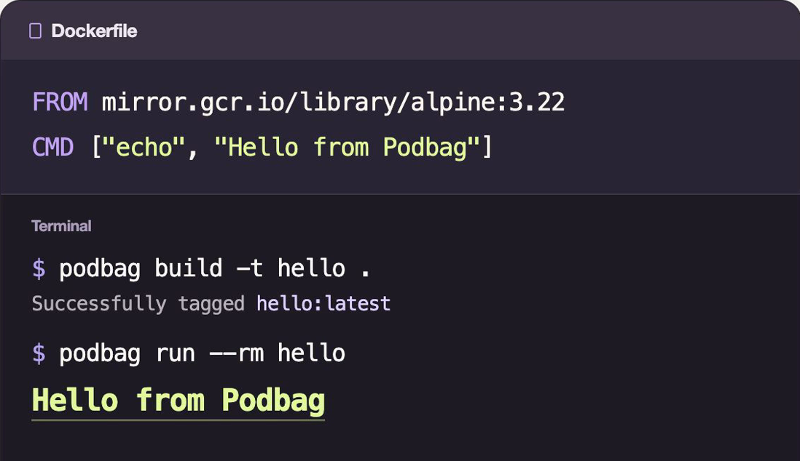
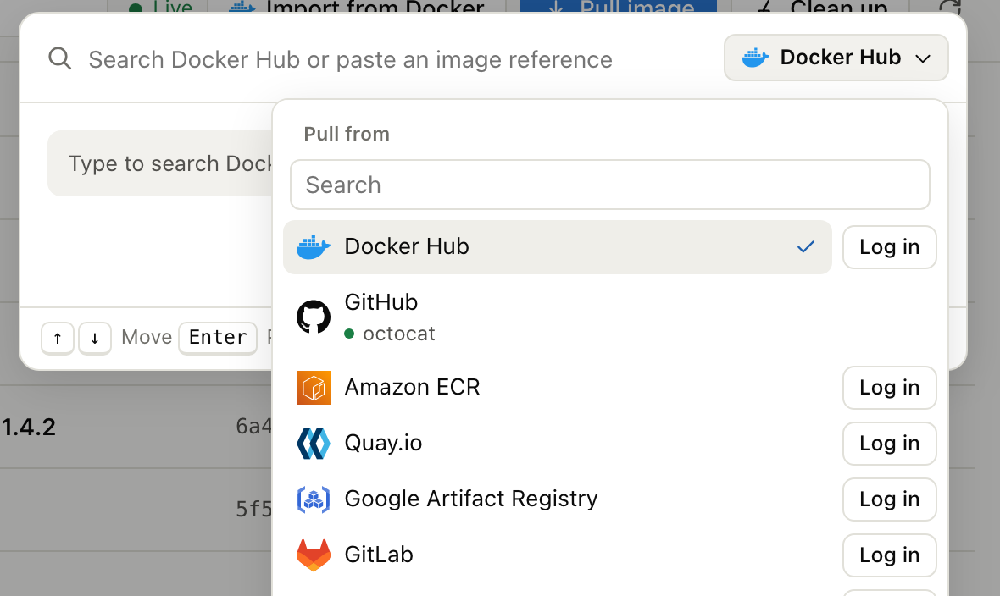
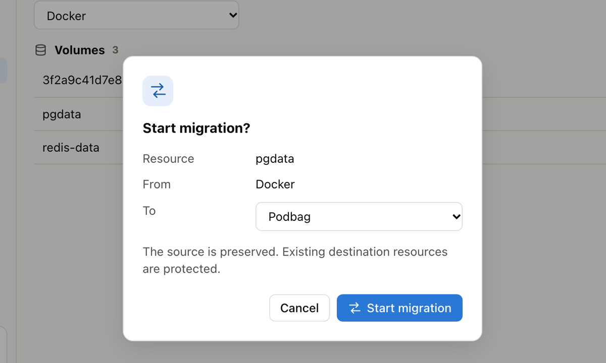
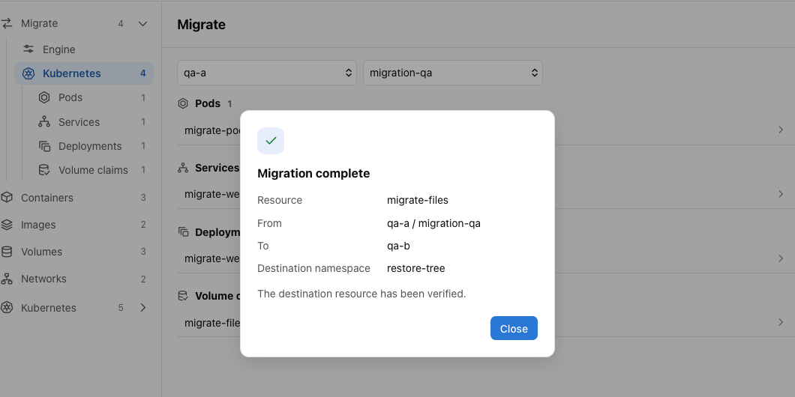
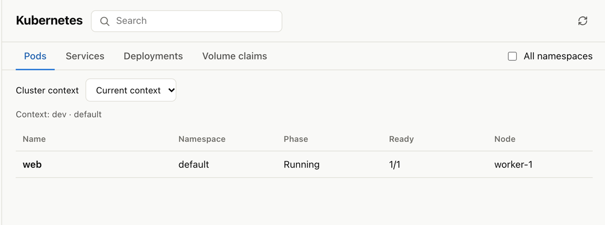
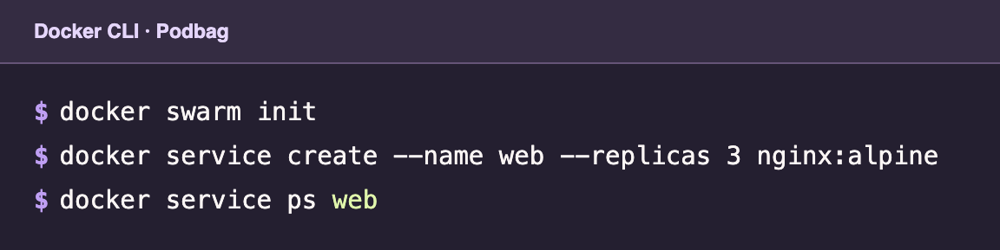
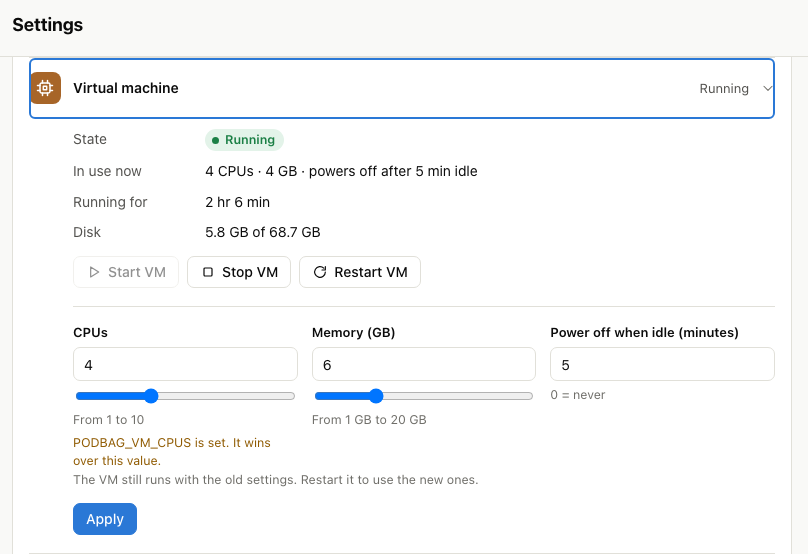

Podbag 0.2.0 を公開しました。イメージをビルドしてレジストリに公開できます。既存のイメージやデータも別のエンジンや Kubernetes クラスタにコピーできます。

## イメージのビルドと取得

`podbag build` は Dockerfile からイメージをビルドします。レジストリからイメージを取得したり、ビルドしたイメージをプッシュしたりできます。



Podbag Desktop でイメージ取得画面を開き、Docker Hub、GitHub Container Registry、または任意のレジストリを選びます。イメージ名とタグを入力します。非公開イメージには、アクセス権のある既存の Docker ログインを使えます。



## エンジン間とクラスタ間のコピー

`podbag migrate` または Desktop の移行メニューで、単一プラットフォームのイメージ、停止中のコンテナ、ローカルボリュームを Docker 互換エンジン間でコピーできます。コピー元は残ります。



Desktop は Kubernetes コンテキスト間で単独の Pod、Service、Deployment、ファイルシステム型の PVC をコピーします。ボリュームに結び付いた PVC ではファイルも転送し、コピー先で確認します。コピーの前に、元のボリュームへ書き込む処理を止めてください。 [移行の要件](https://github.com/SteelCrab/podbag/blob/v0.2.0/docs/usage.md#migrate-between-engines-or-kubernetes-clusters)



## Kubernetes、Swarm、Desktop

Linux ノードでは `podbag cri serve` を Kubernetes のコンテナランタイムとして使えます。 同じ k3s ノード上で Docker Engine と Podbag を比較した結果も公開しています。 [k3s 負荷試験](/ja/blog/k3s-30-pods-docker-podbag/)



単一ノードの Docker Swarm サービスとスタックにも対応します。



`podbag tui` と Desktop でコンテナやイメージを管理し、Docker CLI の接続先を切り替えられます。Apple シリコン搭載 Mac では、Desktop から Linux VM の CPU 数、メモリ、アイドル時の終了までの時間を設定できます。



## 0.2.0 のインストール

Linux または Apple シリコン搭載 Mac では、次のコマンドで 0.2.0 の CLI をインストールします。インストーラーはダウンロードの SHA-256 を検証します。

```sh
curl -fsSL https://podbag.dev/install.sh | PODBAG_VERSION=v0.2.0 sh
podbag --version
```

Desktop は Linux の AMD64 と ARM64 向けに DEB と RPM、Apple シリコン搭載 Mac 向けに ZIP を用意しています。Mac では CLI を先にインストールしてください。Windows CLI は試験的な機能で、WSL 2 が必要です。Android ARM64 の CLI はイメージ関連コマンドに対応します。 [0.2.0 のダウンロード](https://github.com/SteelCrab/podbag/releases/tag/v0.2.0)

0.1.0 で保存したイメージにファイルの更新日時や crontab の問題がある場合、イメージを削除し、再取得または再読み込みしてください。 [変更履歴](https://github.com/SteelCrab/podbag/blob/v0.2.0/CHANGELOG.md#v020-2026-11-20)
