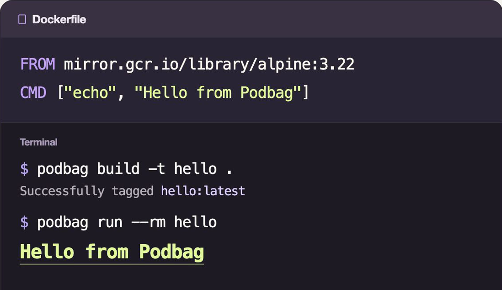
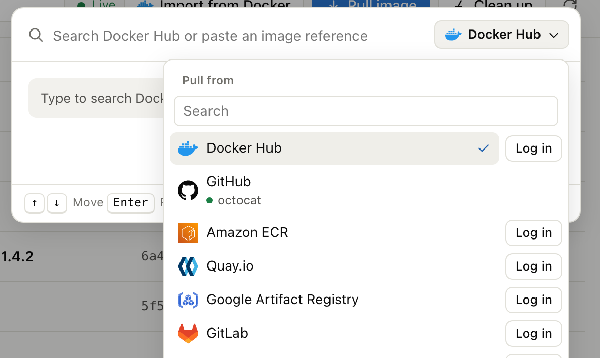
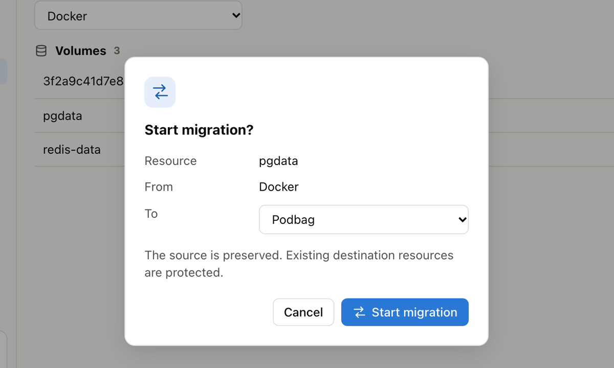
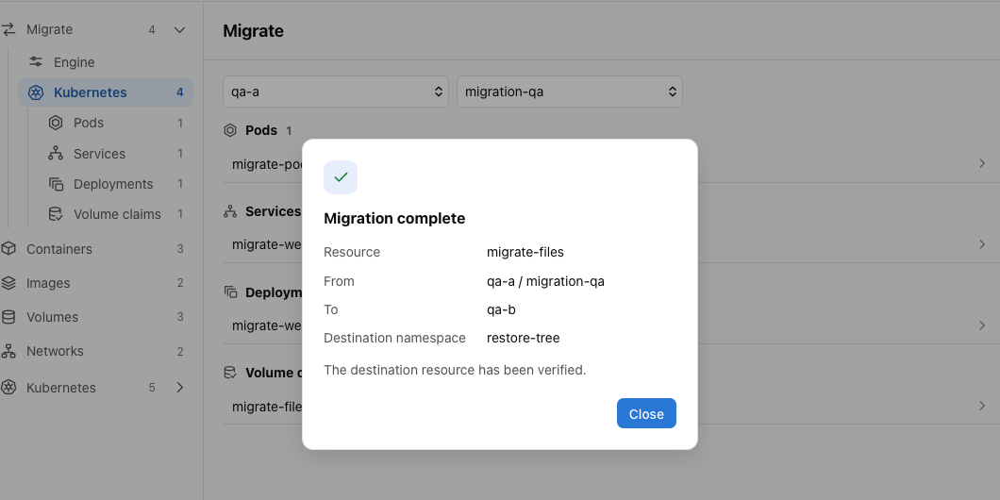
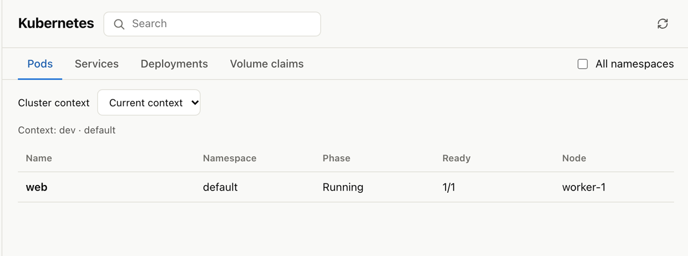
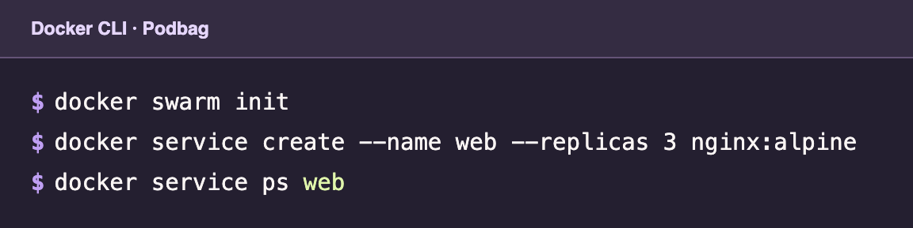
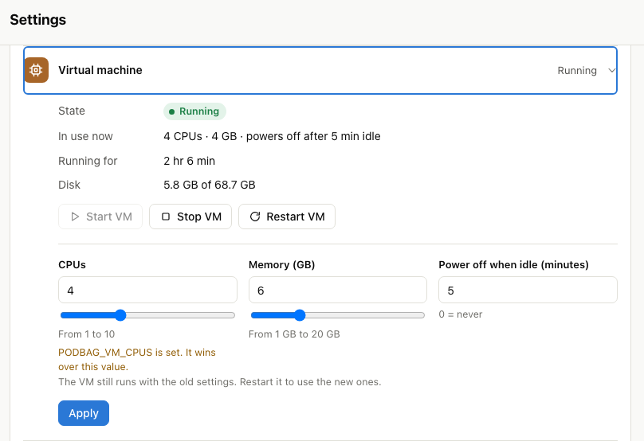

Podbag 0.2.0 đã ra mắt. Bạn có thể tạo ảnh container và đẩy ảnh lên registry. Bạn cũng có thể sao chép ảnh và dữ liệu hiện có sang engine hoặc cụm Kubernetes khác.

## Tạo và tải ảnh container

Dùng `podbag build` để tạo ảnh từ Dockerfile. Bạn có thể tải ảnh từ registry hoặc đẩy ảnh đã tạo lên đó.



Trong Podbag Desktop, mở hộp thoại tải ảnh. Chọn Docker Hub, GitHub Container Registry hoặc nhập địa chỉ registry riêng. Nhập tên và thẻ của ảnh. Với ảnh riêng tư, bạn có thể dùng thông tin đăng nhập Docker hiện có nếu tài khoản có quyền truy cập.



## Sao chép giữa các engine và cụm

Dùng `podbag migrate` hoặc mục di chuyển trong Desktop để sao chép ảnh cho một nền tảng, container đã dừng và ổ đĩa cục bộ giữa các engine tương thích với Docker. Dữ liệu nguồn được giữ lại.



Desktop có thể sao chép Pod độc lập, Service, Deployment và yêu cầu ổ đĩa lưu trữ bền vững (PVC) kiểu hệ thống tệp giữa các ngữ cảnh Kubernetes. Nếu PVC đã gắn với một ổ đĩa, Podbag sao chép các tệp và xác minh chúng ở đích. Hãy dừng tác vụ đang ghi vào ổ đĩa nguồn trước khi sao chép. [Yêu cầu khi di chuyển](https://github.com/SteelCrab/podbag/blob/v0.2.0/docs/usage.md#migrate-between-engines-or-kubernetes-clusters)



## Kubernetes, Swarm và Desktop

Trên nút Linux, chạy `podbag cri serve` để dùng Podbag làm môi trường chạy container cho Kubernetes. Chúng tôi đã đo Docker Engine và Podbag trên cùng một nút k3s. [Thử nghiệm tải trên k3s](/vi/blog/k3s-30-pods-docker-podbag/)



Podbag cũng chạy dịch vụ và stack Docker Swarm trên một nút.



Dùng `podbag tui` hoặc Desktop để quản lý container và ảnh hoặc chuyển ngữ cảnh của Docker CLI. Trên máy Mac dùng Apple silicon, Desktop cho phép đặt số CPU, bộ nhớ và thời gian tự tắt của máy ảo Linux khi không có hoạt động.



## Cài đặt 0.2.0

Trên Linux hoặc Mac dùng Apple silicon, chạy các lệnh sau để cài CLI 0.2.0. Trình cài đặt xác minh mã SHA-256 của tệp tải về.

```sh
curl -fsSL https://podbag.dev/install.sh | PODBAG_VERSION=v0.2.0 sh
podbag --version
```

Desktop có gói DEB và RPM cho Linux AMD64 và ARM64, cùng tệp ZIP cho Mac dùng Apple silicon. Trên macOS, hãy cài CLI trước. CLI thử nghiệm cho Windows cần WSL 2. CLI cho Android ARM64 hỗ trợ các lệnh xử lý ảnh. [Tải xuống 0.2.0](https://github.com/SteelCrab/podbag/releases/tag/v0.2.0)

Để áp dụng bản sửa thời gian chỉnh sửa tệp và crontab cho ảnh bị ảnh hưởng đã lưu bằng 0.1.0, hãy xóa ảnh đó rồi tải hoặc nạp lại. [Nhật ký thay đổi đầy đủ](https://github.com/SteelCrab/podbag/blob/v0.2.0/CHANGELOG.md#v020-2026-11-20)
