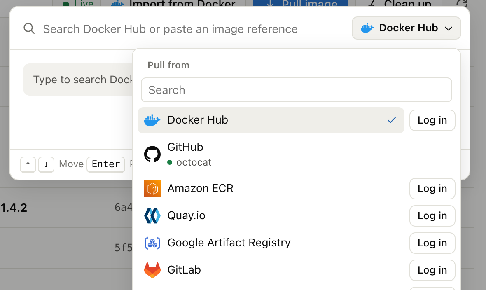
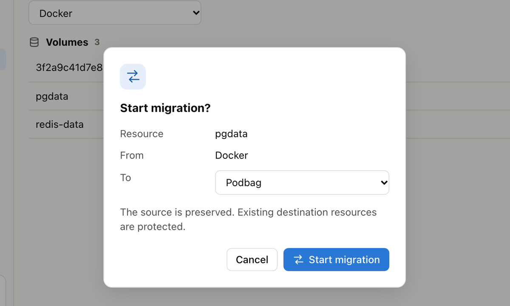
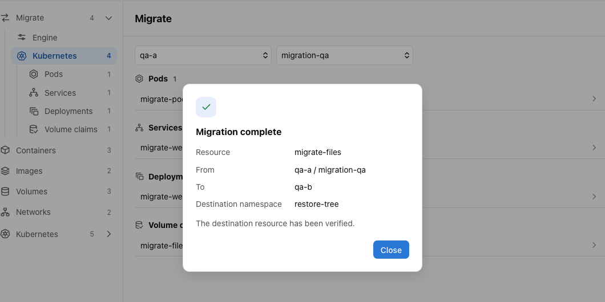
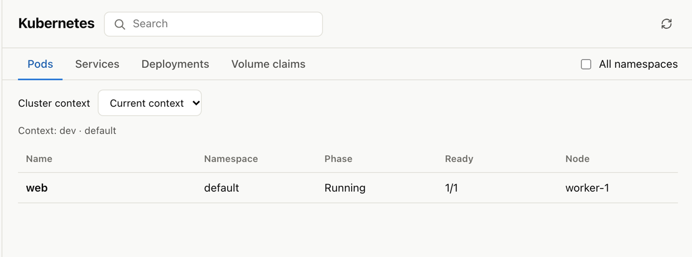
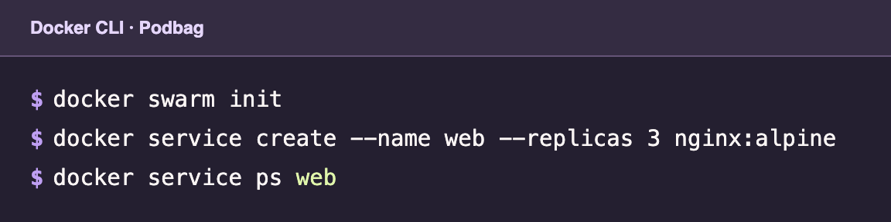
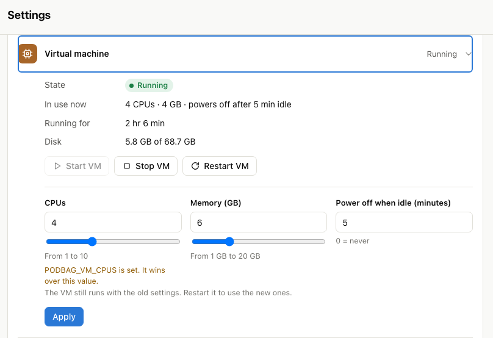

Podbag 0.2.0 已发布。你可以从 Dockerfile 构建镜像并将其推送到镜像仓库，也可以将已有的镜像和数据复制到另一个引擎或 Kubernetes 集群。

## 构建和拉取镜像

使用 `podbag build` 从 Dockerfile 构建镜像。你可以从仓库拉取镜像，也可以推送自己构建的镜像。

```dockerfile
FROM mirror.gcr.io/library/alpine:3.22
CMD ["echo", "Hello from Podbag"]
```

将文件保存到一个空目录，然后在该目录中运行以下命令。 [下载 Dockerfile](Dockerfile)

```sh
podbag build -t hello .
podbag run --rm hello
```

容器会输出 `Hello from Podbag`。

在 Podbag Desktop 中打开拉取镜像对话框，选择 Docker Hub、GitHub Container Registry，或输入自定义仓库地址。填入镜像名称和标签。拉取私有镜像时，可以使用已有权限的 Docker 登录凭据。



## 在引擎和集群之间复制

使用 `podbag migrate` 或 Desktop 的迁移菜单，在兼容 Docker 的引擎之间复制单平台镜像、已停止的容器和本地卷。源数据会保留。



Desktop 可以在不同的 Kubernetes 上下文之间复制独立的 Pod、Service、Deployment 和文件系统类型的持久卷声明（PVC）。如果 PVC 已绑定卷，Podbag 会复制文件并在目标端进行验证。复制前请停止向源卷写入数据的工作负载。 [迁移要求](https://github.com/SteelCrab/podbag/blob/v0.2.0/docs/usage.md#migrate-between-engines-or-kubernetes-clusters)



## Kubernetes、Swarm 和 Desktop

在 Linux 节点上，可通过 `podbag cri serve` 将 Podbag 用作 Kubernetes 容器运行时。我们公布了在同一个 k3s 节点上比较 Docker Engine 和 Podbag 的测试结果。[k3s 负载测试](/zh-CN/blog/k3s-30-pods-docker-podbag/)



它还支持在单节点上运行 Docker Swarm 服务和堆栈。



通过 `podbag tui` 或 Desktop 管理容器和镜像，并切换 Docker CLI 的连接目标。在 Apple 芯片 Mac 上，可以在 Desktop 中设置 Linux 虚拟机的 CPU 核数、内存和空闲关机时间。



## 安装 0.2.0

在 Linux 或搭载 Apple 芯片的 Mac 上，通过下列命令安装 0.2.0 CLI。安装脚本会检查下载文件的 SHA-256。

```sh
curl -fsSL https://podbag.dev/install.sh | PODBAG_VERSION=v0.2.0 sh
podbag --version
```

Linux 桌面版提供 AMD64 和 ARM64 的 DEB、RPM 安装包。Apple 芯片 Mac 提供 ZIP 压缩包，请先安装 CLI。Windows CLI 仍处于实验阶段，需要 WSL 2。Android ARM64 CLI 支持镜像命令。 [下载 0.2.0](https://github.com/SteelCrab/podbag/releases/tag/v0.2.0)

如果 0.1.0 保存的镜像存在文件修改时间或 crontab 问题，请删除受影响的镜像，再重新拉取或加载。 [完整变更记录](https://github.com/SteelCrab/podbag/blob/v0.2.0/CHANGELOG.md#v020-2026-11-20)
