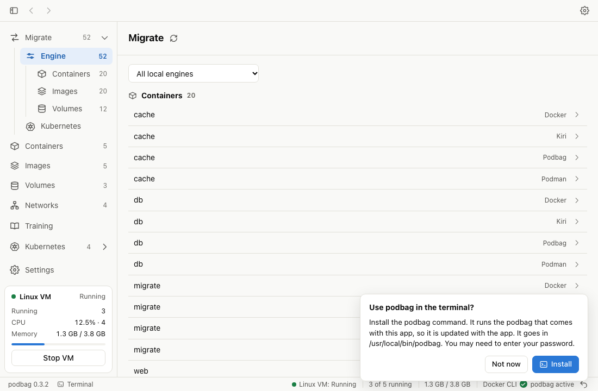

Podbag 0.3.2 is available. Podbag Desktop can now add the `podbag` command to your terminal. This post also covers 0.3.1, which added Intel Macs and in-app updates.

## Use podbag in the terminal

Podbag Desktop includes the podbag CLI. Before 0.3.2, a terminal could not find it.

- When a terminal finds no `podbag`, Desktop shows a notice. Select **Install** to add the command.
- Select **Not now** to skip. You can install it later in **Settings > Terminal command**.
- Open a new terminal and run `podbag --version`.



## One podbag for the app and the terminal

The command runs the podbag inside the app. When the app updates, your terminal gets the same version.

- **macOS and Linux.** The command is a link in `/usr/local/bin`. macOS asks for your password in its own dialog, and Linux asks with `pkexec`. Removing the Linux package removes the link.
- **Windows.** The app's folder is added to your user `Path`.
- **A separate podbag.** You may have installed podbag on its own, for example with `install.sh`. If it is older than the app, Desktop offers to update it to the app's version.

## Also in 0.3.1

- **Intel Macs.** Podbag and Podbag Desktop run on Intel Macs. The VM runs an x86_64 Linux guest and pulls `linux/amd64` images.
- **In-app updates.** Update Desktop in **Settings > Updates**. The app checks the package against `SHA256SUMS`, installs it, and starts again. The app and its podbag change together.

[Download Podbag 0.3.2](https://github.com/SteelCrab/podbag/releases/tag/v0.3.2)

## Install the CLI only

You can use the CLI without Desktop on Linux or macOS. The installer picks the build for your CPU, also on an Intel Mac. It checks the download against its SHA-256 checksum.

```sh
curl -fsSL https://podbag.dev/install.sh | PODBAG_VERSION=v0.3.2 sh
podbag --version
```

To update this CLI later, run `podbag upgrade`.

[Full changelog](https://github.com/SteelCrab/podbag/blob/v0.3.2/CHANGELOG.md#v032-2026-11-23)
