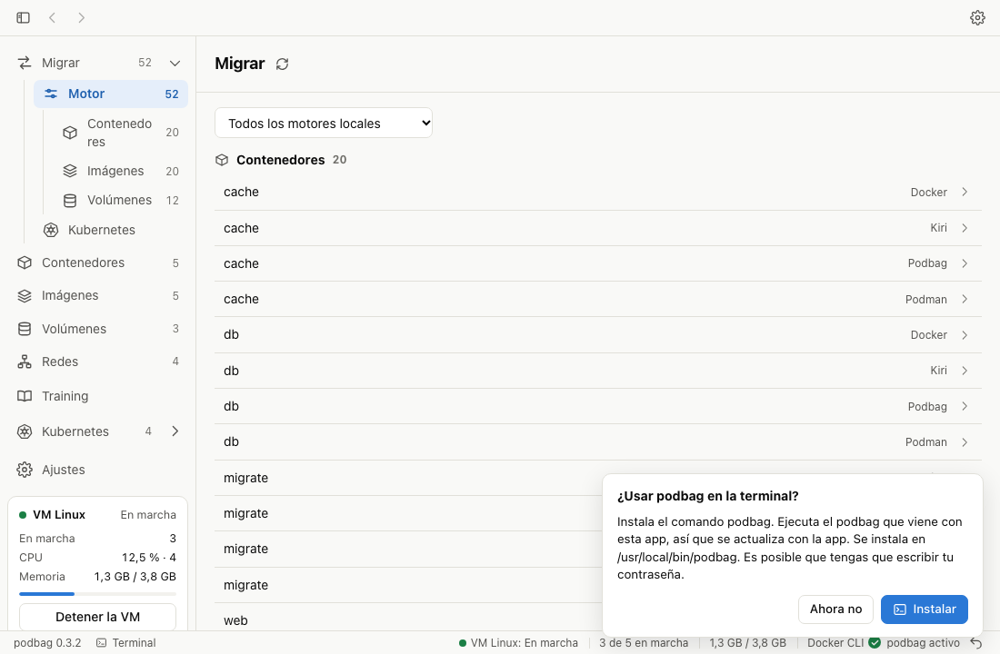

Podbag 0.3.2 ya está disponible. Ahora Podbag Desktop puede añadir el comando `podbag` a tu terminal. Este artículo también resume 0.3.1, que añadió los Mac con Intel y las actualizaciones desde la app.

## Usa podbag en la terminal

Podbag Desktop incluye la CLI de podbag. Antes de 0.3.2, la terminal no la encontraba.

- Si la terminal no encuentra `podbag`, Desktop muestra un aviso. Elige **Instalar** para añadir el comando.
- Elige **Ahora no** para omitirlo. Puedes instalarlo más tarde en **Ajustes > Comando de terminal**.
- Abre una terminal nueva y ejecuta `podbag --version`.



## Un solo podbag para la app y la terminal

El comando ejecuta el podbag que hay dentro de la app. Cuando la app se actualiza, tu terminal usa la misma versión.

- **macOS y Linux.** El comando es un enlace en `/usr/local/bin`. macOS pide tu contraseña en su propio cuadro de diálogo y Linux la pide con `pkexec`. Al desinstalar el paquete de Linux, también se elimina el enlace.
- **Windows.** La carpeta de la app se añade a tu `Path` de usuario.
- **Un podbag aparte.** Quizá instalaste podbag por separado, por ejemplo con `install.sh`. Si es más antiguo que la app, Desktop ofrece actualizarlo a la versión de la app.

## También en 0.3.1

- **Mac con Intel.** podbag y Podbag Desktop funcionan en Mac con Intel. La máquina virtual ejecuta un invitado Linux x86_64 y descarga imágenes `linux/amd64`.
- **Actualizaciones desde la app.** Actualiza Desktop en **Ajustes > Actualizaciones**. La app verifica el paquete con `SHA256SUMS`, lo instala y se vuelve a abrir. La app y su podbag cambian juntos.

[Descarga Podbag 0.3.2](https://github.com/SteelCrab/podbag/releases/tag/v0.3.2)

## Instala solo la CLI

En Linux o macOS puedes usar la CLI sin Desktop. El instalador elige la compilación para tu CPU, también en un Mac con Intel. Además, verifica la suma SHA-256 del archivo descargado.

```sh
curl -fsSL https://podbag.dev/install.sh | PODBAG_VERSION=v0.3.2 sh
podbag --version
```

Para actualizar esta CLI más adelante, ejecuta `podbag upgrade`.

[Registro de cambios completo](https://github.com/SteelCrab/podbag/blob/v0.3.2/CHANGELOG.md#v032-2026-11-23)
