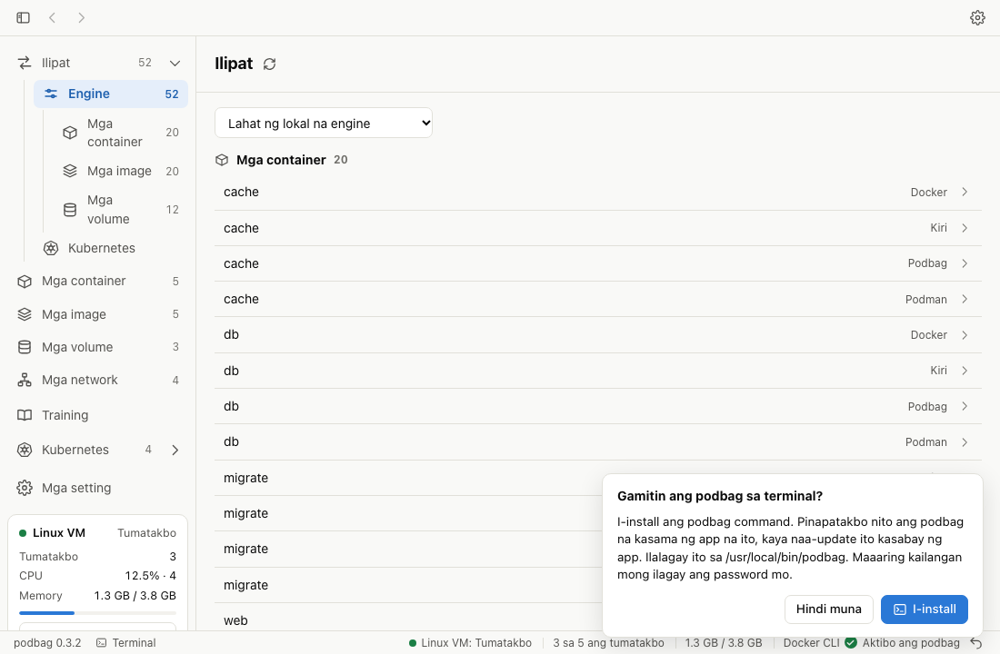

Available na ang Podbag 0.3.2. Kaya na ng Podbag Desktop na idagdag ang `podbag` command sa terminal mo. Tinatalakay rin ng post na ito ang 0.3.1, na nagdagdag ng suporta sa Intel Mac at ng update mula sa app.

## Gamitin ang podbag sa terminal

May kasamang podbag CLI ang Podbag Desktop. Bago ang 0.3.2, hindi ito mahanap ng terminal.

- Kapag walang mahanap na `podbag` ang terminal, magpapakita ang Desktop ng abiso. Piliin ang **I-install** para idagdag ang command.
- Piliin ang **Hindi muna** para laktawan ito. Maaari mo itong i-install mamaya sa **Mga setting > Command sa terminal**.
- Magbukas ng bagong terminal at patakbuhin ang `podbag --version`.



## Iisang podbag para sa app at terminal

Pinapatakbo ng command ang podbag na nasa loob ng app. Kapag nag-update ang app, parehong bersyon din ang makukuha ng terminal mo.

- **macOS at Linux.** Isang link sa `/usr/local/bin` ang command. Hinihingi ng macOS ang password mo sa sarili nitong dialog, at sa `pkexec` naman sa Linux. Kapag inalis ang Linux package, aalisin din ang link.
- **Windows.** Idinadagdag ang folder ng app sa `Path` ng user mo.
- **Hiwalay na podbag.** Maaaring nag-install ka ng podbag nang hiwalay, halimbawa gamit ang `install.sh`. Kung mas luma ito kaysa sa app, iaalok ng Desktop na i-update ito sa bersyon ng app.

## Bago rin sa 0.3.1

- **Intel Mac.** Tumatakbo ang podbag at Podbag Desktop sa Intel Mac. Nagpapatakbo ang VM ng x86_64 na Linux guest at kumukuha ng mga `linux/amd64` na image.
- **Update mula sa app.** I-update ang Desktop sa **Mga setting > Mga update**. Sinusuri ng app ang package gamit ang `SHA256SUMS`, ini-install ito, at nagsisimula ulit. Sabay na nagbabago ang app at ang podbag nito.

[I-download ang Podbag 0.3.2](https://github.com/SteelCrab/podbag/releases/tag/v0.3.2)

## CLI lang ang i-install

Magagamit mo ang CLI nang walang Desktop sa Linux o macOS. Pinipili ng installer ang build para sa CPU mo, pati sa Intel Mac. Bineberipika rin nito ang SHA-256 checksum ng na-download na file.

```sh
curl -fsSL https://podbag.dev/install.sh | PODBAG_VERSION=v0.3.2 sh
podbag --version
```

Para i-update ang CLI na ito sa susunod, patakbuhin ang `podbag upgrade`.

[Buong tala ng mga pagbabago](https://github.com/SteelCrab/podbag/blob/v0.3.2/CHANGELOG.md#v032-2026-11-23)
