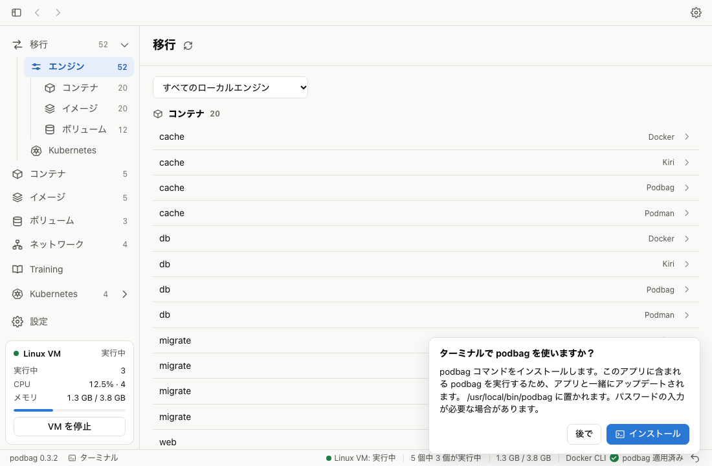

Podbag 0.3.2 を公開しました。Podbag Desktop がターミナルに `podbag` コマンドを追加できるようになりました。Intel Mac とアプリ内アップデートに対応した 0.3.1 の内容もあわせて紹介します。

## ターミナルで podbag を使う

Podbag Desktop には podbag CLI が含まれています。0.3.1 までは、ターミナルからこの CLI が見つかりませんでした。

- ターミナルで `podbag` が見つからないと、Desktop が通知を表示します。**インストール**を選ぶとコマンドが追加されます。
- 今はインストールしない場合は**後で**を選びます。あとから **設定 > ターミナルコマンド** でインストールできます。
- 新しいターミナルを開き、`podbag --version` を実行します。



## アプリとターミナルで同じ podbag を使う

このコマンドはアプリ内の podbag を実行します。アプリをアップデートすると、ターミナルの podbag も同じバージョンになります。

- **macOS と Linux。** コマンドは `/usr/local/bin` のリンクです。macOS はシステムのダイアログで、Linux は `pkexec` でパスワードを尋ねます。Linux のパッケージを削除すると、リンクも削除されます。
- **Windows。** アプリのフォルダーがユーザーの `Path` に追加されます。
- **別にインストールした podbag。** `install.sh` などで podbag を別にインストールしている場合があります。それがアプリより古いと、Desktop がアプリのバージョンへのアップデートを提案します。

## 0.3.1 で追加された機能

- **Intel Mac。** Intel Mac で podbag と Podbag Desktop を実行できます。VM は x86_64 の Linux ゲストを実行し、`linux/amd64` のイメージを取得します。
- **アプリ内アップデート。** **設定 > アップデート** で Desktop をアップデートします。アプリはパッケージを `SHA256SUMS` で検証してインストールし、再起動します。アプリとアプリの podbag が一緒に更新されます。

[Podbag 0.3.2 をダウンロード](https://github.com/SteelCrab/podbag/releases/tag/v0.3.2)

## CLI だけをインストールする

Linux と macOS では、Desktop なしで CLI だけを使えます。インストーラーは Intel Mac も含め、CPU に合ったビルドを選びます。ダウンロードしたファイルの SHA-256 チェックサムも検証します。

```sh
curl -fsSL https://podbag.dev/install.sh | PODBAG_VERSION=v0.3.2 sh
podbag --version
```

この CLI を後でアップデートするには、`podbag upgrade` を実行します。

[変更履歴](https://github.com/SteelCrab/podbag/blob/v0.3.2/CHANGELOG.md#v032-2026-11-23)
