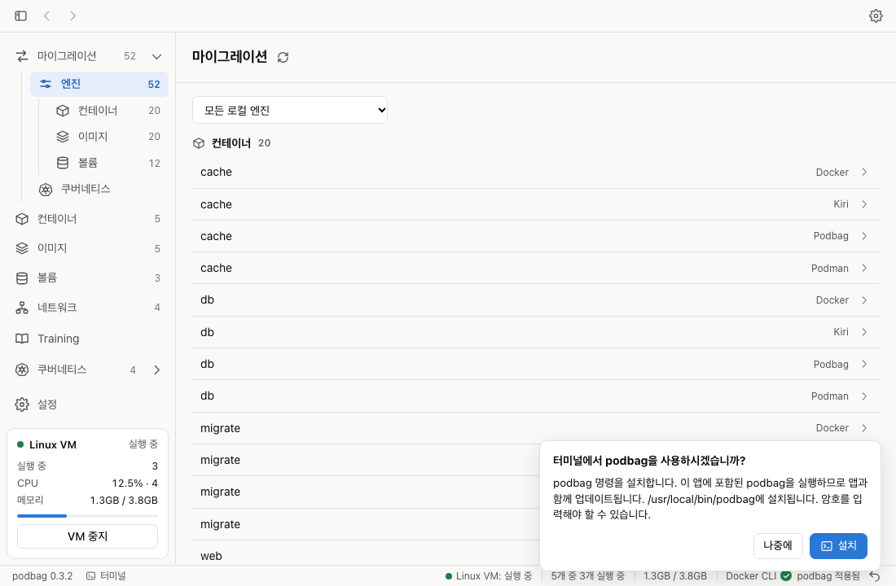

Podbag 0.3.2를 공개했습니다. 이제 Podbag Desktop이 터미널에 `podbag` 명령을 추가합니다. Intel Mac 지원과 앱 내 업데이트를 추가한 0.3.1의 내용도 함께 소개합니다.

## 터미널에서 podbag 사용

Podbag Desktop에는 podbag CLI가 포함되어 있습니다. 0.3.1까지는 터미널에서 이 CLI를 찾지 못했습니다.

- 터미널에서 `podbag`을 찾지 못하면 Desktop이 알림을 표시합니다. **설치**를 선택하면 명령이 추가됩니다.
- 지금 설치하지 않으려면 **나중에**를 선택합니다. 나중에 **설정 > 터미널 명령**에서 설치할 수 있습니다.
- 새 터미널을 열고 `podbag --version`을 실행합니다.



## 앱과 터미널이 같은 podbag 사용

이 명령은 앱 안의 podbag을 실행합니다. 앱을 업데이트하면 터미널의 podbag도 같은 버전이 됩니다.

- **macOS와 Linux.** 명령은 `/usr/local/bin`의 링크입니다. macOS는 시스템 대화 상자에서, Linux는 `pkexec`로 암호를 묻습니다. Linux 패키지를 제거하면 링크도 제거됩니다.
- **Windows.** 앱 폴더가 사용자 `Path`에 추가됩니다.
- **별도로 설치한 podbag.** `install.sh` 등으로 podbag을 따로 설치했을 수 있습니다. 그 버전이 앱보다 낮으면 Desktop이 앱 버전으로 업데이트할 것을 제안합니다.

## 0.3.1에서 추가된 기능

- **Intel Mac.** Intel Mac에서 podbag과 Podbag Desktop을 실행합니다. VM은 x86_64 Linux 게스트를 실행하고 `linux/amd64` 이미지를 받습니다.
- **앱 내 업데이트.** **설정 > 업데이트**에서 Desktop을 업데이트합니다. 앱은 패키지를 `SHA256SUMS`로 확인하고 설치한 뒤 다시 시작합니다. 앱과 앱의 podbag이 함께 바뀝니다.

[Podbag 0.3.2 다운로드](https://github.com/SteelCrab/podbag/releases/tag/v0.3.2)

## CLI만 설치

Linux와 macOS에서는 Desktop 없이 CLI만 사용할 수 있습니다. 설치 스크립트는 Intel Mac을 포함해 CPU에 맞는 빌드를 고릅니다. 다운로드한 파일의 SHA-256 체크섬도 확인합니다.

```sh
curl -fsSL https://podbag.dev/install.sh | PODBAG_VERSION=v0.3.2 sh
podbag --version
```

이 CLI를 나중에 업데이트하려면 `podbag upgrade`를 실행합니다.

[전체 변경 기록](https://github.com/SteelCrab/podbag/blob/v0.3.2/CHANGELOG.md#v032-2026-11-23)
