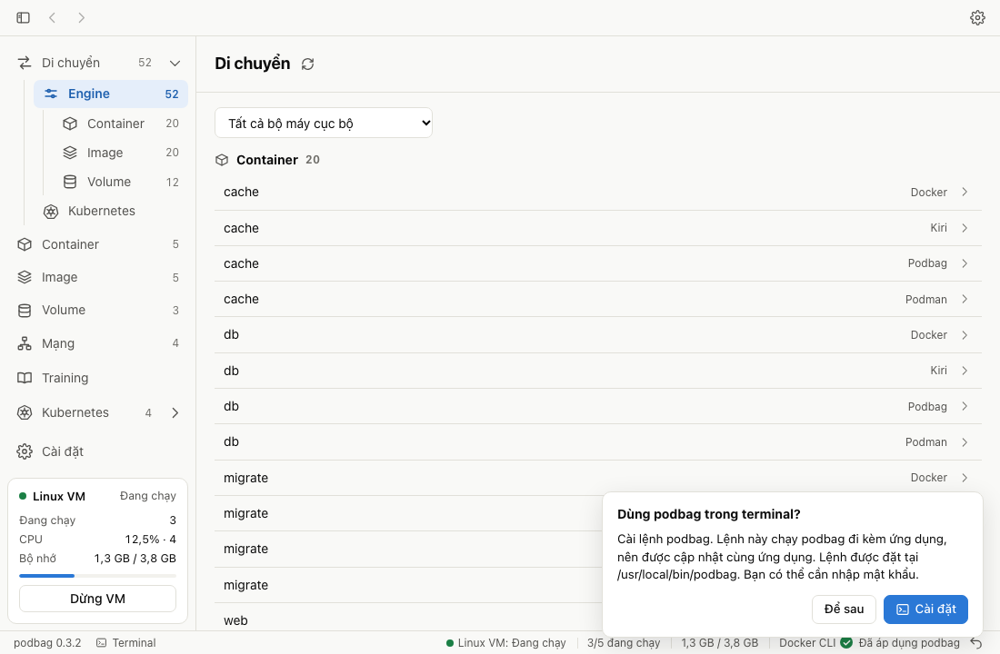

Podbag 0.3.2 đã có mặt. Giờ đây Podbag Desktop có thể thêm lệnh `podbag` vào terminal của bạn. Bài viết này cũng giới thiệu bản 0.3.1, bản đã hỗ trợ máy Mac dùng chip Intel và cập nhật trong ứng dụng.

## Dùng podbag trong terminal

Podbag Desktop có sẵn podbag CLI. Trước bản 0.3.2, terminal không tìm thấy CLI này.

- Khi terminal không tìm thấy `podbag`, Desktop hiện một thông báo. Chọn **Cài đặt** để thêm lệnh.
- Chọn **Để sau** nếu chưa muốn cài. Bạn có thể cài sau trong **Cài đặt > Lệnh terminal**.
- Mở terminal mới và chạy `podbag --version`.



## Một podbag cho cả ứng dụng và terminal

Lệnh này chạy podbag bên trong ứng dụng. Khi ứng dụng cập nhật, terminal của bạn cũng dùng cùng phiên bản.

- **macOS và Linux.** Lệnh là một liên kết trong `/usr/local/bin`. macOS hỏi mật khẩu bằng hộp thoại của hệ thống, còn Linux hỏi bằng `pkexec`. Khi gỡ gói Linux, liên kết cũng bị xóa.
- **Windows.** Thư mục của ứng dụng được thêm vào `Path` của người dùng.
- **Một podbag cài riêng.** Có thể bạn đã cài podbag riêng, ví dụ bằng `install.sh`. Nếu bản đó cũ hơn ứng dụng, Desktop đề nghị cập nhật nó lên phiên bản của ứng dụng.

## Cũng có trong 0.3.1

- **Máy Mac dùng chip Intel.** podbag và Podbag Desktop chạy được trên máy Mac dùng chip Intel. Máy ảo chạy hệ khách Linux x86_64 và tải image `linux/amd64`.
- **Cập nhật trong ứng dụng.** Cập nhật Desktop trong **Cài đặt > Cập nhật**. Ứng dụng kiểm tra gói bằng `SHA256SUMS`, cài gói rồi khởi động lại. Ứng dụng và podbag đi kèm được cập nhật cùng lúc.

[Tải Podbag 0.3.2](https://github.com/SteelCrab/podbag/releases/tag/v0.3.2)

## Chỉ cài CLI

Trên Linux hoặc macOS, bạn có thể dùng CLI mà không cần Desktop. Trình cài đặt chọn bản phù hợp với CPU, kể cả trên máy Mac dùng chip Intel. Trình cài đặt cũng kiểm tra mã SHA-256 của tệp tải về.

```sh
curl -fsSL https://podbag.dev/install.sh | PODBAG_VERSION=v0.3.2 sh
podbag --version
```

Để cập nhật CLI này sau đó, chạy `podbag upgrade`.

[Nhật ký thay đổi đầy đủ](https://github.com/SteelCrab/podbag/blob/v0.3.2/CHANGELOG.md#v032-2026-11-23)
