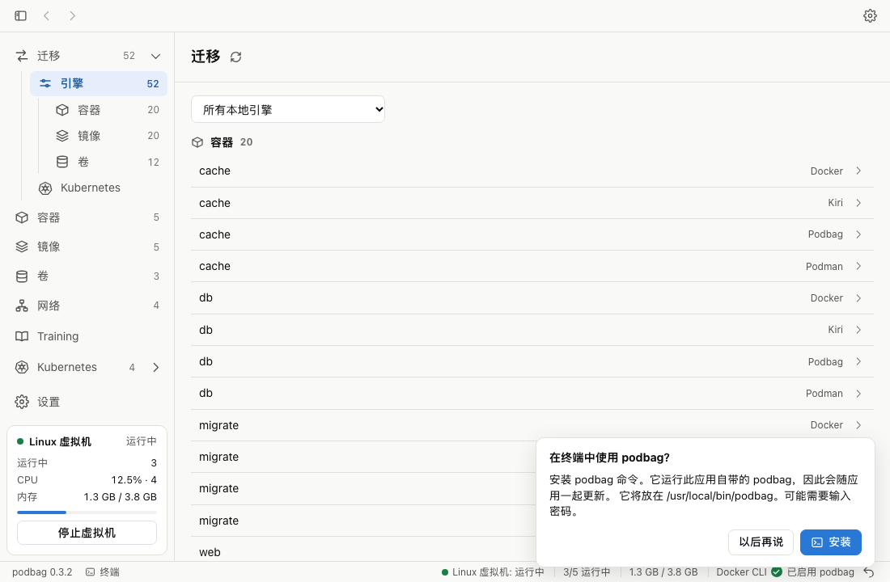

Podbag 0.3.2 已发布。Podbag Desktop 现在可以把 `podbag` 命令添加到终端。本文也介绍 0.3.1 的内容：支持 Intel Mac 和应用内更新。

## 在终端中使用 podbag

Podbag Desktop 自带 podbag CLI。在 0.3.2 之前，终端找不到这个 CLI。

- 终端找不到 `podbag` 时，Desktop 会显示通知。选择**安装**即可添加命令。
- 暂时不想安装时，选择**以后再说**。之后可以在**设置 > 终端命令**中安装。
- 打开新的终端，运行 `podbag --version`。



## 应用和终端使用同一个 podbag

此命令运行应用内的 podbag。应用更新后，终端中的 podbag 也会是同一版本。

- **macOS 和 Linux。** 命令是 `/usr/local/bin` 中的链接。macOS 用系统对话框询问密码，Linux 用 `pkexec` 询问密码。卸载 Linux 软件包时，链接也会被删除。
- **Windows。** 应用文件夹会添加到用户的 `Path`。
- **单独安装的 podbag。** 你可能用 `install.sh` 等方式单独安装过 podbag。如果它比应用旧，Desktop 会提示将它更新到应用的版本。

## 0.3.1 新增的功能

- **Intel Mac。** podbag 和 Podbag Desktop 可以在 Intel Mac 上运行。虚拟机运行 x86_64 Linux 客户机，并拉取 `linux/amd64` 镜像。
- **应用内更新。** 在**设置 > 更新**中更新 Desktop。应用会用 `SHA256SUMS` 校验安装包，安装后重新启动。应用和它自带的 podbag 一起更新。

[下载 Podbag 0.3.2](https://github.com/SteelCrab/podbag/releases/tag/v0.3.2)

## 只安装 CLI

在 Linux 和 macOS 上，可以不装 Desktop，只使用 CLI。安装程序会为你的 CPU 选择合适的版本，Intel Mac 也一样。它还会验证下载文件的 SHA-256 校验和。

```sh
curl -fsSL https://podbag.dev/install.sh | PODBAG_VERSION=v0.3.2 sh
podbag --version
```

以后要更新这个 CLI，运行 `podbag upgrade`。

[完整变更记录](https://github.com/SteelCrab/podbag/blob/v0.3.2/CHANGELOG.md#v032-2026-11-23)
