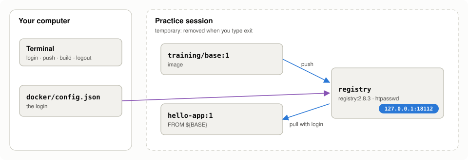

A company often keeps its base images in a private registry. A base image is the image after `FROM` in a Dockerfile. Only users who log in can pull it. `podbag build` uses your login for each image's registry. In this module, you run a registry that needs a login and build on an image from it.

**Time** 10–15 minutes.



## Start the module

Open **Training** in Podbag Desktop and select **Build from a private base image**. New modules appear after **Refresh**. Or run this command in a terminal:

```sh
podbag lab start private-base-image
```

You need a Podbag build that pulls base images with your login (after v0.3.2). Continue at the `training $` prompt.

To do the steps in the TUI instead of Podbag Desktop, add `--tui`.

```sh
podbag lab start private-base-image --tui
```

In the TUI, press `:` to open the training shell for a command step, type `exit` to return to the TUI, and press `q` to end the session.

The practice folder has two folders from the module:

- `auth/htpasswd`: the user `training` with the password `podbag-training`. The password is stored as a bcrypt hash, a form that cannot be turned back into the password.
- `app/Dockerfile`: `FROM ${BASE}`, then a command that prints a line. `BASE` is a build argument; you give its value when you build.

## Pull the busybox image

This image becomes the private base image.

```sh
podbag pull docker.io/library/busybox:1.37.0
```

- **In Podbag Desktop:** Select **Practice containers → Pull docker.io/library/busybox:1.37.0**.
- **In the TUI:** Open **Images**, press `p`, type `docker.io/library/busybox:1.37.0` and press `Enter`.

Podbag checks that the image is there.

## Run a registry that needs a login

`-v ./auth:/auth:ro` gives the registry the `auth` folder, read-only. The three `-e` settings tell the registry to check logins against `/auth/htpasswd`.

```sh
podbag run -d --name registry -p 127.0.0.1:18112:5000 -v ./auth:/auth:ro -e REGISTRY_AUTH=htpasswd -e REGISTRY_AUTH_HTPASSWD_REALM=Training -e REGISTRY_AUTH_HTPASSWD_PATH=/auth/htpasswd docker.io/library/registry:2.8.3
```

The commands below use this port. If `18112` is in use, Training shows the commands with another port; copy them from Training. Podbag checks that `registry` runs.

## Log in to the registry

```sh
podbag login 127.0.0.1:18112 -u training -p podbag-training
```

The output ends with `Login Succeeded`. Podbag checks for these words. The login is saved in the practice session's `docker/config.json`. A password on the command line shows in the process list, so outside Training use `--password-stdin`, or type it when `podbag login` asks.

## Tag busybox as the base image

```sh
podbag tag docker.io/library/busybox:1.37.0 127.0.0.1:18112/training/base:1
```

Podbag checks that the new name exists.

## Push the base image

```sh
podbag push 127.0.0.1:18112/training/base:1
```

Without the login, the registry would refuse the push. Podbag checks the output for `digest: sha256:`.

## Remove the local base image

```sh
podbag rmi 127.0.0.1:18112/training/base:1
```

- **In Podbag Desktop:** Select **Practice containers → Remove image 127.0.0.1:18112/training/base:1** and confirm.
- **In the TUI:** Select `127.0.0.1:18112/training/base:1` in **Images**, press `d`, then `y`.

Now the build has to pull the base image from the registry. Podbag checks that the name is gone.

## Build on the private base image

`--build-arg BASE=…` gives `FROM ${BASE}` the private image. `app` is the folder with the Dockerfile.

```sh
podbag build --build-arg BASE=127.0.0.1:18112/training/base:1 -t hello-app:1 app
```

The build pulls the base image first, with your login for `127.0.0.1:18112`. Podbag 0.3.2 and older pulled base images without a login, so a private base image failed. Podbag checks for `Pulling 127.0.0.1:18112/training/base:1`.

## Run the new image

```sh
podbag run --rm hello-app:1
```

Podbag checks that the output is `Hello from a private base image`.

## Log out from the registry

```sh
podbag logout 127.0.0.1:18112
```

The login is removed from `docker/config.json`. A new pull of the base image would now fail. Podbag checks for `Removing login credentials for 127.0.0.1:18112`.

## Clean up and finish

Remove the registry. It is still running, so `-f` stops it first.

- **In Podbag Desktop:** Select **Practice containers → registry → Remove** and confirm.
- **In the TUI:** Select `registry` in **Containers**, press `d`, then `y`.

```sh
podbag rm -f registry
exit
```

`docker build` works the same way: it sends your logins, and Podbag also uses the logins saved with `podbag login`. The temporary practice session is removed. Training shows the module as complete.
