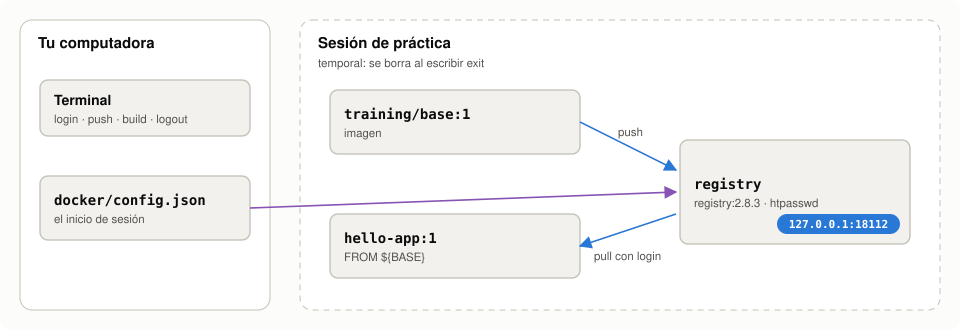

Una empresa suele guardar sus imágenes base en un registro privado. Una imagen base es la imagen que va después de `FROM` en un Dockerfile. Solo los usuarios que inician sesión pueden descargarla. `podbag build` usa tu inicio de sesión para el registro de cada imagen. En este módulo, ejecutas un registro que pide inicio de sesión y construyes sobre una imagen de él.

**Tiempo** 10–15 minutos.



## Inicia el módulo

Abre **Training** en Podbag Desktop y selecciona **Construye a partir de una imagen base privada**. Los módulos nuevos aparecen después de **Actualizar**. O ejecuta este comando en una terminal:

```sh
podbag lab start private-base-image
```

Necesitas una versión de Podbag que descargue las imágenes base con tu inicio de sesión (después de v0.3.2). Continúa en el prompt `training $`.

La carpeta de práctica tiene dos carpetas del módulo:

- `auth/htpasswd`: el usuario `training` con la contraseña `podbag-training`. La contraseña se guarda como un hash bcrypt, una forma que no se puede convertir de nuevo en la contraseña.
- `app/Dockerfile`: `FROM ${BASE}`, y después un comando que muestra una línea. `BASE` es un argumento de build; das su valor cuando construyes.

## Descarga la imagen busybox

Esta imagen será la imagen base privada.

```sh
podbag pull docker.io/library/busybox:1.37.0
```

Podbag comprueba que la imagen está ahí.

## Ejecuta un registro que pide inicio de sesión

`-v ./auth:/auth:ro` da al registro la carpeta `auth`, en solo lectura. Los tres ajustes `-e` indican al registro que compruebe los inicios de sesión con `/auth/htpasswd`.

```sh
podbag run -d --name registry -p 127.0.0.1:18112:5000 -v ./auth:/auth:ro -e REGISTRY_AUTH=htpasswd -e REGISTRY_AUTH_HTPASSWD_REALM=Training -e REGISTRY_AUTH_HTPASSWD_PATH=/auth/htpasswd docker.io/library/registry:2.8.3
```

Los comandos siguientes usan este puerto. Si `18112` está en uso, Training muestra los comandos con otro puerto. Cópialos desde Training. Podbag comprueba que `registry` está en ejecución.

## Inicia sesión en el registro

```sh
podbag login 127.0.0.1:18112 -u training -p podbag-training
```

La salida termina con `Login Succeeded`. Podbag busca estas palabras. El inicio de sesión se guarda en el `docker/config.json` de la sesión de práctica. Una contraseña en la línea de comandos se ve en la lista de procesos, así que fuera de Training usa `--password-stdin`, o escríbela cuando `podbag login` la pida.

## Etiqueta busybox como imagen base

```sh
podbag tag docker.io/library/busybox:1.37.0 127.0.0.1:18112/training/base:1
```

Podbag comprueba que existe el nombre nuevo.

## Sube la imagen base

```sh
podbag push 127.0.0.1:18112/training/base:1
```

Sin el inicio de sesión, el registro rechazaría la subida. Podbag busca `digest: sha256:` en la salida.

## Elimina la imagen base local

```sh
podbag rmi 127.0.0.1:18112/training/base:1
```

Ahora el build tiene que descargar la imagen base desde el registro. Podbag comprueba que el nombre ya no existe.

## Construye sobre la imagen base privada

`--build-arg BASE=…` da a `FROM ${BASE}` la imagen privada. `app` es la carpeta con el Dockerfile.

```sh
podbag build --build-arg BASE=127.0.0.1:18112/training/base:1 -t hello-app:1 app
```

El build descarga primero la imagen base, con tu inicio de sesión para `127.0.0.1:18112`. Podbag 0.3.2 y las versiones anteriores descargaban las imágenes base sin inicio de sesión, así que una imagen base privada fallaba. Podbag busca `Pulling 127.0.0.1:18112/training/base:1`.

## Ejecuta la imagen nueva

```sh
podbag run --rm hello-app:1
```

Podbag comprueba que la salida es `Hello from a private base image`.

## Cierra la sesión del registro

```sh
podbag logout 127.0.0.1:18112
```

El inicio de sesión se elimina de `docker/config.json`. Una nueva descarga de la imagen base fallaría ahora. Podbag busca `Removing login credentials for 127.0.0.1:18112`.

## Elimina el registro y termina

Elimina el registro. Sigue en ejecución, así que `-f` lo detiene primero.

```sh
podbag rm -f registry
exit
```

`docker build` funciona igual: envía tus inicios de sesión, y Podbag también usa los inicios de sesión guardados con `podbag login`. Se elimina la sesión de práctica temporal. Training muestra el módulo como completado.
