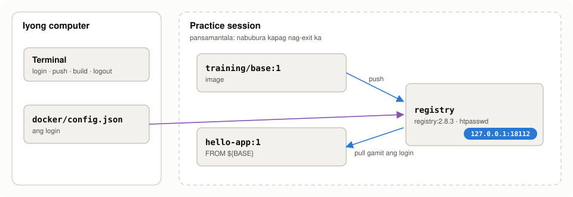

Madalas na nag-iingat ang isang kumpanya ng mga base image nito sa pribadong registry. Ang base image ay ang image pagkatapos ng `FROM` sa isang Dockerfile. Ang mga user lang na naka-log in ang makaka-pull nito. Ginagamit ng `podbag build` ang login mo para sa registry ng bawat image. Sa module na ito, magpapatakbo ka ng registry na nangangailangan ng login at magbi-build ka sa isang image mula rito.

**Oras** 10–15 minuto.



## Simulan ang module

Buksan ang **Training** sa Podbag Desktop at piliin ang **Mag-build mula sa pribadong base image**. Lalabas ang mga bagong module pagkatapos ng **I-refresh**. O patakbuhin ang command na ito sa terminal:

```sh
podbag lab start private-base-image
```

Kailangan mo ng build ng Podbag na nagpu-pull ng mga base image gamit ang login mo (pagkatapos ng v0.3.2). Magpatuloy sa prompt na `training $`.

May dalawang folder mula sa module ang practice folder:

- `auth/htpasswd`: ang user na `training` na may password na `podbag-training`. Nakaimbak ang password bilang bcrypt hash, isang anyo na hindi na maibabalik sa password.
- `app/Dockerfile`: `FROM ${BASE}`, at saka isang command na nagpapakita ng isang linya. Ang `BASE` ay build argument; ibibigay mo ang value nito kapag nagbi-build ka.

## I-pull ang image na busybox

Ang image na ito ang magiging pribadong base image.

```sh
podbag pull docker.io/library/busybox:1.37.0
```

Sinusuri ng Podbag na nandoon ang image.

## Magpatakbo ng registry na nangangailangan ng login

Ibinibigay ng `-v ./auth:/auth:ro` sa registry ang folder na `auth`, read-only. Sinasabi ng tatlong setting na `-e` sa registry na suriin ang mga login laban sa `/auth/htpasswd`.

```sh
podbag run -d --name registry -p 127.0.0.1:18112:5000 -v ./auth:/auth:ro -e REGISTRY_AUTH=htpasswd -e REGISTRY_AUTH_HTPASSWD_REALM=Training -e REGISTRY_AUTH_HTPASSWD_PATH=/auth/htpasswd docker.io/library/registry:2.8.3
```

Ginagamit ng mga command sa ibaba ang port na ito. Kung gamit na ang `18112`, ipapakita ng Training ang mga command na may ibang port. Kopyahin ang mga ito mula sa Training. Sinusuri ng Podbag na tumatakbo ang `registry`.

## Mag-log in sa registry

```sh
podbag login 127.0.0.1:18112 -u training -p podbag-training
```

Nagtatapos ang output sa `Login Succeeded`. Hinahanap ng Podbag ang mga salitang ito. Sine-save ang login sa `docker/config.json` ng practice session. Nakikita sa listahan ng process ang password na nasa command line, kaya sa labas ng Training, gamitin ang `--password-stdin`, o i-type ito kapag hiningi ito ng `podbag login`.

## Lagyan ng tag ang busybox bilang base image

```sh
podbag tag docker.io/library/busybox:1.37.0 127.0.0.1:18112/training/base:1
```

Sinusuri ng Podbag na may bagong pangalan.

## I-push ang base image

```sh
podbag push 127.0.0.1:18112/training/base:1
```

Kung walang login, tatanggihan ng registry ang push. Hinahanap ng Podbag ang `digest: sha256:` sa output.

## Burahin ang lokal na base image

```sh
podbag rmi 127.0.0.1:18112/training/base:1
```

Ngayon, kailangang i-pull ng build ang base image mula sa registry. Sinusuri ng Podbag na wala na ang pangalan.

## Mag-build sa pribadong base image

Ibinibigay ng `--build-arg BASE=…` sa `FROM ${BASE}` ang pribadong image. Ang `app` ay ang folder na may Dockerfile.

```sh
podbag build --build-arg BASE=127.0.0.1:18112/training/base:1 -t hello-app:1 app
```

Ipinu-pull muna ng build ang base image, gamit ang login mo para sa `127.0.0.1:18112`. Ang Podbag 0.3.2 at mas luma ay nagpu-pull ng mga base image nang walang login, kaya nabibigo ang pribadong base image. Hinahanap ng Podbag ang `Pulling 127.0.0.1:18112/training/base:1`.

## Patakbuhin ang bagong image

```sh
podbag run --rm hello-app:1
```

Sinusuri ng Podbag na `Hello from a private base image` ang output.

## Mag-log out sa registry

```sh
podbag logout 127.0.0.1:18112
```

Inaalis ang login sa `docker/config.json`. Mabibigo na ngayon ang bagong pag-pull ng base image. Hinahanap ng Podbag ang `Removing login credentials for 127.0.0.1:18112`.

## Maglinis at tapusin

Burahin ang registry. Tumatakbo pa ito, kaya inihihinto muna ito ng `-f`.

```sh
podbag rm -f registry
exit
```

Ganoon din ang takbo ng `docker build`: ipinapadala nito ang mga login mo, at ginagamit din ng Podbag ang mga login na na-save gamit ang `podbag login`. Naaalis ang pansamantalang practice session. Ipinapakita ng Training na tapos na ang module.
