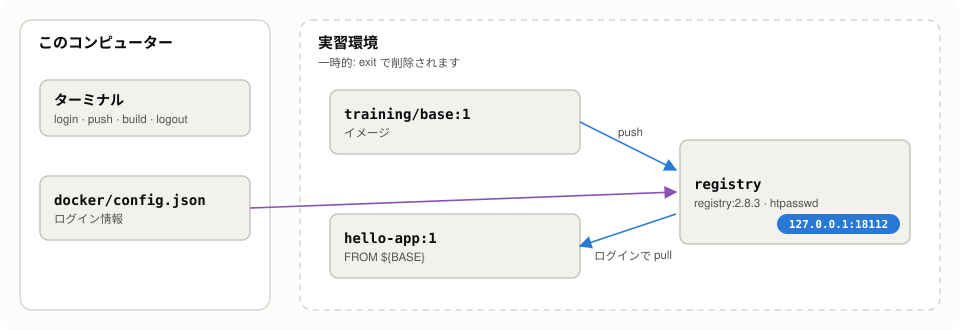

会社では、ベースイメージを非公開のレジストリに置くことがよくあります。ベースイメージは、Dockerfile の `FROM` の後にあるイメージです。ログインしたユーザーだけが取得できます。`podbag build` は、各イメージのレジストリに対して、あなたのログインを使います。このモジュールでは、ログインが必要なレジストリを起動し、そこにあるイメージの上にビルドします。

**所要時間** 10〜15 分。



## モジュールを開始する

Podbag Desktop で **Training** を開き、**非公開のベースイメージからビルドする**を選びます。新しいモジュールは**更新**の後に表示されます。ターミナルで次のコマンドを実行しても開始できます。

```sh
podbag lab start private-base-image
```

あなたのログインでベースイメージを取得する Podbag のビルドが必要です(v0.3.2 より後)。`training $` プロンプトが表示されたら続けます。

Podbag Desktop の代わりに TUI で手順を進めるには、`--tui` を付けます。

```sh
podbag lab start private-base-image --tui
```

TUI では、コマンドの手順で `:` を押すと Training シェルが開きます。`exit` と入力すると TUI に戻ります。`q` を押すと実習を終了します。

実習用のフォルダーには、モジュールの 2 つのフォルダーがあります。

- `auth/htpasswd`: ユーザー `training` とパスワード `podbag-training` です。パスワードは bcrypt ハッシュで保存されます。ハッシュは、パスワードに戻せない形です。
- `app/Dockerfile`: `FROM ${BASE}` と、1 行を表示するコマンドです。`BASE` はビルド引数です。値はビルドのときに渡します。

## busybox イメージを取得する

このイメージを、非公開のベースイメージにします。

```sh
podbag pull docker.io/library/busybox:1.37.0
```

- **Podbag Desktop で:** **実習コンテナ → docker.io/library/busybox:1.37.0 を取得**を選びます。
- **TUI で:** **イメージ**を開き、`p` を押して `docker.io/library/busybox:1.37.0` と入力し、`Enter` を押します。

Podbag はイメージがあることを確認します。

## ログインが必要なレジストリを起動する

`-v ./auth:/auth:ro` は、`auth` フォルダーを読み取り専用でレジストリに渡します。3 つの `-e` は、`/auth/htpasswd` でログインを確認するようレジストリに伝えます。

```sh
podbag run -d --name registry -p 127.0.0.1:18112:5000 -v ./auth:/auth:ro -e REGISTRY_AUTH=htpasswd -e REGISTRY_AUTH_HTPASSWD_REALM=Training -e REGISTRY_AUTH_HTPASSWD_PATH=/auth/htpasswd docker.io/library/registry:2.8.3
```

この後のコマンドは、このポートを使います。`18112` が使われている場合、Training は別のポートでコマンドを表示します。そのときは Training からコマンドをコピーします。Podbag は `registry` が実行中であることを確認します。

## レジストリにログインする

```sh
podbag login 127.0.0.1:18112 -u training -p podbag-training
```

出力の最後は `Login Succeeded` です。Podbag はこの言葉があることを確認します。ログインは、実習環境の `docker/config.json` に保存されます。コマンドラインのパスワードはプロセスの一覧に表示されます。Training の外では `--password-stdin` を使うか、`podbag login` が聞いたときに入力します。

## busybox にベースイメージのタグを付ける

```sh
podbag tag docker.io/library/busybox:1.37.0 127.0.0.1:18112/training/base:1
```

Podbag は新しい名前があることを確認します。

## ベースイメージを push する

```sh
podbag push 127.0.0.1:18112/training/base:1
```

ログインがないと、レジストリは push を拒否します。Podbag は出力に `digest: sha256:` があることを確認します。

## ローカルのベースイメージを削除する

```sh
podbag rmi 127.0.0.1:18112/training/base:1
```

- **Podbag Desktop で:** **実習コンテナ → イメージ 127.0.0.1:18112/training/base:1 を削除**を選び、確認します。
- **TUI で:** **イメージ**で `127.0.0.1:18112/training/base:1` を選び、`d` を押してから `y` を押します。

これで、ビルドはレジストリからベースイメージを取得する必要があります。Podbag は名前が消えたことを確認します。

## 非公開のベースイメージでビルドする

`--build-arg BASE=…` は、`FROM ${BASE}` に非公開のイメージを渡します。`app` は Dockerfile があるフォルダーです。

```sh
podbag build --build-arg BASE=127.0.0.1:18112/training/base:1 -t hello-app:1 app
```

ビルドは、最初にベースイメージを取得します。そのとき、`127.0.0.1:18112` へのあなたのログインを使います。Podbag 0.3.2 以前は、ログインなしでベースイメージを取得したので、非公開のベースイメージは失敗しました。Podbag は `Pulling 127.0.0.1:18112/training/base:1` があることを確認します。

## 新しいイメージを実行する

```sh
podbag run --rm hello-app:1
```

Podbag は出力が `Hello from a private base image` であることを確認します。

## レジストリからログアウトする

```sh
podbag logout 127.0.0.1:18112
```

ログインは `docker/config.json` から削除されます。これで、ベースイメージを新しく取得しようとしても失敗します。Podbag は `Removing login credentials for 127.0.0.1:18112` があることを確認します。

## 片付けて終了する

レジストリを削除します。まだ実行中なので、`-f` で先に停止します。

- **Podbag Desktop で:** **実習コンテナ → registry → 削除**を選び、確認します。
- **TUI で:** **コンテナ**で `registry` を選び、`d` を押してから `y` を押します。

```sh
podbag rm -f registry
exit
```

`docker build` も同じように動きます。ログインを送ります。Podbag は、`podbag login` で保存したログインも使います。一時的な実習環境が削除されます。Training にモジュールの完了が表示されます。
