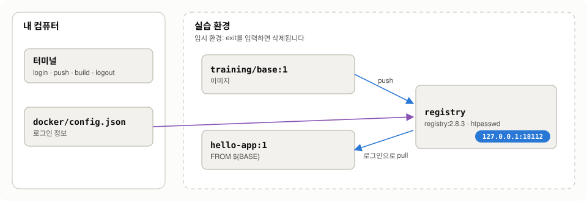

회사는 베이스 이미지를 비공개 레지스트리에 두는 경우가 많습니다. 베이스 이미지는 Dockerfile의 `FROM` 뒤에 오는 이미지입니다. 로그인한 사용자만 받을 수 있습니다. `podbag build`는 이미지마다 그 레지스트리의 로그인 정보를 씁니다. 이번 트레이닝에서는 로그인이 필요한 레지스트리를 실행하고, 그 레지스트리의 이미지 위에 빌드합니다.

**예상 시간** 10~15분.



## 실습 시작

Podbag Desktop에서 **Training**을 열고 **비공개 베이스 이미지로 빌드하기**를 선택합니다. 새 모듈은 **새로 고침** 후에 나타납니다. 터미널에서 다음 명령을 실행해도 됩니다.

```sh
podbag lab start private-base-image
```

로그인 정보로 베이스 이미지를 받는 Podbag 빌드가 필요합니다(v0.3.2 이후). `training $` 프롬프트가 나오면 다음 단계로 진행합니다.

실습 폴더에는 모듈이 만든 폴더 두 개가 있습니다.

- `auth/htpasswd`: 사용자 `training`과 비밀번호 `podbag-training`이 들어 있습니다. 비밀번호는 bcrypt 해시로 저장됩니다. 해시는 원래 비밀번호로 되돌릴 수 없는 형태입니다.
- `app/Dockerfile`: `FROM ${BASE}` 다음에 한 줄을 출력하는 명령이 있습니다. `BASE`는 빌드 인수이고, 값은 빌드할 때 정합니다.

## busybox 이미지 받기

이 이미지가 비공개 베이스 이미지가 됩니다.

```sh
podbag pull docker.io/library/busybox:1.37.0
```

Podbag은 이미지가 있는지 확인합니다.

## 로그인이 필요한 레지스트리 실행하기

`-v ./auth:/auth:ro`는 `auth` 폴더를 레지스트리에 읽기 전용으로 줍니다. `-e` 설정 세 개는 레지스트리가 `/auth/htpasswd`로 로그인을 확인하게 합니다.

```sh
podbag run -d --name registry -p 127.0.0.1:18112:5000 -v ./auth:/auth:ro -e REGISTRY_AUTH=htpasswd -e REGISTRY_AUTH_HTPASSWD_REALM=Training -e REGISTRY_AUTH_HTPASSWD_PATH=/auth/htpasswd docker.io/library/registry:2.8.3
```

아래 명령도 이 포트를 씁니다. `18112`가 이미 사용 중이면 Training이 다른 포트로 바꾼 명령을 보여 줍니다. 명령은 Training에서 복사합니다. Podbag은 `registry`가 실행 중인지 확인합니다.

## 레지스트리에 로그인하기

```sh
podbag login 127.0.0.1:18112 -u training -p podbag-training
```

출력은 `Login Succeeded`로 끝납니다. Podbag은 이 문구를 확인합니다. 로그인 정보는 실습 환경의 `docker/config.json`에 저장됩니다. 명령줄의 비밀번호는 프로세스 목록에 보입니다. 그래서 Training 밖에서는 `--password-stdin`을 쓰거나, `podbag login`이 물어볼 때 입력합니다.

## busybox에 베이스 이미지 태그 붙이기

```sh
podbag tag docker.io/library/busybox:1.37.0 127.0.0.1:18112/training/base:1
```

Podbag은 새 이름이 있는지 확인합니다.

## 베이스 이미지 push하기

```sh
podbag push 127.0.0.1:18112/training/base:1
```

로그인하지 않았다면 레지스트리가 push를 거부합니다. Podbag은 출력에 `digest: sha256:`이 있는지 확인합니다.

## 로컬 베이스 이미지 삭제하기

```sh
podbag rmi 127.0.0.1:18112/training/base:1
```

이제 빌드는 베이스 이미지를 레지스트리에서 받아야 합니다. Podbag은 이 이름이 없어졌는지 확인합니다.

## 비공개 베이스 이미지로 빌드하기

`--build-arg BASE=…`는 `FROM ${BASE}`에 비공개 이미지를 넣습니다. `app`은 Dockerfile이 있는 폴더입니다.

```sh
podbag build --build-arg BASE=127.0.0.1:18112/training/base:1 -t hello-app:1 app
```

빌드는 먼저 `127.0.0.1:18112`의 로그인 정보로 베이스 이미지를 받습니다. Podbag 0.3.2 이하는 로그인 없이 베이스 이미지를 받았기 때문에 비공개 베이스 이미지에서 실패했습니다. Podbag은 `Pulling 127.0.0.1:18112/training/base:1`이 있는지 확인합니다.

## 새 이미지 실행하기

```sh
podbag run --rm hello-app:1
```

Podbag은 출력이 `Hello from a private base image`인지 확인합니다.

## 레지스트리에서 로그아웃하기

```sh
podbag logout 127.0.0.1:18112
```

로그인 정보가 `docker/config.json`에서 지워집니다. 이제 베이스 이미지를 새로 받으면 실패합니다. Podbag은 `Removing login credentials for 127.0.0.1:18112`가 있는지 확인합니다.

## 정리 및 실습 종료

레지스트리를 삭제합니다. 아직 실행 중이므로 `-f`가 먼저 멈춥니다.

```sh
podbag rm -f registry
exit
```

`docker build`도 같은 방식으로 동작합니다. docker CLI가 로그인 정보를 보내고, Podbag은 `podbag login`으로 저장한 로그인도 씁니다. 임시 실습 환경이 삭제됩니다. Training에 모듈이 완료됨으로 표시됩니다.
