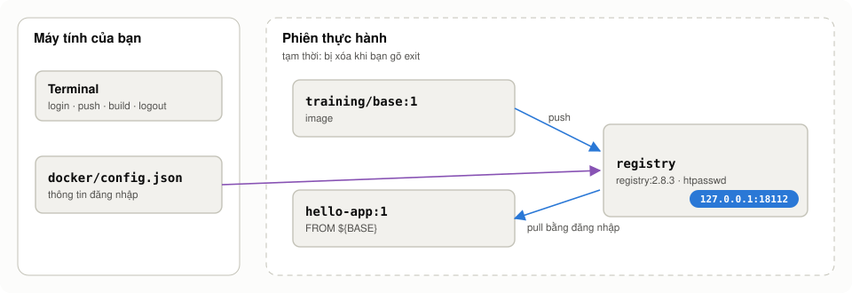

Một công ty thường giữ các image nền trong registry riêng tư. Image nền là image đứng sau `FROM` trong Dockerfile. Chỉ người dùng đã đăng nhập mới kéo được nó. `podbag build` dùng thông tin đăng nhập của bạn cho registry của từng image. Trong mô-đun này, bạn chạy một registry cần đăng nhập và build trên một image lấy từ đó.

**Thời gian** 10–15 phút.



## Bắt đầu mô-đun

Mở **Training** trong Podbag Desktop và chọn **Build từ image nền riêng tư**. Mô-đun mới xuất hiện sau khi chọn **Làm mới**. Hoặc chạy lệnh này trong terminal:

```sh
podbag lab start private-base-image
```

Bạn cần bản Podbag kéo image nền bằng thông tin đăng nhập của bạn (sau v0.3.2). Tiếp tục tại dấu nhắc `training $`.

Thư mục thực hành có hai thư mục từ mô-đun:

- `auth/htpasswd`: người dùng `training` với mật khẩu `podbag-training`. Mật khẩu được lưu dưới dạng bcrypt hash, một dạng không thể đổi ngược lại thành mật khẩu.
- `app/Dockerfile`: `FROM ${BASE}`, rồi một lệnh in ra một dòng. `BASE` là đối số build; bạn đưa giá trị cho nó khi build.

## Kéo image busybox

Image này sẽ trở thành image nền riêng tư.

```sh
podbag pull docker.io/library/busybox:1.37.0
```

Podbag kiểm tra rằng image đã có.

## Chạy registry cần đăng nhập

`-v ./auth:/auth:ro` đưa thư mục `auth` cho registry, ở chế độ chỉ đọc. Ba cài đặt `-e` bảo registry kiểm tra đăng nhập theo `/auth/htpasswd`.

```sh
podbag run -d --name registry -p 127.0.0.1:18112:5000 -v ./auth:/auth:ro -e REGISTRY_AUTH=htpasswd -e REGISTRY_AUTH_HTPASSWD_REALM=Training -e REGISTRY_AUTH_HTPASSWD_PATH=/auth/htpasswd docker.io/library/registry:2.8.3
```

Các lệnh bên dưới dùng cổng này. Nếu `18112` đang được dùng, Training hiển thị các lệnh với cổng khác. Hãy sao chép lệnh từ Training. Podbag kiểm tra rằng `registry` đang chạy.

## Đăng nhập vào registry

```sh
podbag login 127.0.0.1:18112 -u training -p podbag-training
```

Kết quả kết thúc bằng `Login Succeeded`. Podbag tìm các từ này. Thông tin đăng nhập được lưu trong `docker/config.json` của phiên thực hành. Mật khẩu trên dòng lệnh hiện trong danh sách tiến trình, nên ngoài Training hãy dùng `--password-stdin`, hoặc gõ mật khẩu khi `podbag login` hỏi.

## Gắn tag image nền cho busybox

```sh
podbag tag docker.io/library/busybox:1.37.0 127.0.0.1:18112/training/base:1
```

Podbag kiểm tra rằng tên mới đã có.

## Đẩy image nền lên

```sh
podbag push 127.0.0.1:18112/training/base:1
```

Nếu không đăng nhập, registry sẽ từ chối lần đẩy này. Podbag tìm `digest: sha256:` trong kết quả.

## Xóa image nền cục bộ

```sh
podbag rmi 127.0.0.1:18112/training/base:1
```

Bây giờ lần build phải kéo image nền từ registry. Podbag kiểm tra rằng tên này không còn.

## Build trên image nền riêng tư

`--build-arg BASE=…` đưa image riêng tư cho `FROM ${BASE}`. `app` là thư mục có Dockerfile.

```sh
podbag build --build-arg BASE=127.0.0.1:18112/training/base:1 -t hello-app:1 app
```

Lần build kéo image nền trước, bằng thông tin đăng nhập của bạn cho `127.0.0.1:18112`. Podbag 0.3.2 và các bản cũ hơn kéo image nền mà không đăng nhập, nên image nền riêng tư bị lỗi. Podbag tìm `Pulling 127.0.0.1:18112/training/base:1`.

## Chạy image mới

```sh
podbag run --rm hello-app:1
```

Podbag kiểm tra rằng kết quả là `Hello from a private base image`.

## Đăng xuất khỏi registry

```sh
podbag logout 127.0.0.1:18112
```

Thông tin đăng nhập bị xóa khỏi `docker/config.json`. Một lần kéo mới image nền giờ sẽ lỗi. Podbag tìm `Removing login credentials for 127.0.0.1:18112`.

## Dọn dẹp và kết thúc

Xóa registry. Nó vẫn đang chạy, nên `-f` dừng nó trước.

```sh
podbag rm -f registry
exit
```

`docker build` làm việc theo cách tương tự: nó gửi các thông tin đăng nhập của bạn, và Podbag cũng dùng các thông tin đăng nhập đã lưu bằng `podbag login`. Phiên thực hành tạm thời đã được xóa. Training hiển thị mô-đun đã hoàn thành.
