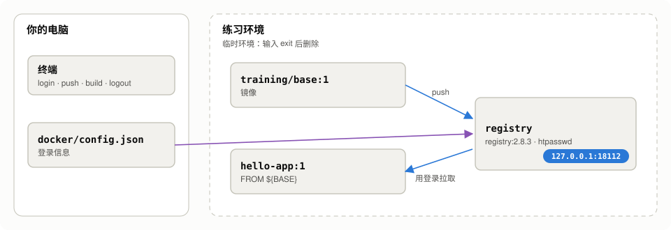

公司常把基础镜像放在私有镜像仓库中。基础镜像是 Dockerfile 中 `FROM` 后面的镜像。只有登录的用户才能拉取它。`podbag build` 会为每个镜像所在的镜像仓库使用你的登录信息。在本模块中，你将运行一个需要登录的镜像仓库，并基于其中的镜像进行构建。

**预计用时** 10–15 分钟。



## 开始模块

在 Podbag Desktop 中打开 **Training**，选择**从私有基础镜像构建**。点击**刷新**后会出现新模块。也可以在终端中运行以下命令：

```sh
podbag lab start private-base-image
```

需要能用你的登录信息拉取基础镜像的 Podbag 版本（v0.3.2 之后）。出现 `training $` 提示符后继续。

练习文件夹中有本模块的两个文件夹：

- `auth/htpasswd`：用户 `training`，密码为 `podbag-training`。密码以 bcrypt 哈希保存，这种形式无法还原成密码。
- `app/Dockerfile`：`FROM ${BASE}`，然后是一条打印一行文字的命令。`BASE` 是构建参数，你在构建时给它赋值。

## 拉取 busybox 镜像

这个镜像将成为私有基础镜像。

```sh
podbag pull docker.io/library/busybox:1.37.0
```

Podbag 会检查镜像是否存在。

## 运行需要登录的镜像仓库

`-v ./auth:/auth:ro` 以只读方式把 `auth` 文件夹交给镜像仓库。三个 `-e` 设置让镜像仓库根据 `/auth/htpasswd` 检查登录。

```sh
podbag run -d --name registry -p 127.0.0.1:18112:5000 -v ./auth:/auth:ro -e REGISTRY_AUTH=htpasswd -e REGISTRY_AUTH_HTPASSWD_REALM=Training -e REGISTRY_AUTH_HTPASSWD_PATH=/auth/htpasswd docker.io/library/registry:2.8.3
```

下面的命令会使用这个端口。如果 `18112` 已被占用，Training 会显示使用其他端口的命令，请从 Training 复制。Podbag 会检查 `registry` 是否正在运行。

## 登录镜像仓库

```sh
podbag login 127.0.0.1:18112 -u training -p podbag-training
```

输出以 `Login Succeeded` 结尾。Podbag 会检查这几个词。登录信息保存在练习环境的 `docker/config.json` 中。命令行中的密码会出现在进程列表里，所以在 Training 之外，请使用 `--password-stdin`，或在 `podbag login` 询问时再输入。

## 把 busybox 标记为基础镜像

```sh
podbag tag docker.io/library/busybox:1.37.0 127.0.0.1:18112/training/base:1
```

Podbag 会检查新名称是否存在。

## 推送基础镜像

```sh
podbag push 127.0.0.1:18112/training/base:1
```

没有登录的话，镜像仓库会拒绝这次推送。Podbag 会检查输出中是否有 `digest: sha256:`。

## 删除本地基础镜像

```sh
podbag rmi 127.0.0.1:18112/training/base:1
```

现在构建必须从镜像仓库拉取基础镜像。Podbag 会检查该名称是否已不存在。

## 基于私有基础镜像构建

`--build-arg BASE=…` 把私有镜像交给 `FROM ${BASE}`。`app` 是存放 Dockerfile 的文件夹。

```sh
podbag build --build-arg BASE=127.0.0.1:18112/training/base:1 -t hello-app:1 app
```

构建会先拉取基础镜像，并使用你在 `127.0.0.1:18112` 上的登录信息。Podbag 0.3.2 及更早版本拉取基础镜像时不带登录信息，所以私有基础镜像会失败。Podbag 会检查是否有 `Pulling 127.0.0.1:18112/training/base:1`。

## 运行新镜像

```sh
podbag run --rm hello-app:1
```

Podbag 会检查输出是否为 `Hello from a private base image`。

## 退出镜像仓库

```sh
podbag logout 127.0.0.1:18112
```

登录信息会从 `docker/config.json` 中删除。现在再次拉取基础镜像会失败。Podbag 会检查是否有 `Removing login credentials for 127.0.0.1:18112`。

## 清理并结束

删除镜像仓库。它仍在运行，所以 `-f` 会先停止它。

```sh
podbag rm -f registry
exit
```

`docker build` 的工作方式相同：它会发送你的登录信息，Podbag 也会使用用 `podbag login` 保存的登录信息。临时练习环境会被删除。Training 会显示该模块已完成。
