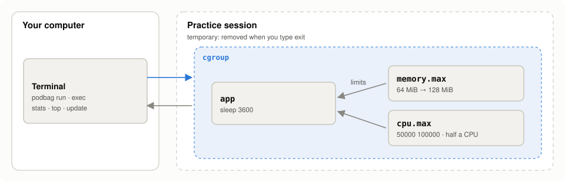

A limit keeps one container from using all of your computer. The `--memory` option sets the most memory a container can use. The `--cpus` option sets how much CPU time it gets. In this module, you set both, read them inside the container, and change one while the container runs.

**Time** 10 minutes.



## Start the module

Open **Training** in Podbag Desktop and select **Limit memory and CPU**. New modules appear after **Refresh**. Or run this command in a terminal:

```sh
podbag lab start resource-limits
```

You need a Podbag build with the Training catalog (after v0.3.2). Continue at the `training $` prompt.

To do the steps in the TUI instead of Podbag Desktop, add `--tui`.

```sh
podbag lab start resource-limits --tui
```

In the TUI, press `:` to open the training shell for a command step, type `exit` to return to the TUI, and press `q` to end the session.

## Run a container with limits

Run a quiet container named `app`. It gets at most 64 MiB of memory and half of one CPU. The `-d` option runs it in the background, and `sleep 3600` keeps it up for an hour.

```sh
podbag run -d --name app --memory 64m --cpus 0.5 docker.io/library/busybox:1.37.0 sleep 3600
```

Podbag checks that `app` runs.

## Read the limits inside the container

Podbag puts each container in a cgroup. A cgroup is a group of processes that the Linux kernel limits together. The container sees its own cgroup files in `/sys/fs/cgroup`. Read the memory limit first.

```sh
podbag exec app cat /sys/fs/cgroup/memory.max
```

The output is `67108864`. That is 64 MiB in bytes. Podbag checks this number.

Then read the CPU limit.

```sh
podbag exec app cat /sys/fs/cgroup/cpu.max
```

The output is `50000 100000`. The container can use 50,000 microseconds of CPU time in each 100,000. That is half a CPU. Podbag checks this line.

## Watch the container with stats and top

`podbag stats` shows the CPU, memory, network and disk use of containers. The `--no-stream` option prints the table once and ends.

```sh
podbag stats --no-stream app
```

The **MEM USAGE / LIMIT** column ends with `64MiB`, the limit you set. Podbag checks for this value.

`podbag top` lists the processes in a container.

```sh
podbag top app
```

The list shows `sleep 3600`. Podbag checks for this process.

## Raise the memory limit

`podbag update` changes the limits of a container. A running container gets the new value at once. You do not need to restart it.

```sh
podbag update --memory 128m app
```

The command prints the name `app`. Read the memory limit again.

```sh
podbag exec app cat /sys/fs/cgroup/memory.max
```

The output is now `134217728`, which is 128 MiB. Podbag checks this number.

## Clean up and finish

Remove the container. `app` still runs, so `-f` stops it first. Then end the session.

- **In Podbag Desktop:** Select **Practice containers → app → Remove** and confirm.
- **In the TUI:** Select `app` in **Containers**, press `d`, then `y`.

```sh
podbag rm -f app
exit
```

The temporary practice resources are removed. Training shows the module as complete.
