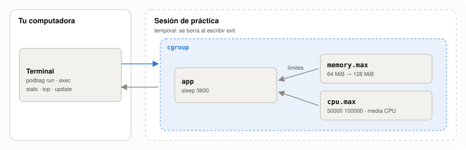

Un límite impide que un contenedor use toda tu computadora. La opción `--memory` indica la memoria máxima que puede usar un contenedor. La opción `--cpus` indica cuánto tiempo de CPU recibe. En este módulo, defines los dos, los lees dentro del contenedor y cambias uno mientras el contenedor se ejecuta.

**Tiempo** 10 minutos.



## Inicia el módulo

Abre **Training** en Podbag Desktop y selecciona **Limita la memoria y la CPU**. Los módulos nuevos aparecen después de **Actualizar**. O ejecuta este comando en una terminal:

```sh
podbag lab start resource-limits
```

Necesitas una versión de Podbag con el catálogo de Training (posterior a v0.3.2). Continúa en el prompt `training $`.

## Ejecuta un contenedor con límites

Ejecuta un contenedor llamado `app` que no hace nada. Recibe como máximo 64 MiB de memoria y la mitad de una CPU. La opción `-d` lo ejecuta en segundo plano, y `sleep 3600` lo mantiene activo durante una hora.

```sh
podbag run -d --name app --memory 64m --cpus 0.5 docker.io/library/busybox:1.37.0 sleep 3600
```

Podbag comprueba que `app` está en ejecución.

## Lee los límites dentro del contenedor

Podbag pone cada contenedor en un cgroup. Un cgroup es un grupo de procesos que el kernel de Linux limita en conjunto. El contenedor ve sus propios archivos de cgroup en `/sys/fs/cgroup`. Lee primero el límite de memoria.

```sh
podbag exec app cat /sys/fs/cgroup/memory.max
```

La salida es `67108864`. Son 64 MiB en bytes. Podbag comprueba este número.

Luego lee el límite de CPU.

```sh
podbag exec app cat /sys/fs/cgroup/cpu.max
```

La salida es `50000 100000`. El contenedor puede usar 50 000 microsegundos de tiempo de CPU de cada 100 000. Es media CPU. Podbag comprueba esta línea.

## Observa el contenedor con stats y top

`podbag stats` muestra el uso de CPU, memoria, red y disco de los contenedores. La opción `--no-stream` muestra la tabla una vez y termina.

```sh
podbag stats --no-stream app
```

La columna **MEM USAGE / LIMIT** termina en `64MiB`, el límite que definiste. Podbag busca este valor.

`podbag top` lista los procesos de un contenedor.

```sh
podbag top app
```

La lista muestra `sleep 3600`. Podbag busca este proceso.

## Sube el límite de memoria

`podbag update` cambia los límites de un contenedor. Un contenedor en ejecución recibe el valor nuevo enseguida. No hace falta reiniciarlo.

```sh
podbag update --memory 128m app
```

El comando muestra el nombre `app`. Vuelve a leer el límite de memoria.

```sh
podbag exec app cat /sys/fs/cgroup/memory.max
```

Ahora la salida es `134217728`, es decir, 128 MiB. Podbag comprueba este número.

## Limpia y termina

Elimina el contenedor. `app` sigue en ejecución, así que `-f` lo detiene primero. Luego termina la sesión.

```sh
podbag rm -f app
exit
```

Se eliminan los recursos temporales de la práctica. Training muestra el módulo como completado.
