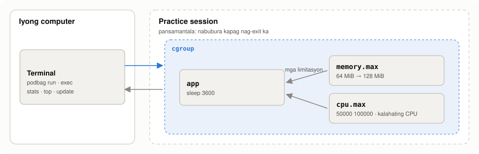

Pinipigilan ng limitasyon ang isang container na gamitin ang buong computer mo. Itinatakda ng option na `--memory` ang pinakamaraming memory na magagamit ng container. Itinatakda ng option na `--cpus` kung gaano karaming CPU time ang makukuha nito. Sa module na ito, itatakda mo ang dalawa at babasahin ang mga ito sa loob ng container. Babaguhin mo rin ang isa habang tumatakbo ang container.

**Oras** 10 minuto.



## Simulan ang module

Buksan ang **Training** sa Podbag Desktop at piliin ang **Limitahan ang memory at CPU**. Lalabas ang mga bagong module pagkatapos ng **I-refresh**. O patakbuhin ang command na ito sa terminal:

```sh
podbag lab start resource-limits
```

Kailangan mo ng build ng Podbag na may Training catalog (pagkatapos ng v0.3.2). Magpatuloy sa prompt na `training $`.

Para gawin ang mga hakbang sa TUI sa halip na sa Podbag Desktop, idagdag ang `--tui`.

```sh
podbag lab start resource-limits --tui
```

Sa TUI, pindutin ang `:` para buksan ang training shell sa isang hakbang na command. I-type ang `exit` para bumalik sa TUI. Pindutin ang `q` para tapusin ang practice session.

## Magpatakbo ng container na may mga limitasyon

Magpatakbo ng tahimik na container na `app`. Makakakuha ito ng hanggang 64 MiB na memory at kalahati ng isang CPU. Pinapatakbo ito ng option na `-d` sa background, at pinapanatili itong tumatakbo ng `sleep 3600` nang isang oras.

```sh
podbag run -d --name app --memory 64m --cpus 0.5 docker.io/library/busybox:1.37.0 sleep 3600
```

Sinusuri ng Podbag na tumatakbo ang `app`.

## Basahin ang mga limitasyon sa loob ng container

Inilalagay ng Podbag ang bawat container sa isang cgroup. Ang cgroup ay grupo ng mga proseso na sabay na nililimitahan ng Linux kernel. Nakikita ng container ang sarili nitong mga cgroup file sa `/sys/fs/cgroup`. Basahin muna ang limitasyon sa memory.

```sh
podbag exec app cat /sys/fs/cgroup/memory.max
```

`67108864` ang output. Iyon ay 64 MiB sa byte. Sinusuri ng Podbag ang numerong ito.

Pagkatapos, basahin ang limitasyon sa CPU.

```sh
podbag exec app cat /sys/fs/cgroup/cpu.max
```

`50000 100000` ang output. Makakagamit ang container ng 50,000 microsecond na CPU time sa bawat 100,000. Iyon ay kalahati ng CPU. Sinusuri ng Podbag ang linyang ito.

## Bantayan ang container gamit ang stats at top

Ipinapakita ng `podbag stats` ang gamit ng mga container sa CPU, memory, network at disk. Ipinapakita ng option na `--no-stream` ang table nang isang beses at saka natatapos.

```sh
podbag stats --no-stream app
```

Nagtatapos sa `64MiB` ang column na **MEM USAGE / LIMIT**. Iyon ang limitasyong itinakda mo. Hinahanap ng Podbag ang value na ito.

Inililista ng `podbag top` ang mga proseso sa container.

```sh
podbag top app
```

Ipinapakita ng listahan ang `sleep 3600`. Hinahanap ng Podbag ang prosesong ito.

## Taasan ang limitasyon sa memory

Binabago ng `podbag update` ang mga limitasyon ng container. Agad na nakukuha ng tumatakbong container ang bagong value. Hindi mo kailangang i-restart ito.

```sh
podbag update --memory 128m app
```

Ipinapakita ng command ang pangalang `app`. Basahin ulit ang limitasyon sa memory.

```sh
podbag exec app cat /sys/fs/cgroup/memory.max
```

`134217728` na ngayon ang output, na 128 MiB. Sinusuri ng Podbag ang numerong ito.

## Maglinis at tapusin

Alisin ang container. Tumatakbo pa ang `app`, kaya inihihinto muna ito ng `-f`. Pagkatapos, tapusin ang session.

- **Sa Podbag Desktop:** Piliin ang **Mga practice container → app → Alisin** at kumpirmahin.
- **Sa TUI:** Piliin ang `app` sa **Mga container**, pindutin ang `d`, saka ang `y`.

```sh
podbag rm -f app
exit
```

Naaalis ang mga pansamantalang resource ng practice. Ipinapakita ng Training na tapos na ang module.
