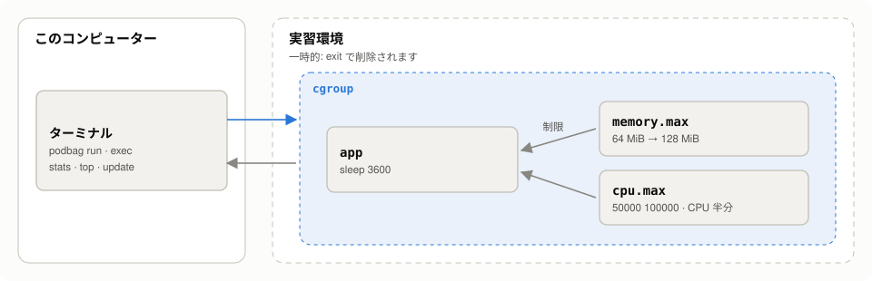

制限を付けると、1 つのコンテナがコンピューター全体を使い切ることを防げます。`--memory` オプションは、コンテナが使えるメモリの上限を設定します。`--cpus` オプションは、コンテナが使える CPU 時間を設定します。このモジュールでは両方を設定し、コンテナの中で読み、実行中に片方を変更します。

**所要時間** 10 分。



## モジュールを開始する

Podbag Desktop で **Training** を開き、**メモリと CPU を制限する**を選びます。新しいモジュールは**更新**の後に表示されます。ターミナルで次のコマンドを実行しても開始できます。

```sh
podbag lab start resource-limits
```

Training カタログがある Podbag のビルド（v0.3.2 より後）が必要です。`training $` プロンプトが表示されたら続けます。

## 制限を付けてコンテナを実行する

何もしないコンテナ `app` を実行します。このコンテナが使えるのは、最大 64 MiB のメモリと CPU 半分です。`-d` オプションはバックグラウンドで実行し、`sleep 3600` は 1 時間動き続けます。

```sh
podbag run -d --name app --memory 64m --cpus 0.5 docker.io/library/busybox:1.37.0 sleep 3600
```

Podbag は `app` が実行中であることを確認します。

## コンテナの中で制限を読む

Podbag は、各コンテナを cgroup に入れます。cgroup は、Linux カーネルがまとめて制限するプロセスのグループです。コンテナは `/sys/fs/cgroup` で自分の cgroup のファイルを見られます。まず、メモリの制限を読みます。

```sh
podbag exec app cat /sys/fs/cgroup/memory.max
```

出力は `67108864` です。これは 64 MiB をバイトで表した値です。Podbag はこの数値を確認します。

次に、CPU の制限を読みます。

```sh
podbag exec app cat /sys/fs/cgroup/cpu.max
```

出力は `50000 100000` です。コンテナは、100,000 マイクロ秒ごとに 50,000 マイクロ秒の CPU 時間を使えます。これは CPU 半分です。Podbag はこの行を確認します。

## stats と top でコンテナの様子を見る

`podbag stats` は、コンテナの CPU、メモリ、ネットワーク、ディスクの使用量を表示します。`--no-stream` オプションは、表を 1 回だけ表示して終了します。

```sh
podbag stats --no-stream app
```

**MEM USAGE / LIMIT** 列の末尾は、設定した制限の `64MiB` です。Podbag はこの値を確認します。

`podbag top` は、コンテナ内のプロセスを一覧表示します。

```sh
podbag top app
```

一覧に `sleep 3600` が表示されます。Podbag はこのプロセスを確認します。

## メモリの制限を引き上げる

`podbag update` はコンテナの制限を変更します。実行中のコンテナには、新しい値がすぐに適用されます。再起動は必要ありません。

```sh
podbag update --memory 128m app
```

このコマンドは名前 `app` を表示します。もう一度メモリの制限を読みます。

```sh
podbag exec app cat /sys/fs/cgroup/memory.max
```

出力は `134217728` になりました。これは 128 MiB です。Podbag はこの数値を確認します。

## 片付けて終了する

コンテナを削除します。`app` はまだ実行中なので、`-f` で先に停止します。その後、実習を終了します。

```sh
podbag rm -f app
exit
```

一時的な実習用のリソースが削除されます。Training にモジュールの完了が表示されます。
