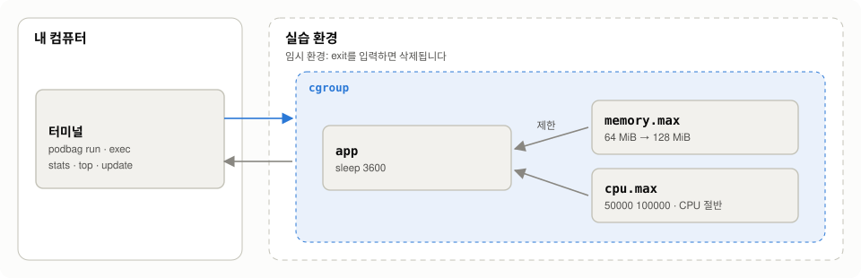

제한을 걸면 컨테이너 하나가 컴퓨터 자원을 모두 쓰지 못합니다. `--memory` 옵션은 컨테이너가 쓸 수 있는 최대 메모리를 정합니다. `--cpus` 옵션은 컨테이너가 받는 CPU 시간을 정합니다. 이번 트레이닝에서는 두 제한을 걸고, 컨테이너 안에서 읽고, 실행 중에 하나를 바꿉니다.

**예상 시간** 10분.



## 실습 시작

Podbag Desktop에서 **Training**을 열고 **메모리와 CPU 제한하기**를 선택합니다. 새 모듈은 **새로 고침** 후에 나타납니다. 터미널에서 다음 명령을 실행해도 됩니다.

```sh
podbag lab start resource-limits
```

Training 카탈로그를 지원하는 Podbag 빌드가 필요합니다(v0.3.2 이후). `training $` 프롬프트가 나오면 다음 단계로 진행합니다.

## 제한을 걸고 컨테이너 실행

`app`이라는 조용한 컨테이너를 실행합니다. 이 컨테이너는 메모리를 최대 64 MiB, CPU를 하나의 절반만 씁니다. `-d` 옵션은 백그라운드에서 실행합니다. `sleep 3600`은 컨테이너를 한 시간 동안 켜 둡니다.

```sh
podbag run -d --name app --memory 64m --cpus 0.5 docker.io/library/busybox:1.37.0 sleep 3600
```

Podbag은 `app`이 실행 중인지 확인합니다.

## 컨테이너 안에서 제한 읽기

Podbag은 컨테이너마다 cgroup을 만듭니다. cgroup은 Linux 커널이 함께 제한하는 프로세스 묶음입니다. 컨테이너는 `/sys/fs/cgroup`에서 자기 cgroup 파일을 봅니다. 먼저 메모리 제한을 읽습니다.

```sh
podbag exec app cat /sys/fs/cgroup/memory.max
```

`67108864`가 출력됩니다. 64 MiB를 바이트로 나타낸 값입니다. Podbag이 이 숫자를 확인합니다.

이어서 CPU 제한을 읽습니다.

```sh
podbag exec app cat /sys/fs/cgroup/cpu.max
```

`50000 100000`이 출력됩니다. 100,000마이크로초마다 CPU 시간을 50,000마이크로초까지 쓸 수 있다는 뜻입니다. 즉 CPU 절반입니다. Podbag이 이 줄을 확인합니다.

## stats와 top으로 살펴보기

`podbag stats`는 컨테이너의 CPU, 메모리, 네트워크, 디스크 사용량을 보여 줍니다. `--no-stream` 옵션은 표를 한 번만 출력하고 끝납니다.

```sh
podbag stats --no-stream app
```

**MEM USAGE / LIMIT** 열 끝에 설정한 제한 `64MiB`가 나옵니다. Podbag이 이 값을 확인합니다.

`podbag top`은 컨테이너 안의 프로세스를 보여 줍니다.

```sh
podbag top app
```

목록에 `sleep 3600`이 나옵니다. Podbag이 이 프로세스를 확인합니다.

## 메모리 제한 늘리기

`podbag update`는 컨테이너의 제한을 바꿉니다. 실행 중인 컨테이너에도 새 값이 바로 적용됩니다. 다시 시작할 필요가 없습니다.

```sh
podbag update --memory 128m app
```

명령이 `app`이라는 이름을 출력합니다. 메모리 제한을 다시 읽습니다.

```sh
podbag exec app cat /sys/fs/cgroup/memory.max
```

이제 128 MiB인 `134217728`이 출력됩니다. Podbag이 이 숫자를 확인합니다.

## 실습 리소스 정리

컨테이너를 삭제합니다. `app`은 아직 실행 중이므로 `-f` 옵션으로 먼저 중지합니다. 그다음 실습을 끝냅니다.

```sh
podbag rm -f app
exit
```

임시 실습 환경이 정리되면 Training에서 **수업 완료**를 확인합니다.
