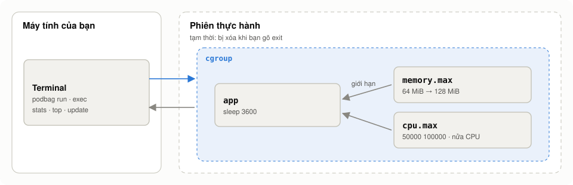

Giới hạn giúp một container không dùng hết tài nguyên của máy tính. Tùy chọn `--memory` đặt lượng bộ nhớ tối đa mà container được dùng. Tùy chọn `--cpus` đặt lượng thời gian CPU mà container nhận được. Trong mô-đun này, bạn đặt cả hai, đọc chúng bên trong container, và thay đổi một giới hạn khi container đang chạy.

**Thời gian** 10 phút.



## Bắt đầu mô-đun

Mở **Training** trong Podbag Desktop và chọn **Giới hạn bộ nhớ và CPU**. Mô-đun mới xuất hiện sau khi chọn **Làm mới**. Hoặc chạy lệnh này trong terminal:

```sh
podbag lab start resource-limits
```

Bạn cần bản Podbag có danh mục Training (sau v0.3.2). Tiếp tục tại dấu nhắc `training $`.

Để làm các bước trong TUI thay cho Podbag Desktop, hãy thêm `--tui`.

```sh
podbag lab start resource-limits --tui
```

Trong TUI, nhấn `:` để mở shell Training cho bước chạy lệnh, gõ `exit` để quay lại TUI và nhấn `q` để kết thúc phiên.

## Chạy container có giới hạn

Chạy một container không làm gì tên `app`. Nó được dùng tối đa 64 MiB bộ nhớ và một nửa CPU. Tùy chọn `-d` chạy nó ở chế độ nền, và `sleep 3600` giữ nó chạy trong một giờ.

```sh
podbag run -d --name app --memory 64m --cpus 0.5 docker.io/library/busybox:1.37.0 sleep 3600
```

Podbag kiểm tra rằng `app` đang chạy.

## Đọc giới hạn bên trong container

Podbag đặt mỗi container vào một cgroup. Cgroup là một nhóm tiến trình mà nhân Linux giới hạn chung. Container thấy các tệp cgroup của chính nó trong `/sys/fs/cgroup`. Hãy đọc giới hạn bộ nhớ trước.

```sh
podbag exec app cat /sys/fs/cgroup/memory.max
```

Kết quả là `67108864`. Đó là 64 MiB tính bằng byte. Podbag kiểm tra con số này.

Sau đó đọc giới hạn CPU.

```sh
podbag exec app cat /sys/fs/cgroup/cpu.max
```

Kết quả là `50000 100000`. Trong mỗi 100.000 micro giây, container được dùng 50.000 micro giây thời gian CPU. Tức là một nửa CPU. Podbag kiểm tra dòng này.

## Theo dõi container bằng stats và top

`podbag stats` hiển thị mức dùng CPU, bộ nhớ, mạng và ổ đĩa của các container. Tùy chọn `--no-stream` in bảng một lần rồi kết thúc.

```sh
podbag stats --no-stream app
```

Cột **MEM USAGE / LIMIT** kết thúc bằng `64MiB`, chính là giới hạn bạn đã đặt. Podbag kiểm tra giá trị này.

`podbag top` liệt kê các tiến trình trong container.

```sh
podbag top app
```

Danh sách hiển thị `sleep 3600`. Podbag kiểm tra tiến trình này.

## Nâng giới hạn bộ nhớ

`podbag update` thay đổi giới hạn của container. Container đang chạy nhận giá trị mới ngay lập tức. Bạn không cần khởi động lại nó.

```sh
podbag update --memory 128m app
```

Lệnh in tên `app`. Hãy đọc lại giới hạn bộ nhớ.

```sh
podbag exec app cat /sys/fs/cgroup/memory.max
```

Kết quả giờ là `134217728`, tức là 128 MiB. Podbag kiểm tra con số này.

## Dọn dẹp và kết thúc

Xóa container. `app` vẫn đang chạy, nên `-f` dừng nó trước. Sau đó kết thúc phiên.

- **Trong Podbag Desktop:** Chọn **Container thực hành → app → Xóa** và xác nhận.
- **Trong TUI:** Chọn `app` trong **Container**, nhấn `d`, rồi nhấn `y`.

```sh
podbag rm -f app
exit
```

Các tài nguyên thực hành tạm thời đã được xóa. Training hiển thị mô-đun đã hoàn thành.
