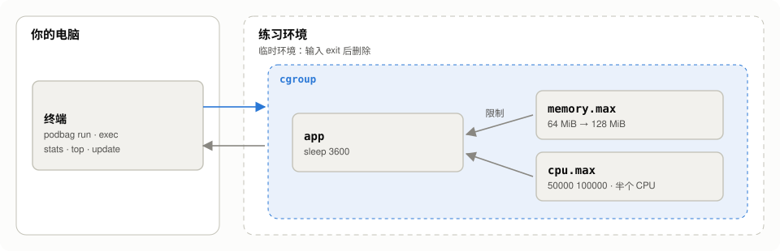

限制可以防止一个容器占用电脑的全部资源。`--memory` 选项设置容器最多可用的内存。`--cpus` 选项设置容器可获得的 CPU 时间。在本模块中，你将设置这两项限制，在容器内读取它们，并在容器运行时更改其中一项。

**预计用时** 10 分钟。



## 开始模块

在 Podbag Desktop 中打开 **Training**，选择**限制内存和 CPU**。点击**刷新**后会出现新模块。也可以在终端中运行以下命令：

```sh
podbag lab start resource-limits
```

需要带有 Training 目录的 Podbag 版本（v0.3.2 之后）。出现 `training $` 提示符后继续。

## 运行带限制的容器

运行一个名为 `app` 的安静容器。它最多使用 64 MiB 内存和半个 CPU。`-d` 选项让它在后台运行，`sleep 3600` 让它保持运行一小时。

```sh
podbag run -d --name app --memory 64m --cpus 0.5 docker.io/library/busybox:1.37.0 sleep 3600
```

Podbag 会检查 `app` 是否正在运行。

## 在容器内读取限制

Podbag 把每个容器放入一个 cgroup。cgroup 是一组进程，Linux 内核会统一限制它们。容器可以在 `/sys/fs/cgroup` 中看到自己的 cgroup 文件。先读取内存限制。

```sh
podbag exec app cat /sys/fs/cgroup/memory.max
```

输出是 `67108864`。这是以字节表示的 64 MiB。Podbag 会检查这个数字。

然后读取 CPU 限制。

```sh
podbag exec app cat /sys/fs/cgroup/cpu.max
```

输出是 `50000 100000`。在每 100,000 微秒中，容器最多可以使用 50,000 微秒的 CPU 时间。也就是半个 CPU。Podbag 会检查这一行。

## 用 stats 和 top 观察容器

`podbag stats` 显示容器的 CPU、内存、网络和磁盘使用情况。`--no-stream` 选项只打印一次表格，然后结束。

```sh
podbag stats --no-stream app
```

**MEM USAGE / LIMIT** 列以 `64MiB` 结尾，这就是你设置的限制。Podbag 会检查这个值。

`podbag top` 列出容器中的进程。

```sh
podbag top app
```

列表中显示 `sleep 3600`。Podbag 会检查这个进程。

## 提高内存限制

`podbag update` 更改容器的限制。正在运行的容器会立即使用新值。不需要重启容器。

```sh
podbag update --memory 128m app
```

命令会打印名称 `app`。再次读取内存限制。

```sh
podbag exec app cat /sys/fs/cgroup/memory.max
```

现在输出是 `134217728`，也就是 128 MiB。Podbag 会检查这个数字。

## 清理并结束

删除容器。`app` 仍在运行，所以 `-f` 会先停止它。然后结束实验。

```sh
podbag rm -f app
exit
```

临时实验资源会被删除。Training 会显示该模块已完成。
