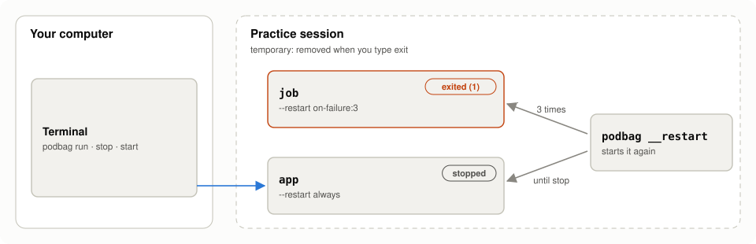

A restart policy tells Podbag what to do when a container stops. Podbag can start it again, only after an error or after every exit. In this module, you run a job that always fails and a container that always ends, and you watch Podbag start them again.

**Time** 10 minutes.



## Start the module

Open **Training** in Podbag Desktop and select **Restart containers that stop**. New modules appear after **Refresh**. Or run this command in a terminal:

```sh
podbag lab start restart-policies
```

You need a Podbag build with the Training catalog (after v0.3.2). Continue at the `training $` prompt.

To do the steps in the TUI instead of Podbag Desktop, add `--tui`.

```sh
podbag lab start restart-policies --tui
```

In the TUI, press `:` to open the training shell for a command step, type `exit` to return to the TUI, and press `q` to end the session.

## Run a job that fails

Run a container named `job`. It prints `try` and ends with the error code `1`. The option `--restart on-failure:3` starts it again after an error, at most 3 times.

```sh
podbag run -d --name job --restart on-failure:3 docker.io/library/busybox:1.37.0 sh -c 'echo try; exit 1'
```

Podbag has no daemon. When the container stops, a small `podbag __restart` process starts it again. It waits 100 ms before the first restart, and twice as long before each next one. Podbag waits until `job` has restarted 3 times.

## Count the restarts

`podbag inspect` shows the details of a container as JSON. Look for `restart_count`.

```sh
podbag inspect job
```

The line `"restart_count": 3` shows the 3 restarts. Then `job` stops for good, with the code `1`. Podbag checks this line.

## See every try in the logs

The logs keep the output of every run.

```sh
podbag logs job
```

- **In Podbag Desktop:** Select **Practice containers → job → Logs**.
- **In the TUI:** Select `job` in **Containers** and press `l`.

The word `try` is printed 4 times: the first run and the 3 restarts. Podbag checks for a line `try`.

Remove the job. It has stopped, so `rm` does not need `-f`.

```sh
podbag rm job
```

- **In Podbag Desktop:** Select **Practice containers → job → Remove** and confirm.
- **In the TUI:** Select `job` in **Containers**, press `d`, then `y`.

## Start a container again after every exit

The option `--restart always` starts a container again after every exit, also after a good one. This container prints `start`, waits 2 seconds and ends with code `0`.

```sh
podbag run -d --name app --restart always docker.io/library/busybox:1.37.0 sh -c 'echo start; sleep 2'
```

Podbag waits until `app` has restarted at least once. `--restart unless-stopped` works the same in Podbag, because nothing starts containers when the machine starts.

## Stop the container

`podbag stop` stops the container. It also ends the restarts until the next `start`.

```sh
podbag stop app
```

- **In Podbag Desktop:** Select **Practice containers → app → Stop**.
- **In the TUI:** Select `app` in **Containers** and press `x`.

Podbag checks that `app` has stopped. List all containers to see it stay stopped.

```sh
podbag ps -a
```

The status of `app` is `Exited`. Podbag checks for this word.

## Start it again

`podbag start` starts the container and turns the restarts back on.

```sh
podbag start app
```

- **In Podbag Desktop:** Select **Practice containers → app → Start**.
- **In the TUI:** Select `app` in **Containers** and press `s`.

Podbag checks that `app` runs.

## Clean up and finish

Remove the container. It may be running, so `-f` stops it first. Then end the session.

- **In Podbag Desktop:** Select **Practice containers → app → Remove** and confirm.
- **In the TUI:** Select `app` in **Containers**, press `d`, then `y`.

```sh
podbag rm -f app
exit
```

The temporary practice resources are removed. Training shows the module as complete.
