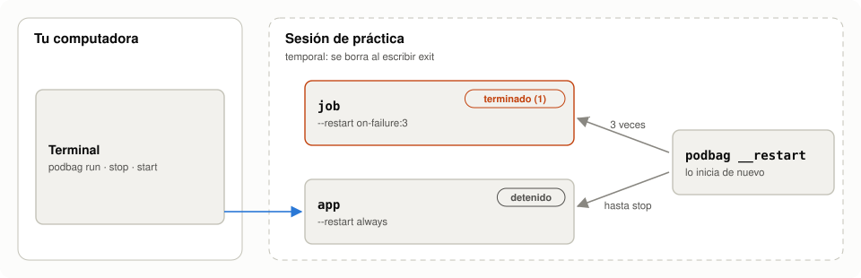

Una política de reinicio le dice a Podbag qué hacer cuando un contenedor se detiene. Podbag puede volver a iniciarlo solo después de un error, o después de cada salida. En este módulo, ejecutas una tarea que siempre falla y un contenedor que siempre termina, y miras cómo Podbag los vuelve a iniciar.

**Tiempo** 10 minutos.



## Inicia el módulo

Abre **Training** en Podbag Desktop y selecciona **Reinicia los contenedores que se detienen**. Los módulos nuevos aparecen después de **Actualizar**. O ejecuta este comando en una terminal:

```sh
podbag lab start restart-policies
```

Necesitas una versión de Podbag con el catálogo de Training (posterior a v0.3.2). Continúa en el prompt `training $`.

Para hacer los pasos en la TUI en lugar de Podbag Desktop, añade `--tui`.

```sh
podbag lab start restart-policies --tui
```

En la TUI, pulsa `:` para abrir la shell de Training cuando un paso pida un comando, escribe `exit` para volver a la TUI y pulsa `q` para terminar la sesión.

## Ejecuta una tarea que falla

Ejecuta un contenedor llamado `job`. Muestra `try` y termina con el código de error `1`. La opción `--restart on-failure:3` lo vuelve a iniciar después de un error, como máximo 3 veces.

```sh
podbag run -d --name job --restart on-failure:3 docker.io/library/busybox:1.37.0 sh -c 'echo try; exit 1'
```

Podbag no tiene daemon. Cuando el contenedor se detiene, un pequeño proceso `podbag __restart` lo vuelve a iniciar. Espera 100 ms antes del primer reinicio, y el doble antes de cada uno de los siguientes. Podbag espera hasta que `job` se haya reiniciado 3 veces.

## Cuenta los reinicios

`podbag inspect` muestra los detalles de un contenedor en JSON. Busca `restart_count`.

```sh
podbag inspect job
```

La línea `"restart_count": 3` muestra los 3 reinicios. Después, `job` se detiene definitivamente con el código `1`. Podbag comprueba esta línea.

## Mira cada intento en los registros

Los registros guardan la salida de cada ejecución.

```sh
podbag logs job
```

- **En Podbag Desktop:** Selecciona **Contenedores de práctica → job → Registros**.
- **En la TUI:** Selecciona `job` en **Contenedores** y pulsa `l`.

La palabra `try` aparece 4 veces: la primera ejecución y los 3 reinicios. Podbag busca una línea `try`.

Elimina la tarea. Ya se detuvo, así que `rm` no necesita `-f`.

```sh
podbag rm job
```

- **En Podbag Desktop:** Selecciona **Contenedores de práctica → job → Eliminar** y confirma.
- **En la TUI:** Selecciona `job` en **Contenedores**, pulsa `d` y luego `y`.

## Inicia un contenedor de nuevo después de cada salida

La opción `--restart always` vuelve a iniciar un contenedor después de cada salida, también después de una salida correcta. Este contenedor muestra `start`, espera 2 segundos y termina con el código `0`.

```sh
podbag run -d --name app --restart always docker.io/library/busybox:1.37.0 sh -c 'echo start; sleep 2'
```

Podbag espera hasta que `app` se haya reiniciado al menos una vez. `--restart unless-stopped` funciona igual en Podbag, porque nada inicia contenedores cuando arranca el equipo.

## Detén el contenedor

`podbag stop` detiene el contenedor. También pone fin a los reinicios hasta el siguiente `start`.

```sh
podbag stop app
```

- **En Podbag Desktop:** Selecciona **Contenedores de práctica → app → Detener**.
- **En la TUI:** Selecciona `app` en **Contenedores** y pulsa `x`.

Podbag comprueba que `app` se ha detenido. Lista todos los contenedores para ver que sigue detenido.

```sh
podbag ps -a
```

El estado de `app` es `Exited`. Podbag busca esta palabra.

## Inícialo de nuevo

`podbag start` inicia el contenedor y vuelve a activar los reinicios.

```sh
podbag start app
```

- **En Podbag Desktop:** Selecciona **Contenedores de práctica → app → Iniciar**.
- **En la TUI:** Selecciona `app` en **Contenedores** y pulsa `s`.

Podbag comprueba que `app` está en ejecución.

## Limpia y termina

Elimina el contenedor. Puede estar en ejecución, así que `-f` lo detiene primero. Luego termina la sesión.

- **En Podbag Desktop:** Selecciona **Contenedores de práctica → app → Eliminar** y confirma.
- **En la TUI:** Selecciona `app` en **Contenedores**, pulsa `d` y luego `y`.

```sh
podbag rm -f app
exit
```

Se eliminan los recursos temporales de la práctica. Training muestra el módulo como completado.
