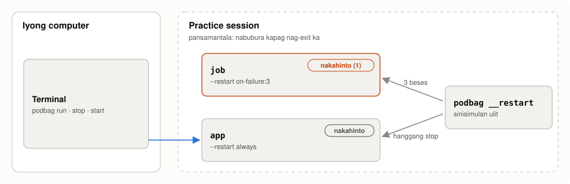

Sinasabi ng restart policy sa Podbag kung ano ang gagawin kapag huminto ang container. Maaari itong simulan ulit ng Podbag pagkatapos lang ng error, o pagkatapos ng bawat paglabas. Sa module na ito, magpapatakbo ka ng job na laging nabibigo at ng container na laging natatapos. Panonoorin mo ang Podbag habang sinisimulan ulit ang mga ito.

**Oras** 10 minuto.



## Simulan ang module

Buksan ang **Training** sa Podbag Desktop at piliin ang **I-restart ang mga container na humihinto**. Lalabas ang mga bagong module pagkatapos ng **I-refresh**. O patakbuhin ang command na ito sa terminal:

```sh
podbag lab start restart-policies
```

Kailangan mo ng build ng Podbag na may Training catalog (pagkatapos ng v0.3.2). Magpatuloy sa prompt na `training $`.

## Magpatakbo ng job na nabibigo

Magpatakbo ng container na `job`. Ipinapakita nito ang `try` at natatapos ito sa error code na `1`. Sinisimulan ito ulit ng option na `--restart on-failure:3` pagkatapos ng error, hanggang 3 beses.

```sh
podbag run -d --name job --restart on-failure:3 docker.io/library/busybox:1.37.0 sh -c 'echo try; exit 1'
```

Walang daemon ang Podbag. Kapag huminto ang container, sinisimulan ito ulit ng maliit na prosesong `podbag __restart`. Naghihintay ito ng 100 ms bago ang unang restart. Doble ang paghihintay bago ang bawat susunod. Naghihintay ang Podbag hanggang ma-restart ang `job` nang 3 beses.

## Bilangin ang mga restart

Ipinapakita ng `podbag inspect` ang detalye ng container bilang JSON. Hanapin ang `restart_count`.

```sh
podbag inspect job
```

Ipinapakita ng linyang `"restart_count": 3` ang 3 restart. Pagkatapos, tuluyang humihinto ang `job`, na may code na `1`. Sinusuri ng Podbag ang linyang ito.

## Tingnan ang bawat pagsubok sa mga log

Itinatago ng mga log ang output ng bawat pagpapatakbo.

```sh
podbag logs job
```

Apat na beses lumalabas ang salitang `try`: ang unang pagpapatakbo at ang 3 restart. Hinahanap ng Podbag ang linyang `try`.

Alisin ang job. Huminto na ito, kaya hindi kailangan ng `rm` ang `-f`.

```sh
podbag rm job
```

## Simulan ulit ang container pagkatapos ng bawat paglabas

Sinisimulan ulit ng option na `--restart always` ang container pagkatapos ng bawat paglabas, pati pagkatapos ng maayos na paglabas. Ipinapakita ng container na ito ang `start`, naghihintay ng 2 segundo at natatapos sa code na `0`.

```sh
podbag run -d --name app --restart always docker.io/library/busybox:1.37.0 sh -c 'echo start; sleep 2'
```

Naghihintay ang Podbag hanggang ma-restart ang `app` nang kahit isang beses. Pareho ang gawa ng `--restart unless-stopped` sa Podbag. Walang nagsisimula ng mga container kapag nagsimula ang makina.

## Ihinto ang container

Inihihinto ng `podbag stop` ang container. Tinatapos din nito ang mga restart hanggang sa susunod na `start`.

```sh
podbag stop app
```

Sinusuri ng Podbag na huminto na ang `app`. Ilista ang lahat ng container para makitang nananatili itong nakahinto.

```sh
podbag ps -a
```

`Exited` ang status ng `app`. Hinahanap ng Podbag ang salitang ito.

## Simulan ito ulit

Sinisimulan ng `podbag start` ang container at ibinabalik ang mga restart.

```sh
podbag start app
```

Sinusuri ng Podbag na tumatakbo ang `app`.

## Maglinis at tapusin

Alisin ang container. Maaaring tumatakbo ito, kaya inihihinto muna ito ng `-f`. Pagkatapos, tapusin ang session.

```sh
podbag rm -f app
exit
```

Naaalis ang mga pansamantalang resource ng practice. Ipinapakita ng Training na tapos na ang module.
