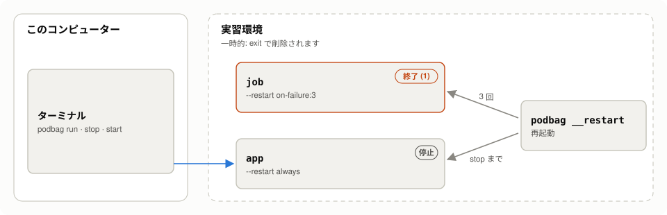

再起動ポリシーは、コンテナが停止したときに Podbag が何をするかを決めます。Podbag は、エラーの後だけ、または毎回の終了の後に、コンテナをもう一度起動できます。このモジュールでは、必ず失敗するジョブと、必ず終了するコンテナを実行し、Podbag がそれらを再起動する様子を確認します。

**所要時間** 10 分。



## モジュールを開始する

Podbag Desktop で **Training** を開き、**停止したコンテナを再起動する**を選びます。新しいモジュールは**更新**の後に表示されます。ターミナルで次のコマンドを実行しても開始できます。

```sh
podbag lab start restart-policies
```

Training カタログがある Podbag のビルド（v0.3.2 より後）が必要です。`training $` プロンプトが表示されたら続けます。

Podbag Desktop の代わりに TUI で手順を進めるには、`--tui` を付けます。

```sh
podbag lab start restart-policies --tui
```

TUI では、コマンドの手順で `:` を押すと Training シェルが開きます。`exit` と入力すると TUI に戻ります。`q` を押すと実習を終了します。

## 失敗するジョブを実行する

`job` という名前のコンテナを実行します。このコンテナは `try` と表示し、エラーコード `1` で終了します。`--restart on-failure:3` オプションは、エラーの後にコンテナを再起動します。再起動は最大 3 回です。

```sh
podbag run -d --name job --restart on-failure:3 docker.io/library/busybox:1.37.0 sh -c 'echo try; exit 1'
```

Podbag にはデーモンがありません。コンテナが停止すると、小さな `podbag __restart` プロセスがコンテナを再起動します。最初の再起動の前に 100 ms 待ち、その後は毎回、前の 2 倍の時間を待ちます。Podbag は、`job` が 3 回再起動するまで待ちます。

## 再起動の回数を数える

`podbag inspect` は、コンテナの詳細を JSON で表示します。`restart_count` を探します。

```sh
podbag inspect job
```

`"restart_count": 3` の行が 3 回の再起動を示します。その後、`job` はコード `1` で完全に停止します。Podbag はこの行を確認します。

## ログですべての試行を見る

ログには、毎回の実行の出力が残ります。

```sh
podbag logs job
```

- **Podbag Desktop で:** **実習コンテナ → job → ログ**を選びます。
- **TUI で:** **コンテナ**で `job` を選び、`l` を押します。

`try` が 4 回表示されます。最初の実行と 3 回の再起動の分です。Podbag は `try` の行を確認します。

ジョブを削除します。ジョブは停止しているので、`rm` に `-f` は必要ありません。

```sh
podbag rm job
```

- **Podbag Desktop で:** **実習コンテナ → job → 削除**を選び、確認します。
- **TUI で:** **コンテナ**で `job` を選び、`d` を押してから `y` を押します。

## 終了するたびにコンテナを再起動する

`--restart always` オプションは、終了するたびにコンテナを再起動します。正常に終了した場合も同じです。このコンテナは `start` と表示し、2 秒待って、コード `0` で終了します。

```sh
podbag run -d --name app --restart always docker.io/library/busybox:1.37.0 sh -c 'echo start; sleep 2'
```

Podbag は、`app` が少なくとも 1 回再起動するまで待ちます。Podbag では、`--restart unless-stopped` も同じように動きます。コンピューターの起動時にコンテナを起動するものがないからです。

## コンテナを停止する

`podbag stop` はコンテナを停止します。次の `start` までは再起動も止まります。

```sh
podbag stop app
```

- **Podbag Desktop で:** **実習コンテナ → app → 停止**を選びます。
- **TUI で:** **コンテナ**で `app` を選び、`x` を押します。

Podbag は `app` が停止したことを確認します。すべてのコンテナを一覧表示し、停止したままであることを確認します。

```sh
podbag ps -a
```

`app` の状態は `Exited` です。Podbag はこの語を確認します。

## もう一度起動する

`podbag start` はコンテナを起動し、再起動をもう一度有効にします。

```sh
podbag start app
```

- **Podbag Desktop で:** **実習コンテナ → app → 開始**を選びます。
- **TUI で:** **コンテナ**で `app` を選び、`s` を押します。

Podbag は `app` が実行中であることを確認します。

## 片付けて終了する

コンテナを削除します。実行中の可能性があるので、`-f` で先に停止します。その後、実習を終了します。

- **Podbag Desktop で:** **実習コンテナ → app → 削除**を選び、確認します。
- **TUI で:** **コンテナ**で `app` を選び、`d` を押してから `y` を押します。

```sh
podbag rm -f app
exit
```

一時的な実習用のリソースが削除されます。Training にモジュールの完了が表示されます。
