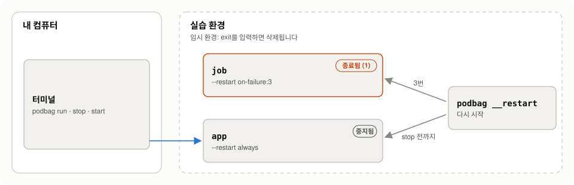

재시작 정책은 컨테이너가 멈췄을 때 Podbag이 할 일을 정합니다. Podbag은 오류가 났을 때만, 또는 끝날 때마다 컨테이너를 다시 시작할 수 있습니다. 이번 트레이닝에서는 항상 실패하는 작업과 항상 끝나는 컨테이너를 실행합니다. 그리고 Podbag이 이들을 다시 시작하는 모습을 봅니다.

**예상 시간** 10분.



## 실습 시작

Podbag Desktop에서 **Training**을 열고 **멈춘 컨테이너 다시 시작하기**를 선택합니다. 새 모듈은 **새로 고침** 후에 나타납니다. 터미널에서 다음 명령을 실행해도 됩니다.

```sh
podbag lab start restart-policies
```

Training 카탈로그를 지원하는 Podbag 빌드가 필요합니다(v0.3.2 이후). `training $` 프롬프트가 나오면 다음 단계로 진행합니다.

## 실패하는 작업 실행

`job`이라는 컨테이너를 실행합니다. 이 컨테이너는 `try`를 출력하고 오류 코드 `1`로 끝납니다. `--restart on-failure:3` 옵션은 오류가 나면 최대 3번까지 다시 시작합니다.

```sh
podbag run -d --name job --restart on-failure:3 docker.io/library/busybox:1.37.0 sh -c 'echo try; exit 1'
```

Podbag에는 데몬이 없습니다. 컨테이너가 멈추면 작은 `podbag __restart` 프로세스가 다시 시작합니다. 첫 재시작 전에는 100ms를 기다리고, 그다음부터는 두 배씩 더 기다립니다. Podbag은 `job`이 3번 재시작할 때까지 기다립니다.

## 재시작 횟수 세기

`podbag inspect`는 컨테이너 정보를 JSON으로 보여 줍니다. `restart_count`를 찾습니다.

```sh
podbag inspect job
```

`"restart_count": 3` 줄이 3번의 재시작을 보여 줍니다. 그 뒤 `job`은 코드 `1`로 완전히 멈춥니다. Podbag이 이 줄을 확인합니다.

## 로그에서 모든 시도 보기

로그에는 모든 실행의 출력이 남습니다.

```sh
podbag logs job
```

`try`가 4번 출력됩니다. 첫 실행과 3번의 재시작입니다. Podbag은 `try` 줄을 확인합니다.

작업을 삭제합니다. 이미 멈췄으므로 `rm`에 `-f`가 필요 없습니다.

```sh
podbag rm job
```

## 끝날 때마다 다시 시작

`--restart always` 옵션은 컨테이너가 끝날 때마다 다시 시작합니다. 정상으로 끝나도 마찬가지입니다. 이 컨테이너는 `start`를 출력하고 2초 기다린 뒤 코드 `0`으로 끝납니다.

```sh
podbag run -d --name app --restart always docker.io/library/busybox:1.37.0 sh -c 'echo start; sleep 2'
```

Podbag은 `app`이 한 번 이상 재시작할 때까지 기다립니다. Podbag에서는 `--restart unless-stopped`도 똑같이 동작합니다. 컴퓨터가 켜질 때 컨테이너를 시작하는 프로그램이 없기 때문입니다.

## 컨테이너 중지

`podbag stop`은 컨테이너를 중지합니다. 다음 `start` 전까지 재시작도 멈춥니다.

```sh
podbag stop app
```

Podbag은 `app`이 중지됐는지 확인합니다. 모든 컨테이너를 보고 계속 멈춰 있는지 확인합니다.

```sh
podbag ps -a
```

`app`의 상태는 `Exited`입니다. Podbag이 이 단어를 확인합니다.

## 다시 시작

`podbag start`는 컨테이너를 시작하고 재시작을 다시 켭니다.

```sh
podbag start app
```

Podbag은 `app`이 실행 중인지 확인합니다.

## 실습 리소스 정리

컨테이너를 삭제합니다. 실행 중일 수 있으므로 `-f` 옵션으로 먼저 중지합니다. 그다음 실습을 끝냅니다.

```sh
podbag rm -f app
exit
```

임시 실습 환경이 정리되면 Training에서 **수업 완료**를 확인합니다.
