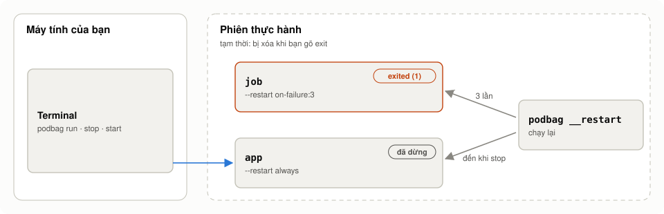

Chính sách khởi động lại (restart policy) cho Podbag biết phải làm gì khi container dừng. Podbag có thể chạy lại container chỉ sau khi có lỗi, hoặc sau mỗi lần thoát. Trong mô-đun này, bạn chạy một tác vụ luôn bị lỗi và một container luôn kết thúc, rồi xem Podbag chạy lại chúng.

**Thời gian** 10 phút.



## Bắt đầu mô-đun

Mở **Training** trong Podbag Desktop và chọn **Khởi động lại container khi nó dừng**. Mô-đun mới xuất hiện sau khi chọn **Làm mới**. Hoặc chạy lệnh này trong terminal:

```sh
podbag lab start restart-policies
```

Bạn cần bản Podbag có danh mục Training (sau v0.3.2). Tiếp tục tại dấu nhắc `training $`.

## Chạy một tác vụ bị lỗi

Chạy một container tên `job`. Nó in `try` và kết thúc với mã lỗi `1`. Tùy chọn `--restart on-failure:3` chạy lại nó sau mỗi lỗi, tối đa 3 lần.

```sh
podbag run -d --name job --restart on-failure:3 docker.io/library/busybox:1.37.0 sh -c 'echo try; exit 1'
```

Podbag không có daemon. Khi container dừng, một tiến trình nhỏ `podbag __restart` chạy lại nó. Tiến trình này chờ 100 ms trước lần khởi động lại đầu tiên. Mỗi lần sau, thời gian chờ tăng gấp đôi. Podbag chờ đến khi `job` đã khởi động lại 3 lần.

## Đếm số lần khởi động lại

`podbag inspect` hiển thị chi tiết của container dưới dạng JSON. Hãy tìm `restart_count`.

```sh
podbag inspect job
```

Dòng `"restart_count": 3` cho thấy 3 lần khởi động lại. Sau đó `job` dừng hẳn với mã `1`. Podbag kiểm tra dòng này.

## Xem mọi lần chạy trong nhật ký

Nhật ký giữ đầu ra của mọi lần chạy.

```sh
podbag logs job
```

Chữ `try` được in 4 lần: lần chạy đầu và 3 lần khởi động lại. Podbag tìm một dòng `try`.

Xóa tác vụ này. Nó đã dừng, nên `rm` không cần `-f`.

```sh
podbag rm job
```

## Chạy lại container sau mỗi lần thoát

Tùy chọn `--restart always` chạy lại container sau mỗi lần thoát, kể cả khi thoát bình thường. Container này in `start`, chờ 2 giây và kết thúc với mã `0`.

```sh
podbag run -d --name app --restart always docker.io/library/busybox:1.37.0 sh -c 'echo start; sleep 2'
```

Podbag chờ đến khi `app` đã khởi động lại ít nhất một lần. Trong Podbag, `--restart unless-stopped` hoạt động giống như vậy, vì không có gì tự chạy container khi máy khởi động.

## Dừng container

`podbag stop` dừng container. Lệnh này cũng ngừng việc khởi động lại cho đến lần `start` tiếp theo.

```sh
podbag stop app
```

Podbag kiểm tra rằng `app` đã dừng. Liệt kê tất cả container để thấy nó vẫn ở trạng thái dừng.

```sh
podbag ps -a
```

Trạng thái của `app` là `Exited`. Podbag tìm chữ này.

## Chạy lại container

`podbag start` chạy container và bật lại việc khởi động lại.

```sh
podbag start app
```

Podbag kiểm tra rằng `app` đang chạy.

## Dọn dẹp và kết thúc

Xóa container. Nó có thể đang chạy, nên `-f` dừng nó trước. Sau đó kết thúc phiên.

```sh
podbag rm -f app
exit
```

Các tài nguyên thực hành tạm thời đã được xóa. Training hiển thị mô-đun đã hoàn thành.
