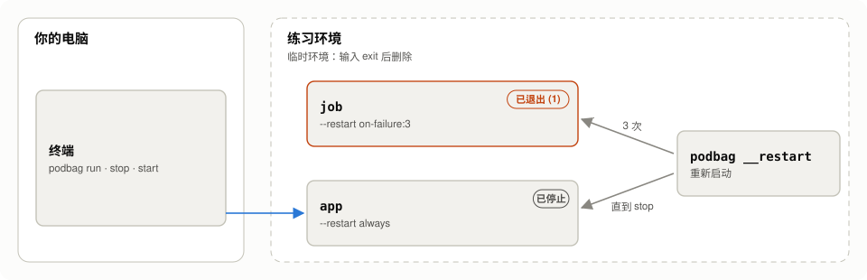

重启策略告诉 Podbag 容器停止后该怎么做。Podbag 可以只在出错后重新启动容器，也可以在每次退出后都重新启动。在本模块中，你将运行一个总是失败的任务和一个总是结束的容器，观察 Podbag 如何重新启动它们。

**预计用时** 10 分钟。



## 开始模块

在 Podbag Desktop 中打开 **Training**，选择**重启已停止的容器**。点击**刷新**后会出现新模块。也可以在终端中运行以下命令：

```sh
podbag lab start restart-policies
```

需要带有 Training 目录的 Podbag 版本（v0.3.2 之后）。出现 `training $` 提示符后继续。

## 运行会失败的任务

运行一个名为 `job` 的容器。它打印 `try`，然后以错误码 `1` 结束。选项 `--restart on-failure:3` 会在出错后重新启动它，最多 3 次。

```sh
podbag run -d --name job --restart on-failure:3 docker.io/library/busybox:1.37.0 sh -c 'echo try; exit 1'
```

Podbag 没有守护进程。容器停止时，一个小型 `podbag __restart` 进程会重新启动它。第一次重启前等待 100 ms，之后每次等待的时间是上一次的两倍。Podbag 会等到 `job` 重启 3 次。

## 统计重启次数

`podbag inspect` 以 JSON 格式显示容器详情。查找 `restart_count`。

```sh
podbag inspect job
```

`"restart_count": 3` 这一行表示重启了 3 次。之后 `job` 以错误码 `1` 彻底停止。Podbag 会检查这一行。

## 在日志中查看每次尝试

日志会保留每次运行的输出。

```sh
podbag logs job
```

`try` 打印了 4 次：第一次运行和 3 次重启。Podbag 会检查是否有 `try` 这一行。

删除这个任务。它已经停止，所以 `rm` 不需要 `-f`。

```sh
podbag rm job
```

## 每次退出后都重新启动容器

选项 `--restart always` 会在容器每次退出后都重新启动它，正常退出也是如此。这个容器打印 `start`，等待 2 秒，然后以退出码 `0` 结束。

```sh
podbag run -d --name app --restart always docker.io/library/busybox:1.37.0 sh -c 'echo start; sleep 2'
```

Podbag 会等到 `app` 至少重启一次。在 Podbag 中，`--restart unless-stopped` 的效果相同，因为机器启动时不会有程序自动启动容器。

## 停止容器

`podbag stop` 停止容器。它也会停止自动重启，直到下一次 `start`。

```sh
podbag stop app
```

Podbag 会检查 `app` 是否已停止。列出所有容器，确认它保持停止状态。

```sh
podbag ps -a
```

`app` 的状态是 `Exited`。Podbag 会检查这个词。

## 再次启动

`podbag start` 启动容器，并重新开启自动重启。

```sh
podbag start app
```

Podbag 会检查 `app` 是否正在运行。

## 清理并结束

删除容器。它可能正在运行，所以 `-f` 会先停止它。然后结束实验。

```sh
podbag rm -f app
exit
```

临时实验资源会被删除。Training 会显示该模块已完成。
