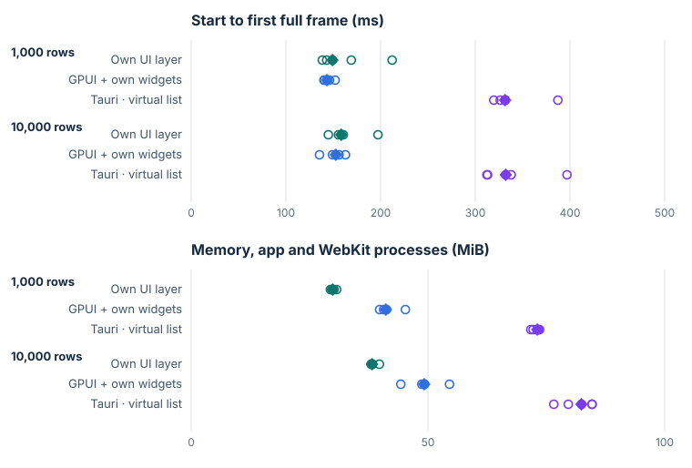

In [the last post](/blog/gpui-tauri-desktop-ui/) we built one Containers screen with GPUI and with Tauri. One screen says little about porting a whole app. This time we ported most of Podbag Desktop twice, in pure Rust and without a WebView:

- **Own UI layer**: our own small framework on [winit](https://github.com/rust-windowing/winit) for windows and input, [wgpu](https://wgpu.rs/) for GPU drawing and [glyphon](https://github.com/grovesNL/glyphon) for text.
- **GPUI + own widgets**: [GPUI](https://github.com/zed-industries/zed/tree/main/crates/gpui) 0.2.2, the framework of the Zed editor. We wrote the widgets it does not ship, such as a text field.

We compared them on four needs: pure Rust, macOS, Linux and Windows, performance, and the cost of porting the current features.

## What we ported

Both ports cover the same features of Podbag Desktop 0.3.2:

- The window shell: sidebar with counts, back and forward, VM card, status bar, toasts and confirm dialogs.
- Containers: search, start, stop, restart, remove, rename, details, live logs and clean up.
- Images: search, remove, clean up, and the pull panel with Docker Hub search and live progress.
- Volumes and Networks: lists, create, remove and clean up.
- Kubernetes: context menu, all namespaces, resource tabs and tables.
- Settings: launch at login, seven languages that switch at once, theme, engine, Docker CLI and VM resources.

Training, Migrate, updates and registry login are not ported. Both ports read the same mocked engine, a Rust port of the mock that Podbag Desktop's preview pages use. It is 2,685 lines and is not counted below. The seven language files are the app's own.

Both apps use Podbag Desktop's release profile and a 1200 × 800 window. As in the last post, a script starts each app, waits for the first full frame, waits 3 seconds, reads memory and measures CPU for 10 seconds. It then types `web-0004` into the search box. For the two ports it also opens the six views one by one and reads memory again. Tauri with a virtual list runs again as the reference.

Apple M5 · 24 GB · macOS 27.2.1 · Rust 1.96.0 · winit 0.30.13 · wgpu 30.0.2 · glyphon 0.12.0 · gpui 0.2.2 (`runtime_shaders`) · Tauri 2.12.7 · five warm runs per case, medians

## Results

| 1,000 rows | Own UI layer | GPUI + own widgets | Tauri · virtual list |
|---|---:|---:|---:|
| Start to first full frame | {{n:149}} ms | {{n:143}} ms | {{n:331}} ms |
| Memory at start, app and WebKit processes | {{n:29.9}} MiB | {{n:41.1}} MiB | {{n:73.1}} MiB |
| Memory after opening all six views | {{n:40.2}} MiB | {{n:40.8}} MiB | – |
| CPU at rest | {{n:0}}% | {{n:0.9}}% | {{n:0.3}}% |
| Filter to 2 rows | {{n:2.5}} ms | {{n:12.3}} ms | {{n:19}} ms |
| Switch views | {{n:2.7}} ms | {{n:14.7}} ms | – |

| 10,000 rows | Own UI layer | GPUI + own widgets | Tauri · virtual list |
|---|---:|---:|---:|
| Start to first full frame | {{n:158}} ms | {{n:153}} ms | {{n:332}} ms |
| Memory at start, app and WebKit processes | {{n:38.2}} MiB | {{n:49.2}} MiB | {{n:82.4}} MiB |
| Memory after opening all six views | {{n:47.5}} MiB | {{n:48.1}} MiB | – |
| CPU at rest | {{n:0}}% | {{n:0.9}}% | {{n:0.1}}% |
| Filter to 2 rows | {{n:7.3}} ms | {{n:14.3}} ms | {{n:15}} ms |
| Switch views | {{n:4.8}} ms | {{n:15.7}} ms | – |

Both ports started in about 150 ms, less than half the time of Tauri. At start, the own layer used the least memory. After all six views were open, both ports used about the same memory: 40 MiB at 1,000 rows and 48 MiB at 10,000 rows. At rest, the own layer used 0.2% CPU or less in every run. GPUI used 0.4–1.2%.

Read the filter and view times with care. GPUI and Tauri report them at the next display refresh. The own layer reports them as soon as its frame is presented. On this display, that difference is up to one frame, 8–17 ms. So these rows show that all three update the screen within the next frame. They do not show that one is several times faster.

## Code and builds

| Full port | Own UI layer | GPUI + own widgets |
|---|---:|---:|
| Lines of Rust | {{n:7525}} | {{n:8951}} |
| Framework or widgets | {{n:3652}} | {{n:2260}} |
| Views and window shell | {{n:3873}} | {{n:6691}} |
| Crates in the dependency tree | {{n:140}} | {{n:454}} |
| Release binary | {{n:4.4}} MB | {{n:4.9}} MB |
| Clean release build | {{n:48}} s | {{n:103}} s |

The own layer has an event loop, GPU drawing, text with fallback fonts for Chinese, Japanese and Korean, hit testing, a text field with IME input, and widgets such as buttons, menus, tables, dialogs and sliders. GPUI gave us layout with a CSS-like style API, lists, tooltips and font fallback. It has no text field, so ours is 701 lines, adapted from GPUI's input example. The GPUI port's views are longer. Part of that is features the own port does not have. Both counts include comments, blank lines and small test hooks.

## What is missing

Own UI layer:

- No tooltips and no Tab key movement between controls.
- Text in logs, JSON and detail fields cannot be selected or copied.
- Long log lines are cut, not wrapped. There are no transition animations.
- Docker image import is not ported.
- Text is about 5% narrower than in native macOS apps. Our text stack does not use the optical size axis of the system font.

GPUI + own widgets:

- Cut text sometimes loses its ellipsis.
- GPUI has no text field, slider or drag handling, so we wrote them.

## macOS, Linux and Windows

We ran both ports on macOS only. For Linux and Windows we ran `cargo check`, which compiles without linking.

| `cargo check --release` | Own UI layer | GPUI + own widgets |
|---|---|---|
| Windows (`x86_64-pc-windows-gnu`, from macOS) | Passes | Fails. gpui compiles its HLSL shaders with `fxc.exe`, which runs only on Windows. A debug check passes. |
| Linux (VM) | Passes | Fails. `xattr` 0.2.3 in gpui 0.2.2's dependencies uses `libc::ENOATTR`, which current `libc` does not have. Passes with a patched `xattr`. |

The Linux VM had no fonts installed, so we could not check text there.

## A fix to the last post

The GPUI prototype in the last post had a layout bug: table rows did not follow the column widths. It is fixed in this round. The Mac was in normal use on both days, so numbers from different days are not comparable. This post compares runs from one session only. The single-screen prototypes ran in the same session, and their data is in the per-run file below.

## What this means for Podbag Desktop

- **Pure Rust**: both ports are pure Rust and use no WebView.
- **macOS, Linux and Windows**: the own layer compiles for all three. In our setup, GPUI needs a Windows machine to build for Windows and a dependency patch for Linux. Neither port has run on Linux or Windows yet.
- **Performance**: both ports start in less than half the time of Tauri and use less memory. The own layer used the least memory at start and the least CPU at rest.
- **Porting cost**: both ports cover the same views. The own layer needed fewer lines, a third of the crates and half the build time. It lacks tooltips, text selection and keyboard focus movement, and we maintain its text, input and drawing code. GPUI gives more for free, but its API is still before 1.0 and it has no text field.

Before we choose, both ports need to run on Linux and Windows.

## Limits

These are two ports on one Mac with a mocked engine, not two finished apps. Filter and view times are measured inside each app. Start-to-frame time is measured from outside and includes everything. We checked the ports with screenshots and scripted input, not with daily use. Scrolling smoothness and long sessions were not measured.

## Reproduce the test

[Benchmark script](run.py) · [Summary script](summary.py) · [Per-run data](results.json) · [Versions and commands](reproduce.txt) · [Source of both ports](prototypes.tar.gz)

[winit](https://github.com/rust-windowing/winit) · [wgpu](https://wgpu.rs/) · [glyphon](https://github.com/grovesNL/glyphon) · [GPUI](https://github.com/zed-industries/zed/tree/main/crates/gpui)
