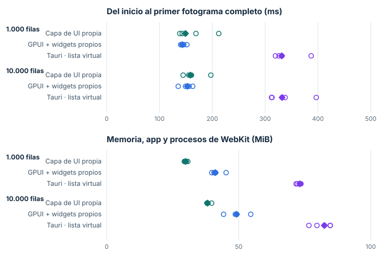

En [la entrada anterior](/es/blog/gpui-tauri-desktop-ui/) creamos una sola pantalla de contenedores con GPUI y con Tauri. Una pantalla dice poco sobre portar una app entera. Esta vez portamos la mayor parte de Podbag Desktop dos veces, en Rust puro y sin WebView:

- **Capa de UI propia**: un framework pequeño hecho por nosotros sobre [winit](https://github.com/rust-windowing/winit) para ventanas y entrada, [wgpu](https://wgpu.rs/) para dibujar con la GPU y [glyphon](https://github.com/grovesNL/glyphon) para el texto.
- **GPUI + widgets propios**: [GPUI](https://github.com/zed-industries/zed/tree/main/crates/gpui) 0.2.2, el framework del editor Zed. Escribimos los widgets que no trae, como un campo de texto.

Los comparamos según cuatro necesidades: Rust puro, macOS, Linux y Windows, rendimiento, y el coste de portar las funciones actuales.

## Qué portamos

Los dos ports cubren las mismas funciones de Podbag Desktop 0.3.2:

- La estructura de la ventana: barra lateral con contadores, atrás y adelante, tarjeta de la VM, barra de estado, avisos y diálogos de confirmación.
- Containers: buscar, iniciar, detener, reiniciar, eliminar, renombrar, detalles, registros en vivo y limpieza.
- Images: buscar, eliminar, limpiar, y el panel de descarga con búsqueda en Docker Hub y progreso en vivo.
- Volumes y Networks: listas, crear, eliminar y limpiar.
- Kubernetes: menú de contextos, todos los espacios de nombres, pestañas de recursos y tablas.
- Settings: abrir al iniciar sesión, siete idiomas que cambian al instante, tema, motor, Docker CLI y recursos de la VM.

Training, Migrate, las actualizaciones y el inicio de sesión en registros no se portaron. Los dos ports leen el mismo motor simulado, un port a Rust del simulador que usan las páginas de vista previa de Podbag Desktop. Tiene 2.685 líneas y no se cuenta abajo. Los archivos de los siete idiomas son los de la app.

Las dos apps usan el perfil release de Podbag Desktop y una ventana de 1200 × 800. Como en la entrada anterior, un script inicia cada app, espera el primer fotograma completo, espera 3 segundos, lee la memoria y mide la CPU durante 10 segundos. Después escribe `web-0004` en el cuadro de búsqueda. En los dos ports también abre las seis vistas una por una y vuelve a leer la memoria. Tauri con lista virtual se mide de nuevo como referencia.

Apple M5 · 24 GB · macOS 27.2.1 · Rust 1.96.0 · winit 0.30.13 · wgpu 30.0.2 · glyphon 0.12.0 · gpui 0.2.2 (`runtime_shaders`) · Tauri 2.12.7 · cinco ejecuciones en caliente por caso, medianas

## Resultados

| 1.000 filas | Capa de UI propia | GPUI + widgets propios | Tauri · lista virtual |
|---|---:|---:|---:|
| Del inicio al primer fotograma completo | {{n:149}} ms | {{n:143}} ms | {{n:331}} ms |
| Memoria al iniciar, app y procesos de WebKit | {{n:29.9}} MiB | {{n:41.1}} MiB | {{n:73.1}} MiB |
| Memoria tras abrir las seis vistas | {{n:40.2}} MiB | {{n:40.8}} MiB | – |
| CPU en reposo | {{n:0}} % | {{n:0.9}} % | {{n:0.3}} % |
| Filtrar a 2 filas | {{n:2.5}} ms | {{n:12.3}} ms | {{n:19}} ms |
| Cambiar de vista | {{n:2.7}} ms | {{n:14.7}} ms | – |

| 10.000 filas | Capa de UI propia | GPUI + widgets propios | Tauri · lista virtual |
|---|---:|---:|---:|
| Del inicio al primer fotograma completo | {{n:158}} ms | {{n:153}} ms | {{n:332}} ms |
| Memoria al iniciar, app y procesos de WebKit | {{n:38.2}} MiB | {{n:49.2}} MiB | {{n:82.4}} MiB |
| Memoria tras abrir las seis vistas | {{n:47.5}} MiB | {{n:48.1}} MiB | – |
| CPU en reposo | {{n:0}} % | {{n:0.9}} % | {{n:0.1}} % |
| Filtrar a 2 filas | {{n:7.3}} ms | {{n:14.3}} ms | {{n:15}} ms |
| Cambiar de vista | {{n:4.8}} ms | {{n:15.7}} ms | – |

Los dos ports arrancaron en unos 150 ms, menos de la mitad que Tauri. Al iniciar, la capa propia usó la menor memoria. Con las seis vistas ya abiertas, los dos ports usaron casi la misma memoria: 40 MiB con 1.000 filas y 48 MiB con 10.000 filas. En reposo, la capa propia usó como máximo un 0,2 % de CPU en todas las ejecuciones. GPUI usó entre un 0,4 y un 1,2 %.

Los tiempos de filtrado y de cambio de vista hay que leerlos con cuidado. GPUI y Tauri los registran en la siguiente actualización de la pantalla. La capa propia los registra en cuanto presenta su fotograma. En esta pantalla esa diferencia es de hasta un fotograma, 8–17 ms. Así que estas filas muestran que las tres opciones actualizan la pantalla dentro del siguiente fotograma. No muestran que una sea varias veces más rápida.

## Código y compilación

| Port completo | Capa de UI propia | GPUI + widgets propios |
|---|---:|---:|
| Líneas de Rust | {{n:7525}} | {{n:8951}} |
| Framework o widgets | {{n:3652}} | {{n:2260}} |
| Vistas y estructura de la ventana | {{n:3873}} | {{n:6691}} |
| Crates en el árbol de dependencias | {{n:140}} | {{n:454}} |
| Binario release | {{n:4.4}} MB | {{n:4.9}} MB |
| Compilación release limpia | {{n:48}} s | {{n:103}} s |

La capa propia tiene un bucle de eventos, dibujo con la GPU, texto con fuentes de respaldo para chino, japonés y coreano, detección de clics, un campo de texto con entrada IME y widgets como botones, menús, tablas, diálogos y deslizadores. GPUI nos dio la disposición con una API de estilos parecida a CSS, listas, tooltips y fuentes de respaldo. No tiene campo de texto, así que el nuestro tiene 701 líneas, adaptado del ejemplo de entrada de GPUI. Las vistas del port con GPUI son más largas. En parte, eso son funciones que el port propio no tiene. Los dos recuentos incluyen comentarios, líneas en blanco y pequeños ganchos de prueba.

## Qué falta

Capa de UI propia:

- No hay tooltips ni movimiento con la tecla Tab entre controles.
- El texto de registros, JSON y detalles no se puede seleccionar ni copiar.
- Las líneas largas de registro se cortan en lugar de ajustarse. No hay animaciones de transición.
- La importación de imágenes de Docker no se portó.
- El texto es un 5 % más estrecho que en las apps nativas de macOS. Nuestro texto no usa el eje de tamaño óptico de la fuente del sistema.

GPUI + widgets propios:

- El texto cortado a veces pierde los puntos suspensivos.
- GPUI no tiene campo de texto, deslizador ni manejo de arrastre, así que los escribimos nosotros.

## macOS, Linux y Windows

Solo ejecutamos los dos ports en macOS. Para Linux y Windows ejecutamos `cargo check`, que compila sin enlazar.

| `cargo check --release` | Capa de UI propia | GPUI + widgets propios |
|---|---|---|
| Windows (`x86_64-pc-windows-gnu`, desde macOS) | Pasa | Falla. gpui compila sus shaders HLSL con `fxc.exe`, que solo funciona en Windows. Una comprobación debug pasa. |
| Linux (VM) | Pasa | Falla. `xattr` 0.2.3, una dependencia de gpui 0.2.2, usa `libc::ENOATTR`, que la versión actual de `libc` ya no tiene. Pasa con un `xattr` parcheado. |

La VM de Linux no tenía fuentes instaladas, así que no pudimos comprobar el texto allí.

## Una corrección a la entrada anterior

El prototipo con GPUI de la entrada anterior tenía un error de disposición: las filas de la tabla no seguían el ancho de las columnas. En esta ronda está corregido. El Mac estaba en uso normal los dos días, así que las cifras de días distintos no se pueden comparar. Esta entrada solo compara ejecuciones de una misma sesión. Los prototipos de una sola pantalla se ejecutaron en la misma sesión, y sus datos están en el archivo por ejecución de abajo.

## Qué significa para Podbag Desktop

- **Rust puro**: los dos ports son Rust puro y no usan WebView.
- **macOS, Linux y Windows**: la capa propia compila para los tres. En nuestro entorno, GPUI necesita una máquina con Windows para compilar para Windows y un parche en una dependencia para Linux. Ninguno de los dos ports se ha ejecutado aún en Linux ni en Windows.
- **Rendimiento**: los dos ports arrancan en menos de la mitad del tiempo de Tauri y usan menos memoria. La capa propia usó la menor memoria al iniciar y la menor CPU en reposo.
- **Coste de portar**: los dos ports cubren las mismas vistas. La capa propia necesitó menos líneas, un tercio de los crates y la mitad del tiempo de compilación. Le faltan tooltips, selección de texto y movimiento del foco con el teclado, y su código de texto, entrada y dibujo lo mantenemos nosotros. GPUI da más cosas hechas, pero su API sigue antes de la 1.0 y no tiene campo de texto.

Antes de elegir, los dos ports tienen que ejecutarse en Linux y en Windows.

## Límites

Son dos ports en un solo Mac con un motor simulado, no dos apps terminadas. Los tiempos de filtrado y de cambio de vista se miden dentro de cada app. El tiempo hasta el primer fotograma se mide desde fuera e incluye todo. Comprobamos los ports con capturas de pantalla y entrada por script, no con uso diario. No medimos la suavidad del desplazamiento ni sesiones largas.

## Reproducir la prueba

[Script de la prueba](run.py) · [Script de resumen](summary.py) · [Datos por ejecución](results.json) · [Versiones y comandos](reproduce.txt) · [Código de los dos ports](prototypes.tar.gz)

[winit](https://github.com/rust-windowing/winit) · [wgpu](https://wgpu.rs/) · [glyphon](https://github.com/grovesNL/glyphon) · [GPUI](https://github.com/zed-industries/zed/tree/main/crates/gpui)
