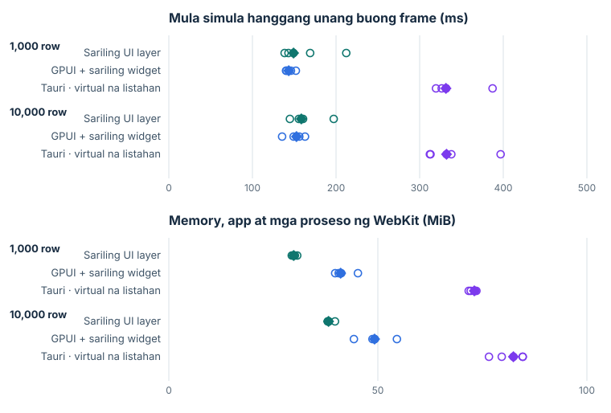

Sa [nakaraang post](/fil/blog/gpui-tauri-desktop-ui/), gumawa kami ng isang Containers screen gamit ang GPUI at ang Tauri. Kaunti lang ang sinasabi ng isang screen tungkol sa paglipat ng buong app. Ngayon, dalawang beses naming inilipat ang karamihan ng Podbag Desktop sa purong Rust, nang walang WebView:

- **Sariling UI layer**: maliit na framework na kami mismo ang gumawa. Ginagamit nito ang [winit](https://github.com/rust-windowing/winit) para sa window at input, ang [wgpu](https://wgpu.rs/) para sa pagguhit sa GPU at ang [glyphon](https://github.com/grovesNL/glyphon) para sa teksto.
- **GPUI + sariling widget**: ang [GPUI](https://github.com/zed-industries/zed/tree/main/crates/gpui) 0.2.2, ang framework ng Zed editor. Kami ang sumulat ng mga widget na wala rito, gaya ng text field.

Inihambing namin sila ayon sa apat na pangangailangan: purong Rust, macOS, Linux at Windows, performance, at ang gastos ng paglipat ng kasalukuyang mga feature.

## Ang inilipat namin

Pareho ang mga feature ng Podbag Desktop 0.3.2 sa dalawang port:

- Ang balangkas ng window: sidebar na may bilang, back at forward, VM card, status bar, toast at mga confirm dialog.
- Containers: search, start, stop, restart, remove, rename, detalye, live log at clean up.
- Images: search, remove, clean up, at ang pull panel na may Docker Hub search at live na progreso.
- Volumes at Networks: listahan, create, remove at clean up.
- Kubernetes: menu ng context, lahat ng namespace, mga tab at table ng resource.
- Settings: buksan pag-log in, pitong wikang agad nagpapalit, theme, engine, Docker CLI at resource ng VM.

Hindi inilipat ang Training, Migrate, mga update at registry login. Iisang kunwaring engine ang binabasa ng dalawang port. Ito ay Rust na bersyon ng kunwaring API na ginagamit ng mga preview page ng Podbag Desktop. May 2,685 linya ito at hindi kasama sa bilang sa ibaba. Ang mga file ng pitong wika ay galing mismo sa app.

Ginagamit ng dalawang app ang release profile ng Podbag Desktop at window na 1200 × 800. Gaya ng nakaraang post, pinapatakbo ng isang script ang bawat app, hinihintay ang unang buong frame, naghihintay ng 3 segundo, binabasa ang memory at sinusukat ang CPU sa loob ng 10 segundo. Pagkatapos, tina-type nito ang `web-0004` sa search box. Sa dalawang port, binubuksan din nito ang anim na view nang isa-isa at binabasa ulit ang memory. Muling sinukat ang Tauri na may virtual na listahan bilang batayan.

Apple M5 · 24 GB · macOS 27.2.1 · Rust 1.96.0 · winit 0.30.13 · wgpu 30.0.2 · glyphon 0.12.0 · gpui 0.2.2 (`runtime_shaders`) · Tauri 2.12.7 · limang warm run bawat kaso, median

## Mga resulta

| 1,000 row | Sariling UI layer | GPUI + sariling widget | Tauri · virtual na listahan |
|---|---:|---:|---:|
| Mula simula hanggang unang buong frame | {{n:149}} ms | {{n:143}} ms | {{n:331}} ms |
| Memory sa simula, app at mga proseso ng WebKit | {{n:29.9}} MiB | {{n:41.1}} MiB | {{n:73.1}} MiB |
| Memory matapos buksan ang anim na view | {{n:40.2}} MiB | {{n:40.8}} MiB | – |
| CPU habang idle | {{n:0}}% | {{n:0.9}}% | {{n:0.3}}% |
| Pagsala hanggang 2 row | {{n:2.5}} ms | {{n:12.3}} ms | {{n:19}} ms |
| Paglipat ng view | {{n:2.7}} ms | {{n:14.7}} ms | – |

| 10,000 row | Sariling UI layer | GPUI + sariling widget | Tauri · virtual na listahan |
|---|---:|---:|---:|
| Mula simula hanggang unang buong frame | {{n:158}} ms | {{n:153}} ms | {{n:332}} ms |
| Memory sa simula, app at mga proseso ng WebKit | {{n:38.2}} MiB | {{n:49.2}} MiB | {{n:82.4}} MiB |
| Memory matapos buksan ang anim na view | {{n:47.5}} MiB | {{n:48.1}} MiB | – |
| CPU habang idle | {{n:0}}% | {{n:0.9}}% | {{n:0.1}}% |
| Pagsala hanggang 2 row | {{n:7.3}} ms | {{n:14.3}} ms | {{n:15}} ms |
| Paglipat ng view | {{n:4.8}} ms | {{n:15.7}} ms | – |

Nagsimula ang dalawang port sa mga 150 ms, wala pang kalahati ng oras ng Tauri. Sa simula, ang sariling UI layer ang gumamit ng pinakakaunting memory. Nang bukas na ang anim na view, halos pareho ang memory ng dalawang port: 40 MiB sa 1,000 row at 48 MiB sa 10,000 row. Habang idle, hindi lumampas sa 0.2% CPU ang sariling UI layer sa bawat run. Ang GPUI ay 0.4–1.2%.

Basahin nang maingat ang oras ng pagsala at paglipat ng view. Itinatala ito ng GPUI at Tauri sa susunod na refresh ng screen. Itinatala ito ng sariling UI layer agad pagkatapos maipakita ang frame nito. Sa display na ito, hanggang isang frame ang pagitan, 8–17 ms. Kaya ipinapakita ng mga row na ito na naa-update ng tatlo ang screen sa loob ng susunod na frame. Hindi nito ipinapakita na ilang beses na mas mabilis ang isa.

## Code at build

| Buong port | Sariling UI layer | GPUI + sariling widget |
|---|---:|---:|
| Mga linya ng Rust | {{n:7525}} | {{n:8951}} |
| Framework o mga widget | {{n:3652}} | {{n:2260}} |
| Mga view at balangkas ng window | {{n:3873}} | {{n:6691}} |
| Mga crate sa dependency tree | {{n:140}} | {{n:454}} |
| Release binary | {{n:4.4}} MB | {{n:4.9}} MB |
| Malinis na release build | {{n:48}} s | {{n:103}} s |

May event loop ang sariling UI layer, pagguhit sa GPU, teksto na may fallback font para sa Chinese, Japanese at Korean, hit testing, text field na may IME input, at mga widget gaya ng button, menu, table, dialog at slider. Mula sa GPUI, nakuha namin agad ang layout na may style API na kahawig ng CSS, mga listahan, tooltip at fallback font. Wala itong text field, kaya ang amin ay 701 linya, inangkop mula sa input example ng GPUI. Mas mahaba ang mga view ng GPUI port. Bahagi nito ang mga feature na wala sa sariling port. Kasama sa dalawang bilang ang mga comment, blangkong linya at maliliit na test hook.

## Ang kulang

Sariling UI layer:

- Walang tooltip at walang paglipat sa pagitan ng mga control gamit ang Tab key.
- Hindi mapipili o makokopya ang teksto sa log, JSON at mga detalye.
- Pinuputol ang mahahabang linya ng log sa halip na i-wrap. Walang animation sa paglipat.
- Hindi inilipat ang pag-import ng image mula sa Docker.
- Mga 5% na mas makitid ang teksto kaysa sa mga native na app ng macOS. Hindi ginagamit ng aming teksto ang optical size axis ng system font.

GPUI + sariling widget:

- Minsan nawawala ang ellipsis sa pinutol na teksto.
- Walang text field, slider o drag handling ang GPUI, kaya kami ang sumulat ng mga ito.

## macOS, Linux at Windows

Sa macOS lamang namin pinatakbo ang dalawang port. Para sa Linux at Windows, pinatakbo namin ang `cargo check`, na nagko-compile nang walang linking.

| `cargo check --release` | Sariling UI layer | GPUI + sariling widget |
|---|---|---|
| Windows (`x86_64-pc-windows-gnu`, mula sa macOS) | Pumasa | Bumagsak. Kino-compile ng gpui ang mga HLSL shader nito gamit ang `fxc.exe`, na sa Windows lamang tumatakbo. Pumapasa ang debug check. |
| Linux (VM) | Pumasa | Bumagsak. Ginagamit ng `xattr` 0.2.3, isang dependency ng gpui 0.2.2, ang `libc::ENOATTR`, na wala na sa kasalukuyang `libc`. Pumapasa kapag na-patch ang `xattr`. |

Walang naka-install na font sa Linux VM, kaya hindi namin nasuri roon ang teksto.

## Pagwawasto sa nakaraang post

May layout bug ang GPUI prototype sa nakaraang post: hindi sinusunod ng mga row ng table ang lapad ng mga column. Naayos na ito ngayon. Ginagamit nang normal ang Mac sa dalawang araw, kaya hindi maihahambing ang mga numero mula sa magkaibang araw. Mga run mula sa iisang session lamang ang inihahambing ng post na ito. Tumakbo rin sa parehong session ang mga prototype na may iisang screen, at nasa file ng datos ng bawat run sa ibaba ang kanilang datos.

## Ano ang ibig sabihin nito para sa Podbag Desktop

- **Purong Rust**: purong Rust ang dalawang port at walang WebView.
- **macOS, Linux at Windows**: nagko-compile ang sariling UI layer para sa tatlo. Sa aming setup, kailangan ng GPUI ng Windows na makina para mag-build para sa Windows, at ng patch sa isang dependency para sa Linux. Wala pang port na tumakbo sa Linux o Windows.
- **Performance**: nagsisimula ang dalawang port sa wala pang kalahati ng oras ng Tauri at mas kaunti ang memory. Ang sariling UI layer ang gumamit ng pinakakaunting memory sa simula at pinakakaunting CPU habang idle.
- **Gastos ng paglipat**: pareho ang mga view ng dalawang port. Mas kaunting linya ang kinailangan ng sariling UI layer, ikatlo ng mga crate at kalahati ng oras ng build. Wala itong tooltip, pagpili ng teksto at paglipat ng focus gamit ang keyboard, at kami ang magme-maintain ng code nito para sa teksto, input at pagguhit. Mas marami ang handa sa GPUI, pero bago pa sa 1.0 ang API nito at wala itong text field.

Bago kami pumili, kailangang patakbuhin ang dalawang port sa Linux at Windows.

## Mga limitasyon

Dalawang port ito sa iisang Mac na may kunwaring engine, hindi dalawang tapos na app. Sinusukat sa loob ng bawat app ang oras ng pagsala at paglipat ng view. Sinusukat mula sa labas ang oras hanggang sa unang frame at kasama na ang lahat. Sinuri namin ang mga port gamit ang screenshot at input mula sa script, hindi sa araw-araw na paggamit. Hindi namin sinukat ang kinis ng pag-scroll o mahahabang session.

## Ulitin ang sukat

[Benchmark script](run.py) · [Summary script](summary.py) · [Datos ng bawat run](results.json) · [Mga bersyon at command](reproduce.txt) · [Source ng dalawang port](prototypes.tar.gz)

[winit](https://github.com/rust-windowing/winit) · [wgpu](https://wgpu.rs/) · [glyphon](https://github.com/grovesNL/glyphon) · [GPUI](https://github.com/zed-industries/zed/tree/main/crates/gpui)
