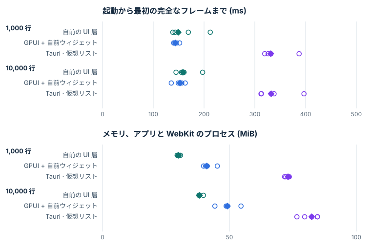

[前回の記事](/ja/blog/gpui-tauri-desktop-ui/)では、コンテナ画面を 1 つだけ GPUI と Tauri で作りました。画面 1 つでは、アプリ全体の移植についてはあまりわかりません。今回は Podbag Desktop の大部分を、WebView を使わずに純粋な Rust で 2 回移植しました。

- **自前の UI 層**: 小さなフレームワークを自分たちで作りました。ウィンドウと入力は [winit](https://github.com/rust-windowing/winit)、GPU 描画は [wgpu](https://wgpu.rs/)、文字は [glyphon](https://github.com/grovesNL/glyphon) を使います。
- **GPUI + 自前ウィジェット**: Zed エディターのフレームワーク [GPUI](https://github.com/zed-industries/zed/tree/main/crates/gpui) 0.2.2 を使います。テキスト入力欄のように GPUI にないウィジェットは自分たちで作りました。

比べる基準は 4 つです。純粋な Rust であること、macOS・Linux・Windows への対応、性能、そして今の機能を移植するコストです。

## 移植した機能

どちらの移植も、Podbag Desktop 0.3.2 の同じ機能を含みます。

- ウィンドウの基本部分: 件数付きのサイドバー、戻ると進む、VM カード、ステータスバー、通知、確認ダイアログ。
- Containers: 検索、開始、停止、再起動、削除、名前の変更、詳細、リアルタイムのログ、クリーンアップ。
- Images: 検索、削除、クリーンアップ、そして Docker Hub 検索とリアルタイムの進捗がある取得パネル。
- Volumes と Networks: 一覧、作成、削除、クリーンアップ。
- Kubernetes: コンテキストのメニュー、すべての名前空間、リソースのタブと表。
- Settings: ログイン時に起動、すぐに切り替わる 7 言語、テーマ、エンジン、Docker CLI、VM のリソース。

Training、Migrate、アップデート、レジストリへのログインは移植していません。どちらの移植も、同じ模擬エンジンを読みます。これは Podbag Desktop のプレビューページが使う模擬 API を Rust に移したものです。2,685 行あり、下の行数には含めていません。7 言語のファイルはアプリのものをそのまま使いました。

どちらのアプリも Podbag Desktop の release プロファイルと 1200 × 800 のウィンドウを使います。前回と同じく、スクリプトがアプリを起動し、最初の完全なフレームを待ち、3 秒後にメモリを読み、10 秒間 CPU を測ります。そのあと検索ボックスに `web-0004` を入力します。2 つの移植では、6 つの画面を順に開いてから、もう一度メモリを読みます。基準として、仮想リストを使う Tauri も測り直しました。

Apple M5 · 24 GB · macOS 27.2.1 · Rust 1.96.0 · winit 0.30.13 · wgpu 30.0.2 · glyphon 0.12.0 · gpui 0.2.2 (`runtime_shaders`) · Tauri 2.12.7 · 各ケースでウォーム実行 5 回、中央値

## 結果

| 1,000 行 | 自前の UI 層 | GPUI + 自前ウィジェット | Tauri · 仮想リスト |
|---|---:|---:|---:|
| 起動から最初の完全なフレームまで | {{n:149}} ms | {{n:143}} ms | {{n:331}} ms |
| 起動時のメモリ、アプリと WebKit のプロセス | {{n:29.9}} MiB | {{n:41.1}} MiB | {{n:73.1}} MiB |
| 6 つの画面をすべて開いた後のメモリ | {{n:40.2}} MiB | {{n:40.8}} MiB | – |
| 待機中の CPU | {{n:0}}% | {{n:0.9}}% | {{n:0.3}}% |
| 2 行に絞り込む | {{n:2.5}} ms | {{n:12.3}} ms | {{n:19}} ms |
| 画面の切り替え | {{n:2.7}} ms | {{n:14.7}} ms | – |

| 10,000 行 | 自前の UI 層 | GPUI + 自前ウィジェット | Tauri · 仮想リスト |
|---|---:|---:|---:|
| 起動から最初の完全なフレームまで | {{n:158}} ms | {{n:153}} ms | {{n:332}} ms |
| 起動時のメモリ、アプリと WebKit のプロセス | {{n:38.2}} MiB | {{n:49.2}} MiB | {{n:82.4}} MiB |
| 6 つの画面をすべて開いた後のメモリ | {{n:47.5}} MiB | {{n:48.1}} MiB | – |
| 待機中の CPU | {{n:0}}% | {{n:0.9}}% | {{n:0.1}}% |
| 2 行に絞り込む | {{n:7.3}} ms | {{n:14.3}} ms | {{n:15}} ms |
| 画面の切り替え | {{n:4.8}} ms | {{n:15.7}} ms | – |

どちらの移植も約 150 ms で起動しました。Tauri の半分以下の時間です。起動時のメモリは自前の UI 層がいちばん少なくなりました。6 つの画面をすべて開いた後は、2 つの移植のメモリはほぼ同じでした。1,000 行で 40 MiB、10,000 行で 48 MiB です。待機中の CPU は、自前の UI 層がすべての実行で 0.2% 以下でした。GPUI は 0.4〜1.2% でした。

絞り込みと画面の切り替えの時間は、注意して読んでください。GPUI と Tauri は、次の画面更新のときに時間を記録します。自前の UI 層は、フレームを出した直後に記録します。このディスプレイでは、その差は最大 1 フレーム、8〜17 ms です。つまりこの行は、3 つとも次のフレームまでに画面を更新できることを示しています。どれかが何倍も速いという意味ではありません。

## コードとビルド

| 全面移植 | 自前の UI 層 | GPUI + 自前ウィジェット |
|---|---:|---:|
| Rust のコード行数 | {{n:7525}} | {{n:8951}} |
| フレームワークまたはウィジェット | {{n:3652}} | {{n:2260}} |
| 画面とウィンドウの基本部分 | {{n:3873}} | {{n:6691}} |
| 依存ツリーの crate 数 | {{n:140}} | {{n:454}} |
| release の実行ファイル | {{n:4.4}} MB | {{n:4.9}} MB |
| クリーンな release ビルド | {{n:48}} 秒 | {{n:103}} 秒 |

自前の UI 層には、イベントループ、GPU 描画、中国語・日本語・韓国語の代替フォントを使う文字処理、クリック位置の判定、IME 入力に対応したテキスト入力欄、そしてボタン、メニュー、表、ダイアログ、スライダーなどのウィジェットがあります。GPUI からは、CSS に似たスタイル API のレイアウト、リスト、ツールチップ、代替フォントをそのまま得られました。テキスト入力欄はないので、GPUI の入力の例を直して 701 行で作りました。GPUI の移植のほうが画面のコードが長くなりました。その一部は、自前の移植にない機能です。どちらの行数にも、コメント、空行、小さなテスト用コードが含まれます。

## 足りない機能

自前の UI 層:

- ツールチップがなく、Tab キーでコントロール間を移動できません。
- ログ、JSON、詳細の文字を選択したりコピーしたりできません。
- 長いログの行は折り返さずに切れます。切り替えのアニメーションはありません。
- Docker イメージの取り込みは移植していません。
- 文字が macOS 標準のアプリより約 5% 狭く見えます。文字処理がシステムフォントの optical size 軸を使っていないためです。

GPUI + 自前ウィジェット:

- 切れた文字の末尾に、省略記号が出ないことがあります。
- GPUI にはテキスト入力欄、スライダー、ドラッグ処理がないので、自分たちで作りました。

## macOS、Linux、Windows

どちらの移植も macOS でだけ実行しました。Linux と Windows は `cargo check` で確かめました。これはリンクせずにコンパイルだけを行います。

| `cargo check --release` | 自前の UI 層 | GPUI + 自前ウィジェット |
|---|---|---|
| Windows (`x86_64-pc-windows-gnu`、macOS から) | 成功 | 失敗。gpui は HLSL シェーダーを `fxc.exe` でコンパイルしますが、このツールは Windows でしか動きません。debug での確認は成功します。 |
| Linux (VM) | 成功 | 失敗。gpui 0.2.2 の依存にある `xattr` 0.2.3 が `libc::ENOATTR` を使いますが、今の `libc` にはこの値がありません。`xattr` を直すと成功します。 |

Linux の VM にはフォントが 1 つも入っていなかったので、文字の表示は確かめられませんでした。

## 前回の記事の訂正

前回の記事の GPUI プロトタイプには、レイアウトのバグがありました。表の行が列の幅に従っていませんでした。今回は直してあります。どちらの日も、この Mac は普段どおりに使われていました。そのため、違う日の数値どうしは比べられません。この記事は 1 回の測定セッションの中だけで比べています。画面 1 つのプロトタイプも同じセッションで測り、そのデータは下の実行ごとのデータにあります。

## Podbag Desktop にとっての意味

- **純粋な Rust**: どちらの移植も純粋な Rust で、WebView を使いません。
- **macOS、Linux、Windows**: 自前の UI 層は 3 つすべてでコンパイルできます。私たちの環境では、GPUI は Windows 向けのビルドに Windows のマシンが必要で、Linux では依存を 1 つ直す必要がありました。どちらの移植も、まだ Linux と Windows で実行していません。
- **性能**: どちらの移植も Tauri の半分以下の時間で起動し、メモリも少なく使います。起動時のメモリと待機中の CPU は、自前の UI 層がいちばん少なくなりました。
- **移植のコスト**: どちらの移植も同じ画面を含みます。自前の UI 層は行数が少なく、crate は 3 分の 1、ビルド時間は半分でした。ただしツールチップ、文字の選択、キーボードでのフォーカス移動がなく、文字、入力、描画のコードを自分たちで保守する必要があります。GPUI は最初から使えるものが多い一方で、API はまだ 1.0 より前で、テキスト入力欄がありません。

どちらかを選ぶ前に、両方の移植を Linux と Windows で実行する必要があります。

## 制約

1 台の Mac で模擬エンジンを使って測った 2 つの移植で、完成した 2 つのアプリではありません。絞り込みと画面の切り替えの時間は、各アプリの中で測っています。最初のフレームまでの時間は外から測り、すべての処理を含みます。移植はスクリーンショットとスクリプトによる入力で確かめ、日々の利用では確かめていません。スクロールのなめらかさや長時間の利用は測っていません。

## 測定を再現する

[測定スクリプト](run.py) · [集計スクリプト](summary.py) · [実行ごとのデータ](results.json) · [バージョンとコマンド](reproduce.txt) · [2 つの移植のソース](prototypes.tar.gz)

[winit](https://github.com/rust-windowing/winit) · [wgpu](https://wgpu.rs/) · [glyphon](https://github.com/grovesNL/glyphon) · [GPUI](https://github.com/zed-industries/zed/tree/main/crates/gpui)
