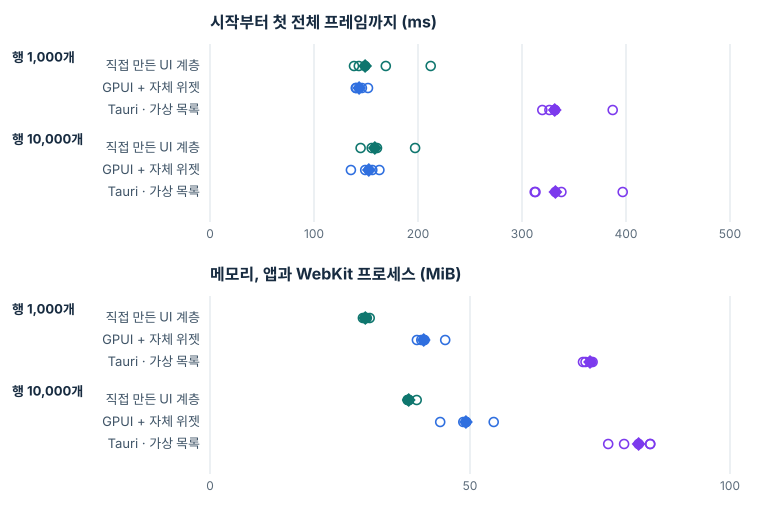

[지난 글](/ko/blog/gpui-tauri-desktop-ui/)에서는 Containers 화면 하나를 GPUI와 Tauri로 만들었습니다. 화면 하나로는 앱 전체를 옮기는 일을 알기 어렵습니다. 이번에는 Podbag Desktop의 대부분을 WebView 없이 순수 Rust로 두 번 옮겼습니다.

- **직접 만든 UI 계층**: 작은 프레임워크를 직접 만들었습니다. 창과 입력은 [winit](https://github.com/rust-windowing/winit), GPU 그리기는 [wgpu](https://wgpu.rs/), 글자는 [glyphon](https://github.com/grovesNL/glyphon)을 씁니다.
- **GPUI + 자체 위젯**: Zed 편집기의 프레임워크인 [GPUI](https://github.com/zed-industries/zed/tree/main/crates/gpui) 0.2.2를 씁니다. 입력창처럼 GPUI에 없는 위젯은 직접 만들었습니다.

비교 기준은 네 가지입니다. 순수 Rust, macOS·Linux·Windows 지원, 성능, 그리고 지금 기능을 옮기는 비용입니다.

## 옮긴 기능

두 포팅 모두 Podbag Desktop 0.3.2의 같은 기능을 담았습니다.

- 창의 기본 틀: 개수를 보여 주는 사이드바, 뒤로와 앞으로, VM 카드, 상태 바, 알림, 확인 대화상자.
- Containers: 검색, 시작, 중지, 재시작, 삭제, 이름 바꾸기, 상세 정보, 실시간 로그, 정리.
- Images: 검색, 삭제, 정리, 그리고 Docker Hub 검색과 실시간 진행률이 있는 내려받기 패널.
- Volumes와 Networks: 목록, 만들기, 삭제, 정리.
- Kubernetes: 컨텍스트 메뉴, 모든 네임스페이스, 리소스 탭과 표.
- Settings: 로그인할 때 실행, 바로 바뀌는 7개 언어, 테마, 엔진, Docker CLI, VM 자원.

Training, Migrate, 업데이트, 레지스트리 로그인은 옮기지 않았습니다. 두 포팅은 같은 가짜 엔진을 읽습니다. Podbag Desktop의 미리보기 페이지가 쓰는 가짜 API를 Rust로 옮긴 것입니다. 이 코드는 2,685줄이며 아래 줄 수에는 넣지 않았습니다. 7개 언어 파일은 앱의 파일을 그대로 썼습니다.

두 앱 모두 Podbag Desktop의 release 프로필과 1200 × 800 창을 씁니다. 지난 글과 같이 스크립트가 앱을 실행하고, 첫 전체 프레임을 기다리고, 3초 뒤에 메모리를 읽고, 10초 동안 CPU를 잽니다. 그다음 검색창에 `web-0004`를 입력합니다. 두 포팅에서는 화면 6개를 차례로 열고 메모리를 다시 읽습니다. 기준으로 가상 목록을 쓴 Tauri도 다시 쟀습니다.

Apple M5 · 24 GB · macOS 27.2.1 · Rust 1.96.0 · winit 0.30.13 · wgpu 30.0.2 · glyphon 0.12.0 · gpui 0.2.2 (`runtime_shaders`) · Tauri 2.12.7 · 경우마다 웜 실행 5회, 중앙값

## 결과

| 행 1,000개 | 직접 만든 UI 계층 | GPUI + 자체 위젯 | Tauri · 가상 목록 |
|---|---:|---:|---:|
| 시작부터 첫 전체 프레임까지 | {{n:149}} ms | {{n:143}} ms | {{n:331}} ms |
| 시작 때 메모리, 앱과 WebKit 프로세스 | {{n:29.9}} MiB | {{n:41.1}} MiB | {{n:73.1}} MiB |
| 화면 6개를 모두 연 뒤 메모리 | {{n:40.2}} MiB | {{n:40.8}} MiB | – |
| 대기 중 CPU | {{n:0}}% | {{n:0.9}}% | {{n:0.3}}% |
| 2행으로 필터 | {{n:2.5}} ms | {{n:12.3}} ms | {{n:19}} ms |
| 화면 전환 | {{n:2.7}} ms | {{n:14.7}} ms | – |

| 행 10,000개 | 직접 만든 UI 계층 | GPUI + 자체 위젯 | Tauri · 가상 목록 |
|---|---:|---:|---:|
| 시작부터 첫 전체 프레임까지 | {{n:158}} ms | {{n:153}} ms | {{n:332}} ms |
| 시작 때 메모리, 앱과 WebKit 프로세스 | {{n:38.2}} MiB | {{n:49.2}} MiB | {{n:82.4}} MiB |
| 화면 6개를 모두 연 뒤 메모리 | {{n:47.5}} MiB | {{n:48.1}} MiB | – |
| 대기 중 CPU | {{n:0}}% | {{n:0.9}}% | {{n:0.1}}% |
| 2행으로 필터 | {{n:7.3}} ms | {{n:14.3}} ms | {{n:15}} ms |
| 화면 전환 | {{n:4.8}} ms | {{n:15.7}} ms | – |

두 포팅 모두 약 150 ms에 시작했습니다. Tauri의 절반도 걸리지 않았습니다. 시작 때 메모리는 직접 만든 UI 계층이 가장 적었습니다. 화면 6개를 모두 연 뒤에는 두 포팅의 메모리가 거의 같았습니다. 행 1,000개에서 40 MiB, 행 10,000개에서 48 MiB였습니다. 대기 중 CPU는 직접 만든 UI 계층이 모든 실행에서 0.2% 이하였습니다. GPUI는 0.4–1.2%였습니다.

필터와 화면 전환 시간은 주의해서 읽어야 합니다. GPUI와 Tauri는 다음 화면 갱신 때 시간을 기록합니다. 직접 만든 UI 계층은 프레임을 내보낸 즉시 기록합니다. 이 디스플레이에서는 그 차이가 최대 한 프레임, 8–17 ms입니다. 그래서 이 행은 세 방식 모두 다음 프레임 안에 화면을 바꾼다는 뜻입니다. 어느 한쪽이 몇 배 빠르다는 뜻은 아닙니다.

## 코드와 빌드

| 전체 포팅 | 직접 만든 UI 계층 | GPUI + 자체 위젯 |
|---|---:|---:|
| Rust 코드 줄 수 | {{n:7525}} | {{n:8951}} |
| 프레임워크 또는 위젯 | {{n:3652}} | {{n:2260}} |
| 화면과 창의 기본 틀 | {{n:3873}} | {{n:6691}} |
| 의존성 트리의 crate 수 | {{n:140}} | {{n:454}} |
| release 실행 파일 | {{n:4.4}} MB | {{n:4.9}} MB |
| 깨끗한 release 빌드 | {{n:48}}초 | {{n:103}}초 |

직접 만든 UI 계층에는 이벤트 루프, GPU 그리기, 중국어·일본어·한국어 대체 글꼴을 쓰는 글자 처리, 클릭 위치 판정, IME 입력을 받는 입력창, 그리고 버튼, 메뉴, 표, 대화상자, 슬라이더 같은 위젯이 들어 있습니다. GPUI에서는 CSS와 비슷한 스타일 API의 레이아웃, 목록, 툴팁, 대체 글꼴을 그대로 얻었습니다. 입력창은 없어서 GPUI의 입력 예제를 고쳐 701줄로 만들었습니다. GPUI 포팅의 화면 코드가 더 깁니다. 그 일부는 직접 만든 쪽에 없는 기능입니다. 두 줄 수 모두 주석, 빈 줄, 작은 테스트용 코드를 포함합니다.

## 빠진 기능

직접 만든 UI 계층:

- 툴팁이 없고, Tab 키로 컨트롤 사이를 옮겨 다닐 수 없습니다.
- 로그, JSON, 상세 정보의 글자를 선택하거나 복사할 수 없습니다.
- 긴 로그 줄은 줄바꿈 없이 잘립니다. 전환 애니메이션이 없습니다.
- Docker 이미지 가져오기는 옮기지 않았습니다.
- 글자가 macOS 기본 앱보다 약 5% 좁습니다. 우리 글자 처리가 시스템 글꼴의 optical size 축을 쓰지 않기 때문입니다.

GPUI + 자체 위젯:

- 잘린 글자 끝에 말줄임표가 가끔 나오지 않습니다.
- GPUI에는 입력창, 슬라이더, 드래그 처리가 없어서 직접 만들었습니다.

## macOS, Linux, Windows

두 포팅 모두 macOS에서만 실행했습니다. Linux와 Windows는 `cargo check`로 확인했습니다. 이 명령은 링크 없이 컴파일만 합니다.

| `cargo check --release` | 직접 만든 UI 계층 | GPUI + 자체 위젯 |
|---|---|---|
| Windows (`x86_64-pc-windows-gnu`, macOS에서) | 통과 | 실패. gpui는 HLSL 셰이더를 `fxc.exe`로 컴파일하는데, 이 도구는 Windows에서만 돕니다. debug 검사는 통과합니다. |
| Linux (VM) | 통과 | 실패. gpui 0.2.2의 의존성인 `xattr` 0.2.3이 `libc::ENOATTR`를 쓰는데, 지금 `libc`에는 이 값이 없습니다. `xattr`를 고치면 통과합니다. |

Linux VM에는 글꼴이 하나도 없어서 글자 표시는 확인하지 못했습니다.

## 지난 글 바로잡기

지난 글의 GPUI 시제품에는 레이아웃 버그가 있었습니다. 표의 행이 열 너비를 따르지 않았습니다. 이번에 고쳤습니다. 두 날 모두 이 Mac을 평소처럼 쓰는 중이었습니다. 그래서 다른 날의 숫자끼리는 비교할 수 없습니다. 이 글은 한 번의 측정 세션 안에서만 비교합니다. 화면 하나짜리 시제품도 같은 세션에서 쟀고, 그 데이터는 아래 실행별 데이터 파일에 있습니다.

## Podbag Desktop에 주는 의미

- **순수 Rust**: 두 포팅 모두 순수 Rust이고 WebView를 쓰지 않습니다.
- **macOS, Linux, Windows**: 직접 만든 UI 계층은 세 운영체제 모두에서 컴파일됩니다. 우리 환경에서 GPUI는 Windows용 빌드에 Windows 컴퓨터가 필요하고, Linux에서는 의존성 하나를 고쳐야 했습니다. 두 포팅 모두 아직 Linux와 Windows에서 실행하지 않았습니다.
- **성능**: 두 포팅 모두 Tauri의 절반도 안 되는 시간에 시작하고 메모리도 덜 씁니다. 직접 만든 UI 계층이 시작 때 메모리와 대기 중 CPU를 가장 적게 썼습니다.
- **옮기는 비용**: 두 포팅 모두 같은 화면을 담았습니다. 직접 만든 UI 계층은 줄 수가 더 적고, crate는 3분의 1, 빌드 시간은 절반이었습니다. 하지만 툴팁, 글자 선택, 키보드 포커스 이동이 없고, 글자, 입력, 그리기 코드를 우리가 직접 유지해야 합니다. GPUI는 기본으로 주는 것이 더 많지만, API가 아직 1.0 전이고 입력창이 없습니다.

어느 쪽을 고르기 전에 두 포팅 모두 Linux와 Windows에서 실행해 봐야 합니다.

## 한계

Mac 한 대에서 가짜 엔진으로 잰 두 포팅입니다. 완성된 앱 두 개가 아닙니다. 필터와 화면 전환 시간은 각 앱 안에서 잽니다. 첫 프레임까지의 시간은 바깥에서 재며 모든 과정을 포함합니다. 포팅은 스크린샷과 스크립트 입력으로 확인했고, 매일 쓰면서 확인하지는 않았습니다. 스크롤의 부드러움과 오래 쓰는 경우는 재지 않았습니다.

## 측정 다시 하기

[측정 스크립트](run.py) · [요약 스크립트](summary.py) · [실행별 데이터](results.json) · [버전과 명령](reproduce.txt) · [두 포팅의 소스](prototypes.tar.gz)

[winit](https://github.com/rust-windowing/winit) · [wgpu](https://wgpu.rs/) · [glyphon](https://github.com/grovesNL/glyphon) · [GPUI](https://github.com/zed-industries/zed/tree/main/crates/gpui)
