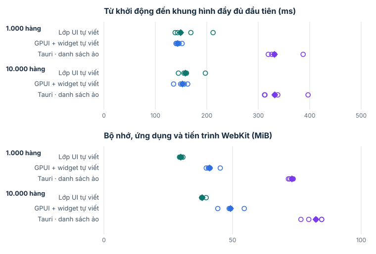

Trong [bài trước](/vi/blog/gpui-tauri-desktop-ui/), chúng tôi dựng một màn hình Containers bằng GPUI và bằng Tauri. Một màn hình chưa nói được nhiều về việc chuyển cả ứng dụng. Lần này chúng tôi chuyển phần lớn Podbag Desktop hai lần, bằng Rust thuần và không dùng WebView:

- **Lớp UI tự viết**: một framework nhỏ do chúng tôi tự viết, dùng [winit](https://github.com/rust-windowing/winit) cho cửa sổ và đầu vào, [wgpu](https://wgpu.rs/) để vẽ bằng GPU và [glyphon](https://github.com/grovesNL/glyphon) cho chữ.
- **GPUI + widget tự viết**: [GPUI](https://github.com/zed-industries/zed/tree/main/crates/gpui) 0.2.2, framework của trình soạn thảo Zed. Chúng tôi tự viết các widget mà nó không có, như ô nhập văn bản.

Chúng tôi so sánh theo bốn yêu cầu: Rust thuần, chạy trên macOS, Linux và Windows, hiệu năng, và chi phí chuyển các tính năng hiện có.

## Những gì chúng tôi chuyển

Cả hai bản chuyển có cùng các tính năng của Podbag Desktop 0.3.2:

- Khung cửa sổ: thanh bên có số lượng, lùi và tiến, thẻ VM, thanh trạng thái, thông báo và hộp thoại xác nhận.
- Containers: tìm kiếm, khởi động, dừng, khởi động lại, xóa, đổi tên, chi tiết, log trực tiếp và dọn dẹp.
- Images: tìm kiếm, xóa, dọn dẹp, và bảng kéo image có tìm kiếm Docker Hub và tiến độ trực tiếp.
- Volumes và Networks: danh sách, tạo, xóa và dọn dẹp.
- Kubernetes: menu context, mọi namespace, các tab và bảng tài nguyên.
- Settings: mở khi đăng nhập, bảy ngôn ngữ đổi ngay, giao diện sáng tối, engine, Docker CLI và tài nguyên VM.

Training, Migrate, cập nhật và đăng nhập registry không được chuyển. Hai bản chuyển đọc cùng một engine giả lập. Đó là bản Rust của API giả lập mà các trang xem trước của Podbag Desktop dùng. Phần này có 2.685 dòng và không được tính ở dưới. Các tệp của bảy ngôn ngữ là tệp của chính ứng dụng.

Cả hai ứng dụng dùng cấu hình release của Podbag Desktop và cửa sổ 1200 × 800. Như bài trước, một script khởi động mỗi ứng dụng, chờ khung hình đầy đủ đầu tiên, chờ 3 giây, đọc bộ nhớ và đo CPU trong 10 giây. Sau đó nó gõ `web-0004` vào ô tìm kiếm. Với hai bản chuyển, script còn mở lần lượt sáu màn hình rồi đọc lại bộ nhớ. Tauri với danh sách ảo được đo lại để làm mốc.

Apple M5 · 24 GB · macOS 27.2.1 · Rust 1.96.0 · winit 0.30.13 · wgpu 30.0.2 · glyphon 0.12.0 · gpui 0.2.2 (`runtime_shaders`) · Tauri 2.12.7 · năm lần chạy nóng cho mỗi trường hợp, lấy trung vị

## Kết quả

| 1.000 hàng | Lớp UI tự viết | GPUI + widget tự viết | Tauri · danh sách ảo |
|---|---:|---:|---:|
| Từ khởi động đến khung hình đầy đủ đầu tiên | {{n:149}} ms | {{n:143}} ms | {{n:331}} ms |
| Bộ nhớ lúc khởi động, ứng dụng và tiến trình WebKit | {{n:29.9}} MiB | {{n:41.1}} MiB | {{n:73.1}} MiB |
| Bộ nhớ sau khi mở cả sáu màn hình | {{n:40.2}} MiB | {{n:40.8}} MiB | – |
| CPU khi rảnh | {{n:0}}% | {{n:0.9}}% | {{n:0.3}}% |
| Lọc còn 2 hàng | {{n:2.5}} ms | {{n:12.3}} ms | {{n:19}} ms |
| Chuyển màn hình | {{n:2.7}} ms | {{n:14.7}} ms | – |

| 10.000 hàng | Lớp UI tự viết | GPUI + widget tự viết | Tauri · danh sách ảo |
|---|---:|---:|---:|
| Từ khởi động đến khung hình đầy đủ đầu tiên | {{n:158}} ms | {{n:153}} ms | {{n:332}} ms |
| Bộ nhớ lúc khởi động, ứng dụng và tiến trình WebKit | {{n:38.2}} MiB | {{n:49.2}} MiB | {{n:82.4}} MiB |
| Bộ nhớ sau khi mở cả sáu màn hình | {{n:47.5}} MiB | {{n:48.1}} MiB | – |
| CPU khi rảnh | {{n:0}}% | {{n:0.9}}% | {{n:0.1}}% |
| Lọc còn 2 hàng | {{n:7.3}} ms | {{n:14.3}} ms | {{n:15}} ms |
| Chuyển màn hình | {{n:4.8}} ms | {{n:15.7}} ms | – |

Cả hai bản chuyển khởi động trong khoảng 150 ms, chưa bằng một nửa thời gian của Tauri. Lúc khởi động, lớp UI tự viết dùng ít bộ nhớ nhất. Khi đã mở cả sáu màn hình, hai bản chuyển dùng bộ nhớ gần như bằng nhau: 40 MiB với 1.000 hàng và 48 MiB với 10.000 hàng. Khi rảnh, lớp UI tự viết dùng không quá 0,2% CPU trong mọi lần chạy. GPUI dùng 0,4–1,2%.

Hãy đọc thời gian lọc và chuyển màn hình một cách thận trọng. GPUI và Tauri ghi thời gian ở lần làm mới màn hình kế tiếp. Lớp UI tự viết ghi ngay khi khung hình được đưa ra. Trên màn hình này, chênh lệch đó tối đa là một khung hình, 8–17 ms. Vì vậy các hàng này cho thấy cả ba đều cập nhật màn hình trong khung hình kế tiếp. Chúng không cho thấy một bên nhanh hơn nhiều lần.

## Mã và bản dựng

| Bản chuyển đầy đủ | Lớp UI tự viết | GPUI + widget tự viết |
|---|---:|---:|
| Số dòng Rust | {{n:7525}} | {{n:8951}} |
| Framework hoặc widget | {{n:3652}} | {{n:2260}} |
| Màn hình và khung cửa sổ | {{n:3873}} | {{n:6691}} |
| Số crate trong cây phụ thuộc | {{n:140}} | {{n:454}} |
| Tệp thực thi release | {{n:4.4}} MB | {{n:4.9}} MB |
| Dựng release từ đầu | {{n:48}} giây | {{n:103}} giây |

Lớp UI tự viết có vòng lặp sự kiện, vẽ bằng GPU, xử lý chữ với phông dự phòng cho tiếng Trung, tiếng Nhật và tiếng Hàn, xác định vị trí nhấp chuột, ô nhập văn bản hỗ trợ IME, và các widget như nút, menu, bảng, hộp thoại và thanh trượt. Từ GPUI, chúng tôi có sẵn bố cục với API kiểu dáng giống CSS, danh sách, tooltip và phông dự phòng. GPUI không có ô nhập văn bản, nên ô của chúng tôi dài 701 dòng, chỉnh từ ví dụ nhập liệu của GPUI. Mã màn hình của bản GPUI dài hơn. Một phần trong đó là các tính năng mà bản tự viết không có. Cả hai số đều gồm chú thích, dòng trống và một ít mã kiểm thử.

## Còn thiếu gì

Lớp UI tự viết:

- Không có tooltip và không di chuyển giữa các điều khiển bằng phím Tab.
- Không thể chọn hay sao chép chữ trong log, JSON và phần chi tiết.
- Dòng log dài bị cắt thay vì xuống dòng. Không có hiệu ứng chuyển tiếp.
- Chưa chuyển tính năng nhập image từ Docker.
- Chữ hẹp hơn khoảng 5% so với ứng dụng gốc của macOS. Phần xử lý chữ của chúng tôi không dùng trục optical size của phông hệ thống.

GPUI + widget tự viết:

- Chữ bị cắt đôi khi mất dấu ba chấm.
- GPUI không có ô nhập văn bản, thanh trượt hay xử lý kéo, nên chúng tôi tự viết.

## macOS, Linux và Windows

Chúng tôi chỉ chạy hai bản chuyển trên macOS. Với Linux và Windows, chúng tôi chạy `cargo check`, lệnh này biên dịch mà không liên kết.

| `cargo check --release` | Lớp UI tự viết | GPUI + widget tự viết |
|---|---|---|
| Windows (`x86_64-pc-windows-gnu`, từ macOS) | Đạt | Không đạt. gpui biên dịch shader HLSL bằng `fxc.exe`, công cụ này chỉ chạy trên Windows. Bản kiểm tra debug thì đạt. |
| Linux (VM) | Đạt | Không đạt. `xattr` 0.2.3, một phụ thuộc của gpui 0.2.2, dùng `libc::ENOATTR`, mà `libc` hiện tại không còn. Đạt khi vá `xattr`. |

VM Linux không cài phông chữ nào, nên chúng tôi không kiểm tra được phần hiển thị chữ ở đó.

## Đính chính bài trước

Bản mẫu GPUI trong bài trước có lỗi bố cục: các hàng của bảng không theo độ rộng cột. Lần này lỗi đã được sửa. Cả hai ngày, máy Mac vẫn được dùng như bình thường, nên không thể so sánh số liệu của các ngày khác nhau. Bài này chỉ so sánh các lần chạy trong cùng một phiên. Các bản mẫu một màn hình cũng chạy trong phiên đó, và dữ liệu của chúng nằm trong tệp dữ liệu từng lần chạy bên dưới.

## Ý nghĩa với Podbag Desktop

- **Rust thuần**: cả hai bản chuyển đều là Rust thuần và không dùng WebView.
- **macOS, Linux và Windows**: lớp UI tự viết biên dịch được cho cả ba. Trong môi trường của chúng tôi, GPUI cần một máy Windows để dựng bản cho Windows và cần vá một phụ thuộc cho Linux. Chưa bản chuyển nào chạy trên Linux hay Windows.
- **Hiệu năng**: cả hai bản chuyển khởi động trong chưa đến một nửa thời gian của Tauri và dùng ít bộ nhớ hơn. Lớp UI tự viết dùng ít bộ nhớ nhất lúc khởi động và ít CPU nhất khi rảnh.
- **Chi phí chuyển**: hai bản chuyển có cùng các màn hình. Lớp UI tự viết cần ít dòng hơn, một phần ba số crate và một nửa thời gian dựng. Nó thiếu tooltip, chọn chữ và di chuyển tiêu điểm bằng bàn phím, và chúng tôi phải tự duy trì mã chữ, nhập liệu và vẽ. GPUI có sẵn nhiều thứ hơn, nhưng API vẫn ở trước bản 1.0 và không có ô nhập văn bản.

Trước khi chọn, cả hai bản chuyển cần chạy trên Linux và Windows.

## Giới hạn

Đây là hai bản chuyển trên một máy Mac với engine giả lập, không phải hai ứng dụng hoàn chỉnh. Thời gian lọc và chuyển màn hình được đo bên trong mỗi ứng dụng. Thời gian đến khung hình đầu tiên được đo từ bên ngoài và bao gồm mọi bước. Chúng tôi kiểm tra các bản chuyển bằng ảnh chụp màn hình và đầu vào từ script, không phải bằng việc dùng hằng ngày. Chúng tôi chưa đo độ mượt khi cuộn hay phiên dùng dài.

## Chạy lại phép đo

[Script đo](run.py) · [Script tổng hợp](summary.py) · [Dữ liệu từng lần chạy](results.json) · [Phiên bản và lệnh](reproduce.txt) · [Mã nguồn hai bản chuyển](prototypes.tar.gz)

[winit](https://github.com/rust-windowing/winit) · [wgpu](https://wgpu.rs/) · [glyphon](https://github.com/grovesNL/glyphon) · [GPUI](https://github.com/zed-industries/zed/tree/main/crates/gpui)
