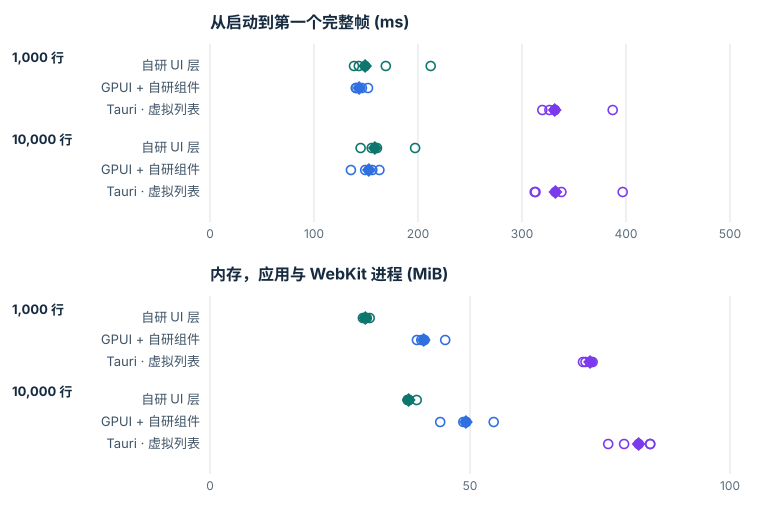

在[上一篇文章](/zh-CN/blog/gpui-tauri-desktop-ui/)中，我们用 GPUI 和 Tauri 各做了一个容器界面。只有一个界面，很难说明移植整个应用要付出什么。这次我们不用 WebView，用纯 Rust 把 Podbag Desktop 的大部分功能移植了两次：

- **自研 UI 层**：我们自己写了一个小框架。窗口和输入用 [winit](https://github.com/rust-windowing/winit)，GPU 绘制用 [wgpu](https://wgpu.rs/)，文字用 [glyphon](https://github.com/grovesNL/glyphon)。
- **GPUI + 自研组件**：使用 Zed 编辑器的框架 [GPUI](https://github.com/zed-industries/zed/tree/main/crates/gpui) 0.2.2。GPUI 没有的组件，例如文本输入框，由我们自己编写。

比较依据四个要求：纯 Rust，支持 macOS、Linux 和 Windows，性能，以及移植现有功能的成本。

## 移植了什么

两个移植都包含 Podbag Desktop 0.3.2 的相同功能：

- 窗口框架：带数量的侧边栏、后退与前进、VM 卡片、状态栏、通知和确认对话框。
- Containers：搜索、启动、停止、重启、删除、重命名、详情、实时日志和清理。
- Images：搜索、删除、清理，以及带 Docker Hub 搜索和实时进度的拉取面板。
- Volumes 和 Networks：列表、创建、删除和清理。
- Kubernetes：上下文菜单、所有命名空间、资源标签页和表格。
- Settings：登录时启动、立即切换的 7 种语言、主题、引擎、Docker CLI 和 VM 资源。

Training、Migrate、更新和镜像仓库登录没有移植。两个移植读取同一个模拟引擎。它是 Podbag Desktop 预览页面所用模拟 API 的 Rust 版本，共 2,685 行，不计入下面的行数。7 种语言的文件直接使用应用自己的文件。

两个应用都使用 Podbag Desktop 的 release 配置和 1200 × 800 的窗口。和上一篇一样，脚本启动应用，等待第一个完整帧，3 秒后读取内存，并测量 10 秒内的 CPU。然后在搜索框中输入 `web-0004`。对两个移植，脚本还会依次打开 6 个界面，再读取一次内存。作为参照，使用虚拟列表的 Tauri 也重新测量了。

Apple M5 · 24 GB · macOS 27.2.1 · Rust 1.96.0 · winit 0.30.13 · wgpu 30.0.2 · glyphon 0.12.0 · gpui 0.2.2 (`runtime_shaders`) · Tauri 2.12.7 · 每种情况 5 次热启动运行，取中位数

## 结果

| 1,000 行 | 自研 UI 层 | GPUI + 自研组件 | Tauri · 虚拟列表 |
|---|---:|---:|---:|
| 从启动到第一个完整帧 | {{n:149}} ms | {{n:143}} ms | {{n:331}} ms |
| 启动时内存，应用与 WebKit 进程 | {{n:29.9}} MiB | {{n:41.1}} MiB | {{n:73.1}} MiB |
| 打开全部 6 个界面后的内存 | {{n:40.2}} MiB | {{n:40.8}} MiB | – |
| 空闲 CPU | {{n:0}}% | {{n:0.9}}% | {{n:0.3}}% |
| 过滤到 2 行 | {{n:2.5}} ms | {{n:12.3}} ms | {{n:19}} ms |
| 切换界面 | {{n:2.7}} ms | {{n:14.7}} ms | – |

| 10,000 行 | 自研 UI 层 | GPUI + 自研组件 | Tauri · 虚拟列表 |
|---|---:|---:|---:|
| 从启动到第一个完整帧 | {{n:158}} ms | {{n:153}} ms | {{n:332}} ms |
| 启动时内存，应用与 WebKit 进程 | {{n:38.2}} MiB | {{n:49.2}} MiB | {{n:82.4}} MiB |
| 打开全部 6 个界面后的内存 | {{n:47.5}} MiB | {{n:48.1}} MiB | – |
| 空闲 CPU | {{n:0}}% | {{n:0.9}}% | {{n:0.1}}% |
| 过滤到 2 行 | {{n:7.3}} ms | {{n:14.3}} ms | {{n:15}} ms |
| 切换界面 | {{n:4.8}} ms | {{n:15.7}} ms | – |

两个移植都在约 150 ms 内启动，不到 Tauri 的一半。启动时，自研 UI 层的内存最少。打开全部 6 个界面后，两个移植的内存几乎相同：1,000 行时 40 MiB，10,000 行时 48 MiB。空闲时，自研 UI 层在每次运行中的 CPU 都不超过 0.2%。GPUI 为 0.4–1.2%。

过滤和切换界面的时间需要谨慎解读。GPUI 和 Tauri 在下一次屏幕刷新时记录时间。自研 UI 层在帧提交后立即记录。在这台显示器上，这个差别最多一帧，即 8–17 ms。所以这些行说明三者都能在下一帧内更新屏幕，并不说明某一方快了好几倍。

## 代码与构建

| 完整移植 | 自研 UI 层 | GPUI + 自研组件 |
|---|---:|---:|
| Rust 代码行数 | {{n:7525}} | {{n:8951}} |
| 框架或组件 | {{n:3652}} | {{n:2260}} |
| 界面与窗口框架 | {{n:3873}} | {{n:6691}} |
| 依赖树中的 crate 数 | {{n:140}} | {{n:454}} |
| release 可执行文件 | {{n:4.4}} MB | {{n:4.9}} MB |
| 干净的 release 构建 | {{n:48}} 秒 | {{n:103}} 秒 |

自研 UI 层包括事件循环、GPU 绘制、带中日韩备用字体的文字处理、点击位置判定、支持输入法的文本输入框，以及按钮、菜单、表格、对话框和滑块等组件。GPUI 直接提供了类似 CSS 样式 API 的布局、列表、提示框和备用字体。它没有文本输入框，所以我们改写了 GPUI 的输入示例，写了 701 行。GPUI 移植的界面代码更长，其中一部分是自研移植没有的功能。两边的行数都包含注释、空行和少量测试代码。

## 缺少的功能

自研 UI 层：

- 没有提示框，也不能用 Tab 键在控件之间移动。
- 日志、JSON 和详情中的文字无法选择或复制。
- 过长的日志行会被截断，不会换行。没有过渡动画。
- 没有移植从 Docker 导入镜像。
- 文字比 macOS 原生应用窄约 5%。我们的文字处理没有使用系统字体的 optical size 轴。

GPUI + 自研组件：

- 被截断的文字末尾有时不显示省略号。
- GPUI 没有文本输入框、滑块和拖动处理，所以由我们编写。

## macOS、Linux 和 Windows

两个移植都只在 macOS 上运行过。对 Linux 和 Windows，我们运行了 `cargo check`，它只编译，不链接。

| `cargo check --release` | 自研 UI 层 | GPUI + 自研组件 |
|---|---|---|
| Windows（`x86_64-pc-windows-gnu`，在 macOS 上） | 通过 | 失败。gpui 用 `fxc.exe` 编译 HLSL 着色器，而这个工具只能在 Windows 上运行。debug 检查可以通过。 |
| Linux（虚拟机） | 通过 | 失败。gpui 0.2.2 的依赖 `xattr` 0.2.3 使用 `libc::ENOATTR`，而当前的 `libc` 已经没有这个值。修补 `xattr` 后可以通过。 |

Linux 虚拟机里没有安装任何字体，因此无法检查文字显示。

## 对上一篇文章的更正

上一篇文章中的 GPUI 原型有一个布局错误：表格的行没有按照列宽排列。这次已经修复。两天里这台 Mac 都在正常使用，所以不同日期的数字不能相互比较。本文只比较同一次测量中的运行。单界面原型也在同一次测量中运行过，数据在下面的每次运行数据中。

## 对 Podbag Desktop 意味着什么

- **纯 Rust**：两个移植都是纯 Rust，不使用 WebView。
- **macOS、Linux 和 Windows**：自研 UI 层在三个系统上都能编译。在我们的环境中，GPUI 构建 Windows 版本需要一台 Windows 电脑，在 Linux 上需要修补一个依赖。两个移植都还没有在 Linux 和 Windows 上运行过。
- **性能**：两个移植的启动时间都不到 Tauri 的一半，内存也更少。自研 UI 层启动时的内存和空闲 CPU 最少。
- **移植成本**：两个移植包含相同的界面。自研 UI 层的代码行数更少，crate 数是三分之一，构建时间是一半。但它没有提示框、文字选择和键盘焦点移动，而且文字、输入和绘制代码都要由我们维护。GPUI 自带的功能更多，但 API 仍在 1.0 之前，也没有文本输入框。

在做出选择之前，两个移植都需要在 Linux 和 Windows 上实际运行。

## 局限

这是在一台 Mac 上用模拟引擎测量的两个移植，不是两个完成的应用。过滤和切换界面的时间在各应用内部测量。到第一帧的时间从外部测量，包含全部过程。我们通过截图和脚本输入检查移植，没有在日常使用中检查。没有测量滚动是否流畅，也没有测量长时间使用。

## 复现测试

[测试脚本](run.py) · [汇总脚本](summary.py) · [每次运行的数据](results.json) · [版本和命令](reproduce.txt) · [两个移植的源代码](prototypes.tar.gz)

[winit](https://github.com/rust-windowing/winit) · [wgpu](https://wgpu.rs/) · [glyphon](https://github.com/grovesNL/glyphon) · [GPUI](https://github.com/zed-industries/zed/tree/main/crates/gpui)
