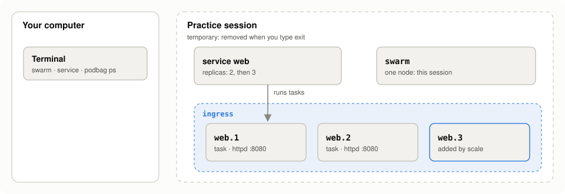

In Swarm mode, you do not start containers one by one. You describe a service: an image and how many copies of it to run. The swarm starts the copies and keeps that number running. podbag runs a swarm with one node, through the Docker CLI. In this module, you run a web service, scale it and remove it.

**Time** 10–15 minutes.



## Start the module

You need a build of Podbag Desktop and the CLI with the Training catalog. It was added after v0.3.2. You also need the Docker CLI (the `docker` command). You do not need Docker Engine. The Docker CLI steps work on Linux and macOS. On Windows, Podbag Desktop leaves this module out.

Open **Training** in Podbag Desktop and select **Run a service in Swarm mode**. New modules appear after **Refresh**. Or run this command in a terminal:

```sh
podbag lab start swarm-service
```

Continue at the `training $` prompt. In this shell, `docker` goes to the practice session's engine.

## Start a swarm

```sh
docker swarm init
```

The practice engine becomes a swarm manager. The output shows a `docker swarm join` command for other machines. podbag's swarm has one node only, so other machines cannot join it. Podbag checks the output for `Swarm initialized`.

## Create a service with two replicas

```sh
docker service create --name web --replicas 2 docker.io/library/busybox:1.37.0 httpd -f -p 8080
```

A replica is one copy of the service. Each one runs as a task. The docker command shows the progress, then waits a few seconds to see that the tasks keep running. Podbag checks the output for `converged`, the word for "the wanted number of tasks runs".

## List the services

```sh
docker service ls
```

The `REPLICAS` column shows `2/2`: two tasks run, and two are wanted. Podbag checks the output for `2/2`.

## List the tasks of the service

```sh
docker service ps web
```

Each line is one task: `web.1` and `web.2`, with the state `Running`. Podbag checks the output for `Running`.

## Scale the service to three replicas

```sh
docker service scale web=3
```

The swarm starts one more task, `web.3`. The two tasks that run keep running. Podbag checks the output for `web scaled to 3`.

## See the tasks as podbag containers

```sh
podbag ps
```

Each task is an ordinary podbag container. Its name is the service, the slot and the task ID, for example `web.3.sww90wy2infn3juxpw09s013f`. When a task stops, the swarm starts a new one. Podbag checks the output for `web.3.`.

## Remove the service

```sh
docker service rm web
```

The swarm removes the service and all its tasks. Podbag checks that no container is left.

## Leave the swarm and finish

```sh
docker swarm leave --force
exit
```

`--force` is needed because this node is the swarm's only manager. Leaving removes the swarm's services, secrets and configs. Podbag checks the output for `left the swarm`. Then `exit` removes the temporary practice session. Training shows the module as complete.
