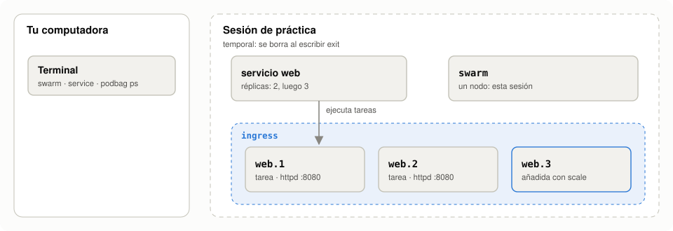

En modo Swarm, no inicias los contenedores uno a uno. Describes un servicio: una imagen y cuántas copias ejecutar. El swarm inicia las copias y mantiene ese número en ejecución. podbag ejecuta un swarm de un solo nodo a través de la CLI de Docker. En este módulo, ejecutas un servicio web, lo escalas y lo eliminas.

**Tiempo** 10–15 minutos.



## Inicia el módulo

Necesitas una versión de Podbag Desktop y de la CLI con el catálogo de Training. Se añadió después de v0.3.2. También necesitas la CLI de Docker (el comando `docker`). No necesitas Docker Engine. Los pasos con la CLI de Docker funcionan en Linux y macOS. En Windows, Podbag Desktop no muestra este módulo.

Abre **Training** en Podbag Desktop y selecciona **Ejecuta un servicio en modo Swarm**. Los módulos nuevos aparecen después de **Actualizar**. O ejecuta este comando en una terminal:

```sh
podbag lab start swarm-service
```

Continúa en el prompt `training $`. En esta shell, `docker` va al motor de la sesión de práctica.

Para hacer los pasos en la TUI en lugar de Podbag Desktop, añade `--tui`.

```sh
podbag lab start swarm-service --tui
```

En la TUI, pulsa `:` para abrir la shell de Training cuando un paso pida un comando, escribe `exit` para volver a la TUI y pulsa `q` para terminar la sesión.

## Inicia un swarm

```sh
docker swarm init
```

El motor de práctica pasa a ser un manager del swarm. La salida muestra un comando `docker swarm join` para otras máquinas. El swarm de podbag tiene un solo nodo, así que otras máquinas no pueden unirse. Podbag busca `Swarm initialized` en la salida.

## Crea un servicio con dos réplicas

```sh
docker service create --name web --replicas 2 docker.io/library/busybox:1.37.0 httpd -f -p 8080
```

Una réplica es una copia del servicio. Cada una se ejecuta como una tarea. El comando docker muestra el progreso y luego espera unos segundos para ver que las tareas siguen en ejecución. Podbag busca `converged` en la salida. Esta palabra significa que se ejecuta el número de tareas deseado.

## Lista los servicios

```sh
docker service ls
```

La columna `REPLICAS` muestra `2/2`: se ejecutan dos tareas y se desean dos. Podbag busca `2/2` en la salida.

## Lista las tareas del servicio

```sh
docker service ps web
```

Cada línea es una tarea: `web.1` y `web.2`, con el estado `Running`. Podbag busca `Running` en la salida.

## Escala el servicio a tres réplicas

```sh
docker service scale web=3
```

El swarm inicia una tarea más, `web.3`. Las dos tareas que ya se ejecutan siguen en ejecución. Podbag busca `web scaled to 3` en la salida.

## Mira las tareas como contenedores de podbag

```sh
podbag ps
```

Cada tarea es un contenedor normal de podbag. Su nombre tiene el servicio, la posición (slot) y el ID de la tarea, por ejemplo `web.3.sww90wy2infn3juxpw09s013f`. Cuando una tarea se detiene, el swarm inicia una nueva. Podbag busca `web.3.` en la salida.

## Elimina el servicio

```sh
docker service rm web
```

El swarm elimina el servicio y todas sus tareas. Podbag comprueba que no queda ningún contenedor.

## Sal del swarm y termina

```sh
docker swarm leave --force
exit
```

`--force` es necesario porque este nodo es el único manager del swarm. Al salir se eliminan los servicios, los secretos y las configuraciones del swarm. Podbag busca `left the swarm` en la salida. Luego `exit` elimina la sesión de práctica temporal. Training muestra el módulo como completado.
