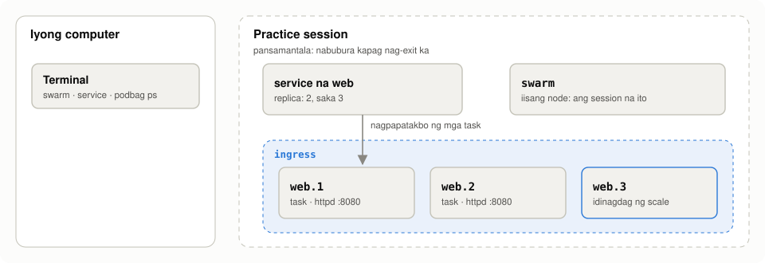

Sa Swarm mode, hindi mo sinisimulan ang mga container nang isa-isa. Inilalarawan mo ang isang service: isang image at kung ilang kopya nito ang patatakbuhin. Sinisimulan ng swarm ang mga kopya at pinapanatili nitong tumatakbo ang bilang na iyon. Nagpapatakbo ang podbag ng swarm na may iisang node, sa pamamagitan ng Docker CLI. Sa module na ito, magpapatakbo ka ng web service, ii-scale ito at aalisin ito.

**Oras** 10–15 minuto.



## Simulan ang module

Kailangan mo ng build ng Podbag Desktop at ng CLI na may Training catalog. Idinagdag ito pagkatapos ng v0.3.2. Kailangan mo rin ang Docker CLI (ang `docker` command). Hindi mo kailangan ang Docker Engine. Gumagana ang mga hakbang ng Docker CLI sa Linux at macOS. Sa Windows, hindi isinasama ng Podbag Desktop ang module na ito.

Buksan ang **Training** sa Podbag Desktop at piliin ang **Magpatakbo ng service sa Swarm mode**. Lalabas ang mga bagong module pagkatapos ng **I-refresh**. O patakbuhin ang command na ito sa terminal:

```sh
podbag lab start swarm-service
```

Magpatuloy sa prompt na `training $`. Sa shell na ito, papunta sa engine ng practice session ang `docker`.

## Magsimula ng swarm

```sh
docker swarm init
```

Nagiging swarm manager ang practice engine. Ipinapakita ng output ang command na `docker swarm join` para sa ibang makina. Iisa lang ang node ng swarm ng podbag, kaya hindi ito masasalihan ng ibang makina. Hinahanap ng Podbag ang `Swarm initialized` sa output.

## Gumawa ng service na may dalawang replica

```sh
docker service create --name web --replicas 2 docker.io/library/busybox:1.37.0 httpd -f -p 8080
```

Ang replica ay isang kopya ng service. Tumatakbo ang bawat isa bilang task. Ipinapakita ng docker command ang progreso. Pagkatapos, naghihintay ito ng ilang segundo para makitang patuloy na tumatakbo ang mga task. Hinahanap ng Podbag ang `converged` sa output. Ibig sabihin nito ay "tumatakbo ang gustong bilang ng mga task".

## Ilista ang mga service

```sh
docker service ls
```

Ipinapakita ng column na `REPLICAS` ang `2/2`: dalawang task ang tumatakbo, at dalawa ang gusto. Hinahanap ng Podbag ang `2/2` sa output.

## Ilista ang mga task ng service

```sh
docker service ps web
```

Isang task ang bawat linya: `web.1` at `web.2`, na may state na `Running`. Hinahanap ng Podbag ang `Running` sa output.

## I-scale ang service sa tatlong replica

```sh
docker service scale web=3
```

Nagsisimula ang swarm ng isa pang task, ang `web.3`. Patuloy na tumatakbo ang dalawang tumatakbong task. Hinahanap ng Podbag ang `web scaled to 3` sa output.

## Tingnan ang mga task bilang podbag container

```sh
podbag ps
```

Ordinaryong podbag container ang bawat task. Ang pangalan nito ay ang service, ang slot at ang task ID, halimbawa `web.3.sww90wy2infn3juxpw09s013f`. Kapag huminto ang isang task, nagsisimula ang swarm ng bago. Hinahanap ng Podbag ang `web.3.` sa output.

## Alisin ang service

```sh
docker service rm web
```

Inaalis ng swarm ang service at ang lahat ng task nito. Sinusuri ng Podbag na walang natitirang container.

## Umalis sa swarm at tapusin

```sh
docker swarm leave --force
exit
```

Kailangan ang `--force` dahil ang node na ito lang ang manager ng swarm. Inaalis ng pag-alis ang mga service, secret at config ng swarm. Hinahanap ng Podbag ang `left the swarm` sa output. Pagkatapos, inaalis ng `exit` ang pansamantalang practice session. Ipinapakita ng Training na tapos na ang module.
