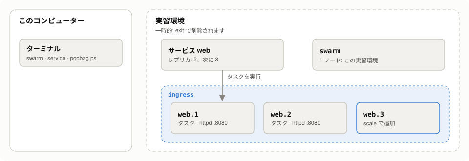

Swarm モードでは、コンテナを 1 つずつ起動しません。代わりにサービスを定義します。サービスは、イメージと、そのコピーをいくつ動かすかの指定です。swarm はコピーを起動し、その数を保ちます。podbag は、Docker CLI を通して 1 ノードの swarm を動かします。このモジュールでは、Web サービスを実行し、スケールして、削除します。

**所要時間** 10〜15 分。



## モジュールを開始する

Training カタログがある Podbag Desktop と CLI のビルドが必要です。カタログは v0.3.2 より後に追加されました。Docker CLI（`docker` コマンド）も必要です。Docker Engine は必要ありません。Docker CLI の手順は Linux と macOS で動きます。Windows の Podbag Desktop には、このモジュールは表示されません。

Podbag Desktop で **Training** を開き、**Swarm モードでサービスを実行する**を選びます。新しいモジュールは**更新**の後に表示されます。ターミナルで次のコマンドを実行しても開始できます。

```sh
podbag lab start swarm-service
```

`training $` プロンプトが表示されたら続けます。このシェルでは、`docker` は実習環境のエンジンに接続します。

Podbag Desktop の代わりに TUI で手順を進めるには、`--tui` を付けます。

```sh
podbag lab start swarm-service --tui
```

TUI では、コマンドの手順で `:` を押すと Training シェルが開きます。`exit` と入力すると TUI に戻ります。`q` を押すと実習を終了します。

## swarm を開始する

```sh
docker swarm init
```

実習用のエンジンが swarm のマネージャーになります。出力には、ほかのマシン向けの `docker swarm join` コマンドが表示されます。podbag の swarm は 1 ノードだけなので、ほかのマシンは参加できません。Podbag は出力に `Swarm initialized` があることを確認します。

## レプリカ 2 つでサービスを作成する

```sh
docker service create --name web --replicas 2 docker.io/library/busybox:1.37.0 httpd -f -p 8080
```

レプリカは、サービスの 1 つのコピーです。各レプリカはタスクとして動きます。docker コマンドは進み具合を表示し、数秒待ってタスクが動き続けることを確かめます。Podbag は出力に `converged` があることを確認します。これは「必要な数のタスクが動いている」という意味の語です。

## サービスを一覧表示する

```sh
docker service ls
```

`REPLICAS` 列に `2/2` と表示されます。2 つのタスクが動いていて、必要な数も 2 つです。Podbag は出力に `2/2` があることを確認します。

## サービスのタスクを一覧表示する

```sh
docker service ps web
```

各行が 1 つのタスクです。`web.1` と `web.2` が、状態 `Running` で表示されます。Podbag は出力に `Running` があることを確認します。

## サービスを 3 つのレプリカにスケールする

```sh
docker service scale web=3
```

swarm はタスクをもう 1 つ、`web.3` を起動します。動いている 2 つのタスクはそのまま動き続けます。Podbag は出力に `web scaled to 3` があることを確認します。

## タスクを podbag のコンテナとして見る

```sh
podbag ps
```

各タスクは、通常の podbag のコンテナです。名前は、サービス名、スロット番号、タスク ID からできています。たとえば `web.3.sww90wy2infn3juxpw09s013f` です。タスクが停止すると、swarm は新しいタスクを起動します。Podbag は出力に `web.3.` があることを確認します。

## サービスを削除する

```sh
docker service rm web
```

swarm はサービスとそのすべてのタスクを削除します。Podbag は、コンテナが残っていないことを確認します。

## swarm から抜けて終了する

```sh
docker swarm leave --force
exit
```

このノードは swarm の唯一のマネージャーなので、`--force` が必要です。swarm から抜けると、swarm のサービス、シークレット、設定が削除されます。Podbag は出力に `left the swarm` があることを確認します。次に、`exit` が一時的な実習環境を削除します。Training にモジュールの完了が表示されます。
