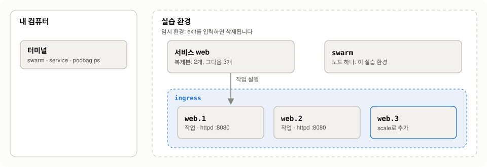

Swarm 모드에서는 컨테이너를 하나씩 시작하지 않습니다. 대신 서비스를 정의합니다. 서비스는 이미지와 실행할 복사본 수입니다. swarm은 복사본을 시작하고 그 수를 계속 유지합니다. podbag은 Docker CLI를 통해 노드가 하나인 swarm을 실행합니다. 이번 트레이닝에서는 웹 서비스를 실행하고, 늘리고, 삭제합니다.

**예상 시간** 10~15분.



## 실습 시작

Training 카탈로그가 들어 있는 Podbag Desktop과 CLI가 필요합니다. 이 기능은 v0.3.2 이후에 추가됐습니다. Docker CLI(`docker` 명령)도 필요합니다. Docker Engine은 필요 없습니다. Docker CLI 단계는 Linux와 macOS에서 할 수 있습니다. Windows의 Podbag Desktop은 이 모듈을 목록에 보여 주지 않습니다.

Podbag Desktop에서 **Training**을 열고 **Swarm 모드로 서비스 실행하기**를 선택합니다. 새 모듈은 **새로 고침**을 누르면 나타납니다. 터미널에서 다음 명령을 실행해도 됩니다.

```sh
podbag lab start swarm-service
```

`training $` 프롬프트에서 계속 진행합니다. 이 셸에서 `docker`는 실습 환경의 엔진으로 연결됩니다.

## swarm 시작하기

```sh
docker swarm init
```

실습 엔진이 swarm 매니저가 됩니다. 출력에는 다른 컴퓨터용 `docker swarm join` 명령이 표시됩니다. podbag의 swarm은 노드가 하나뿐이므로 다른 컴퓨터는 참여할 수 없습니다. Podbag은 출력에 `Swarm initialized`가 있는지 확인합니다.

## 복제본 두 개로 서비스 만들기

```sh
docker service create --name web --replicas 2 docker.io/library/busybox:1.37.0 httpd -f -p 8080
```

복제본은 서비스의 복사본 하나입니다. 복제본은 각각 작업(task)으로 실행됩니다. docker 명령은 진행 상황을 보여 주고, 작업이 계속 실행되는지 몇 초 동안 지켜봅니다. Podbag은 출력에 `converged`가 있는지 확인합니다. 원하는 수만큼 작업이 실행 중이라는 뜻입니다.

## 서비스 목록 보기

```sh
docker service ls
```

`REPLICAS` 열에 `2/2`가 표시됩니다. 원하는 작업 두 개가 모두 실행 중이라는 뜻입니다. Podbag은 출력에 `2/2`가 있는지 확인합니다.

## 서비스의 작업 보기

```sh
docker service ps web
```

한 줄이 작업 하나입니다. `web.1`과 `web.2`가 `Running` 상태로 표시됩니다. Podbag은 출력에 `Running`이 있는지 확인합니다.

## 복제본 세 개로 늘리기

```sh
docker service scale web=3
```

swarm이 작업 `web.3`을 하나 더 시작합니다. 실행 중이던 작업 두 개는 그대로 실행됩니다. Podbag은 출력에 `web scaled to 3`이 있는지 확인합니다.

## 작업을 podbag 컨테이너로 보기

```sh
podbag ps
```

작업은 각각 일반 podbag 컨테이너입니다. 이름은 서비스, 슬롯 번호, 작업 ID로 이루어집니다. 예를 들면 `web.3.sww90wy2infn3juxpw09s013f`입니다. 작업이 멈추면 swarm이 새 작업을 시작합니다. Podbag은 출력에 `web.3.`이 있는지 확인합니다.

## 서비스 삭제하기

```sh
docker service rm web
```

swarm이 서비스와 모든 작업을 삭제합니다. Podbag은 남은 컨테이너가 없는지 확인합니다.

## swarm에서 나가고 실습 종료하기

```sh
docker swarm leave --force
exit
```

이 노드가 swarm의 유일한 매니저이므로 `--force`가 필요합니다. swarm에서 나가면 swarm의 서비스, 시크릿, 설정이 삭제됩니다. Podbag은 출력에 `left the swarm`이 있는지 확인합니다. 그다음 `exit`로 임시 실습 환경을 삭제합니다. Training에 모듈이 완료됨으로 표시됩니다.
