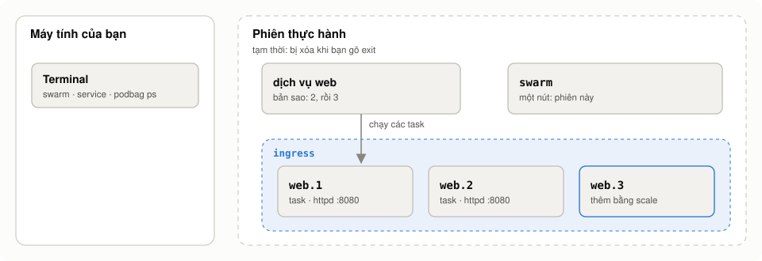

Ở chế độ Swarm, bạn không chạy từng container một. Bạn mô tả một dịch vụ (service): một image và số bản sao cần chạy. Swarm chạy các bản sao và giữ cho số lượng đó luôn chạy. podbag chạy swarm có một nút, thông qua Docker CLI. Trong mô-đun này, bạn chạy một dịch vụ web, tăng số bản sao và xóa dịch vụ.

**Thời gian** 10–15 phút.



## Bắt đầu mô-đun

Bạn cần bản Podbag Desktop và CLI có danh mục Training. Danh mục này được thêm sau v0.3.2. Bạn cũng cần Docker CLI (lệnh `docker`). Bạn không cần Docker Engine. Các bước dùng Docker CLI chạy được trên Linux và macOS. Trên Windows, Podbag Desktop không hiển thị mô-đun này.

Mở **Training** trong Podbag Desktop và chọn **Chạy dịch vụ ở chế độ Swarm**. Mô-đun mới xuất hiện sau khi chọn **Làm mới**. Hoặc chạy lệnh này trong terminal:

```sh
podbag lab start swarm-service
```

Tiếp tục tại dấu nhắc `training $`. Trong shell này, `docker` đi tới engine của phiên thực hành.

Để làm các bước trong TUI thay cho Podbag Desktop, hãy thêm `--tui`.

```sh
podbag lab start swarm-service --tui
```

Trong TUI, nhấn `:` để mở shell Training cho bước chạy lệnh, gõ `exit` để quay lại TUI và nhấn `q` để kết thúc phiên.

## Khởi tạo swarm

```sh
docker swarm init
```

Engine thực hành trở thành swarm manager (máy quản lý). Kết quả hiển thị lệnh `docker swarm join` cho các máy khác. Swarm của podbag chỉ có một nút, nên máy khác không thể tham gia. Podbag tìm `Swarm initialized` trong kết quả.

## Tạo dịch vụ có hai bản sao

```sh
docker service create --name web --replicas 2 docker.io/library/busybox:1.37.0 httpd -f -p 8080
```

Bản sao (replica) là một bản chạy của dịch vụ. Mỗi bản sao chạy dưới dạng một task. Lệnh docker hiển thị tiến độ, rồi chờ vài giây để xem các task có tiếp tục chạy không. Podbag tìm `converged` trong kết quả. Từ này có nghĩa là "số task mong muốn đang chạy".

## Liệt kê các dịch vụ

```sh
docker service ls
```

Cột `REPLICAS` hiển thị `2/2`: hai task đang chạy và cần hai task. Podbag tìm `2/2` trong kết quả.

## Liệt kê các task của dịch vụ

```sh
docker service ps web
```

Mỗi dòng là một task: `web.1` và `web.2`, với trạng thái `Running`. Podbag tìm `Running` trong kết quả.

## Tăng dịch vụ lên ba bản sao

```sh
docker service scale web=3
```

Swarm chạy thêm một task, `web.3`. Hai task đang chạy vẫn tiếp tục chạy. Podbag tìm `web scaled to 3` trong kết quả.

## Xem các task dưới dạng container podbag

```sh
podbag ps
```

Mỗi task là một container podbag bình thường. Tên của nó gồm tên dịch vụ, số thứ tự (slot) và ID của task, ví dụ `web.3.sww90wy2infn3juxpw09s013f`. Khi một task dừng, swarm chạy một task mới. Podbag tìm `web.3.` trong kết quả.

## Xóa dịch vụ

```sh
docker service rm web
```

Swarm xóa dịch vụ và mọi task của nó. Podbag kiểm tra rằng không còn container nào.

## Rời swarm và kết thúc

```sh
docker swarm leave --force
exit
```

Cần `--force` vì nút này là manager duy nhất của swarm. Khi rời swarm, các dịch vụ, secret và config của swarm bị xóa. Podbag tìm `left the swarm` trong kết quả. Sau đó `exit` xóa phiên thực hành tạm thời. Training hiển thị mô-đun đã hoàn thành.
