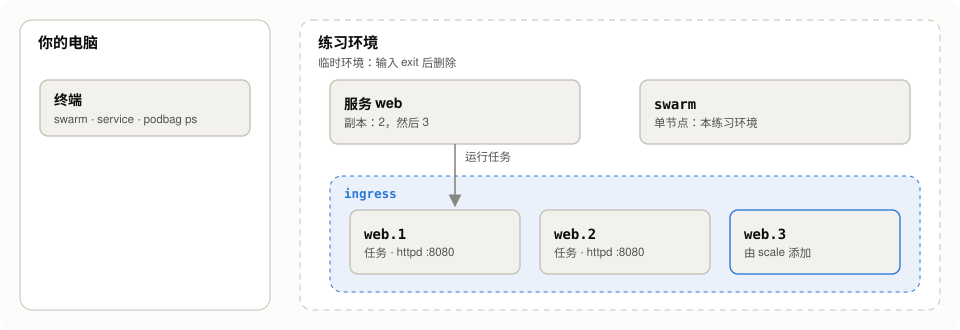

在 Swarm 模式下，你不需要逐个启动容器。你只需描述一个服务：使用哪个镜像，运行多少个副本。swarm 会启动这些副本，并让运行数量保持不变。podbag 通过 Docker CLI 运行单节点 swarm。在本模块中，你将运行一个 Web 服务，扩展它，然后删除它。

**预计用时** 10–15 分钟。



## 开始模块

需要带有 Training 目录的 Podbag Desktop 和 CLI 版本。该目录在 v0.3.2 之后加入。还需要 Docker CLI（`docker` 命令）。不需要 Docker Engine。Docker CLI 步骤可在 Linux 和 macOS 上运行。在 Windows 上，Podbag Desktop 不显示此模块。

在 Podbag Desktop 中打开 **Training**，选择**在 Swarm 模式下运行服务**。点击**刷新**后会出现新模块。也可以在终端中运行以下命令：

```sh
podbag lab start swarm-service
```

出现 `training $` 提示符后继续。在这个 shell 中，`docker` 会连接到练习环境的引擎。

要在 TUI 而不是 Podbag Desktop 中完成这些步骤，请加上 `--tui`。

```sh
podbag lab start swarm-service --tui
```

在 TUI 中，按 `:` 打开 Training 终端来执行命令步骤，输入 `exit` 返回 TUI，按 `q` 结束实验。

## 启动 swarm

```sh
docker swarm init
```

练习环境的引擎成为 swarm 管理节点。输出中显示一条供其他机器使用的 `docker swarm join` 命令。podbag 的 swarm 只有一个节点，所以其他机器无法加入。Podbag 会检查输出中是否有 `Swarm initialized`。

## 创建有两个副本的服务

```sh
docker service create --name web --replicas 2 docker.io/library/busybox:1.37.0 httpd -f -p 8080
```

副本是服务的一个实例。每个副本作为一个任务运行。docker 命令会显示进度，然后等待几秒，确认任务保持运行。Podbag 会检查输出中是否有 `converged`，这个词表示“期望数量的任务正在运行”。

## 列出服务

```sh
docker service ls
```

`REPLICAS` 列显示 `2/2`：两个任务正在运行，期望数量也是两个。Podbag 会检查输出中是否有 `2/2`。

## 列出服务的任务

```sh
docker service ps web
```

每一行是一个任务：`web.1` 和 `web.2`，状态为 `Running`。Podbag 会检查输出中是否有 `Running`。

## 将服务扩展到三个副本

```sh
docker service scale web=3
```

swarm 再启动一个任务 `web.3`。正在运行的两个任务继续运行。Podbag 会检查输出中是否有 `web scaled to 3`。

## 把任务看作 podbag 容器

```sh
podbag ps
```

每个任务都是一个普通的 podbag 容器。它的名称由服务名、槽位编号和任务 ID 组成，例如 `web.3.sww90wy2infn3juxpw09s013f`。任务停止时，swarm 会启动一个新任务。Podbag 会检查输出中是否有 `web.3.`。

## 删除服务

```sh
docker service rm web
```

swarm 删除该服务及其所有任务。Podbag 会检查是否已没有容器。

## 退出 swarm 并结束

```sh
docker swarm leave --force
exit
```

这个节点是 swarm 唯一的管理节点，所以需要 `--force`。退出 swarm 会删除它的服务、密钥和配置。Podbag 会检查输出中是否有 `left the swarm`。然后 `exit` 删除临时练习环境。Training 会显示该模块已完成。
