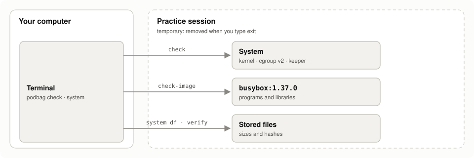

Podbag has its own checks. They tell you if the system can run containers, if the programs in an image can run, and if the stored image files are whole. In this module, you run each check once and read what it says.

**Time** 10 minutes.



## Start the module

Open **Training** in Podbag Desktop and select **Check the system and the images**. New modules appear after **Refresh**. Or run this command in a terminal:

```sh
podbag lab start system-checks
```

You need a Podbag build with the Training catalog (after v0.3.2). Continue at the `training $` prompt.

## Check the system

`podbag check` lists what Podbag needs on this system, one line each. Examples are the kernel, cgroup v2 and the keeper. The keeper is the small process that watches containers in the background.

```sh
podbag check
```

Each line starts with `ok`, `warn`, `fail` or `n/a` (does not apply here). A problem comes with the command that fixes it. The last line says if Podbag can run containers here. Podbag checks for the line about `cgroup v2`.

## Pull an image

The practice session starts with no images. Pull a small one.

```sh
podbag pull docker.io/library/busybox:1.37.0
```

Podbag checks that the image is there.

## Check the programs in the image

`podbag check-image` reads every program and library in a pulled image. It does not run them. It reports programs built for another C library or another CPU, and missing libraries.

```sh
podbag check-image docker.io/library/busybox:1.37.0
```

The output says how many files it checked and ends with `no problems found`. Podbag checks for these words. When it finds an error, it exits with code `1`, so a build script can stop.

## See the disk use

`podbag system df` shows how much disk space images, stored files and containers use.

```sh
podbag system df
```

The **Objects** line counts the stored files of all images. Images that share a file store it once. Podbag checks for the word `Objects`.

## Verify the stored files

`podbag system verify` reads every stored file and checks its hash. A hash is a short fingerprint of the file's contents. A damaged file has another hash.

```sh
podbag system verify
```

The output ends with `0 damaged`. Podbag checks for these words. If a file is damaged, the command names the images that use it and exits with code `1`. Then `podbag system verify --fix` removes those images, and you pull them again.

## Clean up and finish

Remove the image. Then end the session.

```sh
podbag rmi docker.io/library/busybox:1.37.0
exit
```

The temporary practice resources are removed. Training shows the module as complete.
