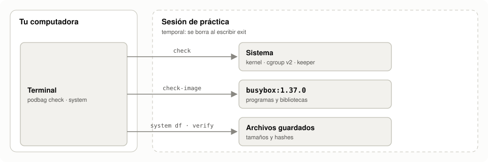

Podbag tiene sus propias comprobaciones. Te dicen si el sistema puede ejecutar contenedores, si los programas de una imagen pueden ejecutarse y si los archivos de imagen guardados están completos. En este módulo, ejecutas cada comprobación una vez y lees lo que dice.

**Tiempo** 10 minutos.



## Inicia el módulo

Abre **Training** en Podbag Desktop y selecciona **Comprueba el sistema y las imágenes**. Los módulos nuevos aparecen después de **Actualizar**. O ejecuta este comando en una terminal:

```sh
podbag lab start system-checks
```

Necesitas una versión de Podbag con el catálogo de Training (posterior a v0.3.2). Continúa en el prompt `training $`.

Para hacer los pasos en la TUI en lugar de Podbag Desktop, añade `--tui`.

```sh
podbag lab start system-checks --tui
```

En la TUI, pulsa `:` para abrir la shell de Training cuando un paso pida un comando, escribe `exit` para volver a la TUI y pulsa `q` para terminar la sesión.

## Comprueba el sistema

`podbag check` lista lo que Podbag necesita en este sistema, una línea por elemento. Algunos ejemplos son el kernel, cgroup v2 y el keeper. El keeper es el pequeño proceso que vigila los contenedores en segundo plano.

```sh
podbag check
```

Cada línea empieza con `ok`, `warn`, `fail` o `n/a` (no se aplica aquí). Cada problema viene con el comando que lo soluciona. La última línea dice si Podbag puede ejecutar contenedores aquí. Podbag busca la línea sobre `cgroup v2`.

## Descarga una imagen

La sesión de práctica empieza sin imágenes. Descarga una pequeña.

```sh
podbag pull docker.io/library/busybox:1.37.0
```

- **En Podbag Desktop:** Selecciona **Contenedores de práctica → Descargar docker.io/library/busybox:1.37.0**.
- **En la TUI:** Abre **Imágenes**, pulsa `p`, escribe `docker.io/library/busybox:1.37.0` y pulsa `Enter`.

Podbag comprueba que la imagen está ahí.

## Comprueba los programas de la imagen

`podbag check-image` lee todos los programas y bibliotecas de una imagen descargada. No los ejecuta. Informa de programas creados para otra biblioteca de C u otra CPU, y de bibliotecas que faltan.

```sh
podbag check-image docker.io/library/busybox:1.37.0
```

La salida dice cuántos archivos comprobó y termina con `no problems found`. Podbag busca estas palabras. Cuando encuentra un error, termina con el código `1`. Así, un script de build puede detenerse.

## Mira el uso del disco

`podbag system df` muestra cuánto espacio en disco usan las imágenes, los archivos guardados y los contenedores.

```sh
podbag system df
```

La línea **Objects** cuenta los archivos guardados de todas las imágenes. Si varias imágenes comparten un archivo, se guarda una sola vez. Podbag busca la palabra `Objects`.

## Verifica los archivos guardados

`podbag system verify` lee cada archivo guardado y comprueba su hash. Un hash es una huella corta del contenido del archivo. Un archivo dañado tiene otro hash.

```sh
podbag system verify
```

La salida termina con `0 damaged`. Podbag busca estas palabras. Si un archivo está dañado, el comando nombra las imágenes que lo usan y termina con el código `1`. Entonces `podbag system verify --fix` elimina esas imágenes, y tú las vuelves a descargar.

## Limpia y termina

Elimina la imagen. Luego termina la sesión.

- **En Podbag Desktop:** Selecciona **Contenedores de práctica → Eliminar la imagen docker.io/library/busybox:1.37.0** y confirma.
- **En la TUI:** Selecciona `docker.io/library/busybox:1.37.0` en **Imágenes**, pulsa `d` y luego `y`.

```sh
podbag rmi docker.io/library/busybox:1.37.0
exit
```

Se eliminan los recursos temporales de la práctica. Training muestra el módulo como completado.
