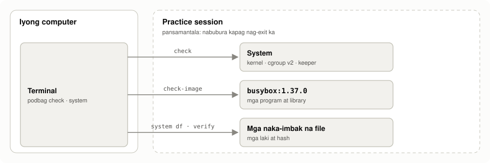

May sariling mga check ang Podbag. Sinasabi nito kung kaya ng system na magpatakbo ng mga container, kung tatakbo ang mga program sa image, at kung buo ang mga naka-imbak na file ng image. Sa module na ito, patatakbuhin mo ang bawat check nang isang beses at babasahin ang sinasabi nito.

**Oras** 10 minuto.



## Simulan ang module

Buksan ang **Training** sa Podbag Desktop at piliin ang **Suriin ang system at ang mga image**. Lalabas ang mga bagong module pagkatapos ng **I-refresh**. O patakbuhin ang command na ito sa terminal:

```sh
podbag lab start system-checks
```

Kailangan mo ng build ng Podbag na may Training catalog (pagkatapos ng v0.3.2). Magpatuloy sa prompt na `training $`.

## Suriin ang system

Inililista ng `podbag check` ang kailangan ng Podbag sa system na ito, tig-iisang linya. Halimbawa nito ang kernel, cgroup v2 at ang keeper. Ang keeper ay maliit na prosesong nagbabantay sa mga container sa background.

```sh
podbag check
```

Nagsisimula ang bawat linya sa `ok`, `warn`, `fail` o `n/a` (hindi angkop dito). May kasamang command na umaayos sa bawat problema. Sinasabi ng huling linya kung kaya ng Podbag na magpatakbo ng mga container dito. Hinahanap ng Podbag ang linya tungkol sa `cgroup v2`.

## Kumuha ng image

Walang image ang practice session sa simula. Kumuha ng maliit na image.

```sh
podbag pull docker.io/library/busybox:1.37.0
```

Sinusuri ng Podbag na nandoon ang image.

## Suriin ang mga program sa image

Binabasa ng `podbag check-image` ang bawat program at library sa nakuhang image. Hindi nito pinapatakbo ang mga ito. Iniuulat nito ang mga program na ginawa para sa ibang C library o ibang CPU, at ang mga nawawalang library.

```sh
podbag check-image docker.io/library/busybox:1.37.0
```

Sinasabi ng output kung ilang file ang sinuri nito, at nagtatapos ito sa `no problems found`. Hinahanap ng Podbag ang mga salitang ito. Kapag may nakita itong error, lalabas ito na may code na `1`. Sa ganoon, maaaring huminto ang build script.

## Tingnan ang gamit ng disk

Ipinapakita ng `podbag system df` kung gaano karaming disk space ang ginagamit ng mga image, naka-imbak na file at container.

```sh
podbag system df
```

Binibilang ng linyang **Objects** ang mga naka-imbak na file ng lahat ng image. Isang beses lang iniimbak ang file na pinaghahatian ng mga image. Hinahanap ng Podbag ang salitang `Objects`.

## Beripikahin ang mga naka-imbak na file

Binabasa ng `podbag system verify` ang bawat naka-imbak na file at sinusuri ang hash nito. Ang hash ay maikling fingerprint ng laman ng file. Iba ang hash ng sirang file.

```sh
podbag system verify
```

Nagtatapos ang output sa `0 damaged`. Hinahanap ng Podbag ang mga salitang ito. Kapag may sirang file, pinapangalanan ng command ang mga image na gumagamit nito at lalabas ito na may code na `1`. Pagkatapos, inaalis ng `podbag system verify --fix` ang mga image na iyon, at kukunin mo ulit ang mga ito.

## Maglinis at tapusin

Alisin ang image. Pagkatapos, tapusin ang session.

```sh
podbag rmi docker.io/library/busybox:1.37.0
exit
```

Naaalis ang mga pansamantalang resource ng practice. Ipinapakita ng Training na tapos na ang module.
