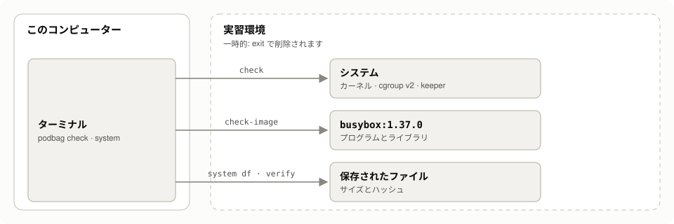

Podbag には専用のチェックがあります。システムでコンテナを実行できるか、イメージ内のプログラムが動くか、保存されたイメージのファイルが壊れていないかがわかります。このモジュールでは、各チェックを 1 回ずつ実行し、結果を読みます。

**所要時間** 10 分。



## モジュールを開始する

Podbag Desktop で **Training** を開き、**システムとイメージを点検する**を選びます。新しいモジュールは**更新**の後に表示されます。ターミナルで次のコマンドを実行しても開始できます。

```sh
podbag lab start system-checks
```

Training カタログがある Podbag のビルド（v0.3.2 より後）が必要です。`training $` プロンプトが表示されたら続けます。

Podbag Desktop の代わりに TUI で手順を進めるには、`--tui` を付けます。

```sh
podbag lab start system-checks --tui
```

TUI では、コマンドの手順で `:` を押すと Training シェルが開きます。`exit` と入力すると TUI に戻ります。`q` を押すと実習を終了します。

## システムを確認する

`podbag check` は、Podbag がこのシステムで必要とするものを 1 行ずつ表示します。たとえば、カーネル、cgroup v2、keeper です。keeper は、バックグラウンドでコンテナを見守る小さなプロセスです。

```sh
podbag check
```

各行は `ok`、`warn`、`fail`、`n/a`（ここでは該当しない）のどれかで始まります。問題がある場合は、それを直すコマンドも表示されます。最後の行は、ここで Podbag がコンテナを実行できるかを示します。Podbag は `cgroup v2` の行を確認します。

## イメージを取得する

実習環境は、イメージがない状態で始まります。小さなイメージを取得します。

```sh
podbag pull docker.io/library/busybox:1.37.0
```

- **Podbag Desktop で:** **実習コンテナ → docker.io/library/busybox:1.37.0 を取得**を選びます。
- **TUI で:** **イメージ**を開き、`p` を押して `docker.io/library/busybox:1.37.0` と入力し、`Enter` を押します。

Podbag はイメージがあることを確認します。

## イメージ内のプログラムを調べる

`podbag check-image` は、取得したイメージ内のすべてのプログラムとライブラリを読みます。プログラムは実行しません。別の C ライブラリや別の CPU 向けにビルドされたプログラムと、足りないライブラリを報告します。

```sh
podbag check-image docker.io/library/busybox:1.37.0
```

出力には調べたファイルの数が表示され、最後に `no problems found` と表示されます。Podbag はこの語を確認します。エラーが見つかると、コード `1` で終了します。そのため、ビルドスクリプトを止めることができます。

## ディスクの使用量を見る

`podbag system df` は、イメージ、保存されたファイル、コンテナが使うディスク容量を表示します。

```sh
podbag system df
```

**Objects** の行は、すべてのイメージの保存されたファイルの数です。同じファイルを共有するイメージは、そのファイルを 1 回だけ保存します。Podbag は `Objects` の語を確認します。

## 保存されたファイルを検証する

`podbag system verify` は、保存されたすべてのファイルを読み、ハッシュを確認します。ハッシュは、ファイルの内容から作る短い指紋のようなものです。壊れたファイルは別のハッシュになります。

```sh
podbag system verify
```

出力の最後に `0 damaged` と表示されます。Podbag はこの語を確認します。壊れたファイルがある場合、このコマンドはそのファイルを使うイメージの名前を表示し、コード `1` で終了します。そのときは、`podbag system verify --fix` でそのイメージを削除し、もう一度取得します。

## 片付けて終了する

イメージを削除します。その後、実習を終了します。

- **Podbag Desktop で:** **実習コンテナ → イメージ docker.io/library/busybox:1.37.0 を削除**を選び、確認します。
- **TUI で:** **イメージ**で `docker.io/library/busybox:1.37.0` を選び、`d` を押してから `y` を押します。

```sh
podbag rmi docker.io/library/busybox:1.37.0
exit
```

一時的な実習用のリソースが削除されます。Training にモジュールの完了が表示されます。
