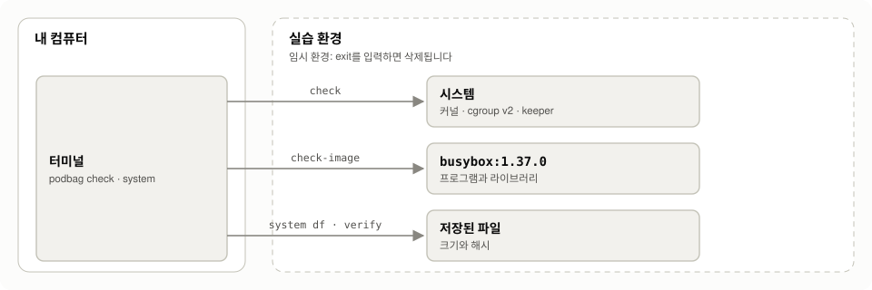

Podbag에는 자체 점검 명령이 있습니다. 시스템이 컨테이너를 실행할 수 있는지, 이미지의 프로그램이 실행될 수 있는지, 저장된 이미지 파일이 온전한지 알려 줍니다. 이번 트레이닝에서는 점검 명령을 하나씩 실행하고 결과를 읽습니다.

**예상 시간** 10분.



## 실습 시작

Podbag Desktop에서 **Training**을 열고 **시스템과 이미지 점검하기**를 선택합니다. 새 모듈은 **새로 고침** 후에 나타납니다. 터미널에서 다음 명령을 실행해도 됩니다.

```sh
podbag lab start system-checks
```

Training 카탈로그를 지원하는 Podbag 빌드가 필요합니다(v0.3.2 이후). `training $` 프롬프트가 나오면 다음 단계로 진행합니다.

## 시스템 점검

`podbag check`는 Podbag이 이 시스템에서 필요한 것을 한 줄씩 보여 줍니다. 커널, cgroup v2, keeper 등이 있습니다. keeper는 백그라운드에서 컨테이너를 지켜보는 작은 프로세스입니다.

```sh
podbag check
```

각 줄은 `ok`, `warn`, `fail`, `n/a`(여기에는 해당 없음) 중 하나로 시작합니다. 문제가 있으면 고치는 명령도 함께 나옵니다. 마지막 줄은 이 시스템에서 컨테이너를 실행할 수 있는지 알려 줍니다. Podbag은 `cgroup v2` 줄을 확인합니다.

## 이미지 받기

실습 환경에는 처음에 이미지가 없습니다. 작은 이미지를 받습니다.

```sh
podbag pull docker.io/library/busybox:1.37.0
```

Podbag은 이미지가 있는지 확인합니다.

## 이미지의 프로그램 점검

`podbag check-image`는 받은 이미지의 모든 프로그램과 라이브러리를 읽습니다. 실행하지는 않습니다. 다른 C 라이브러리나 다른 CPU용으로 만든 프로그램, 없는 라이브러리를 알려 줍니다.

```sh
podbag check-image docker.io/library/busybox:1.37.0
```

출력은 검사한 파일 수를 알려 주고 `no problems found`로 끝납니다. Podbag이 이 글자를 확인합니다. 오류를 찾으면 코드 `1`로 끝나므로 빌드 스크립트를 멈출 수 있습니다.

## 디스크 사용량 보기

`podbag system df`는 이미지, 저장된 파일, 컨테이너가 쓰는 디스크 공간을 보여 줍니다.

```sh
podbag system df
```

**Objects** 줄은 모든 이미지의 저장된 파일 수를 셉니다. 여러 이미지가 같은 파일을 쓰면 한 번만 저장합니다. Podbag은 `Objects`라는 단어를 확인합니다.

## 저장된 파일 검증

`podbag system verify`는 저장된 파일을 모두 읽고 해시를 확인합니다. 해시는 파일 내용의 짧은 지문입니다. 손상된 파일은 해시가 달라집니다.

```sh
podbag system verify
```

출력은 `0 damaged`로 끝납니다. Podbag이 이 글자를 확인합니다. 손상된 파일이 있으면 그 파일을 쓰는 이미지를 알려 주고 코드 `1`로 끝납니다. 그때는 `podbag system verify --fix`로 해당 이미지를 지운 뒤 다시 받습니다.

## 실습 리소스 정리

이미지를 삭제합니다. 그다음 실습을 끝냅니다.

```sh
podbag rmi docker.io/library/busybox:1.37.0
exit
```

임시 실습 환경이 정리되면 Training에서 **수업 완료**를 확인합니다.
